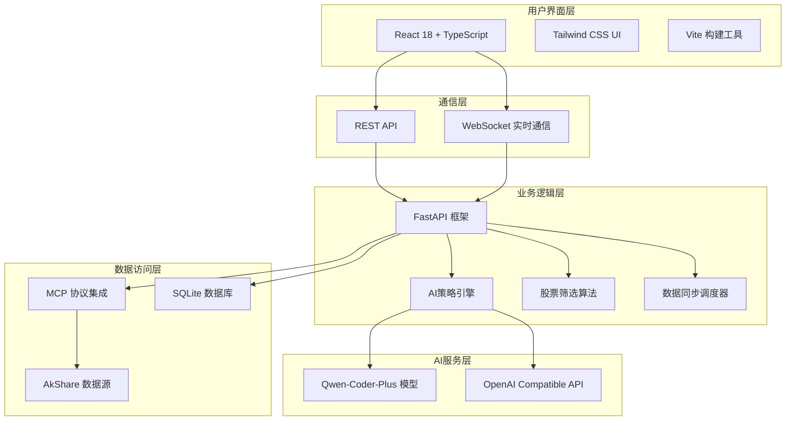

# 🤖 AI股票聊天助手 - 智能投资分析平台

<div align="center">


**基于AI的现代化股票投资分析平台，集成智能策略生成与专业股票管理**

[🚀 快速开始](#-快速开始) • [✨ 核心功能](#-核心功能) • [🏗️ 技术架构](#️-技术架构) • [📊 功能展示](#-功能展示)

</div>

---

## 📋 目录

- [🎯 项目概述](#-项目概述)
- [🚀 快速开始](#-快速开始)
- [✨ 核心功能](#-核心功能)
- [🏗️ 技术架构](#️-技术架构)
- [📊 功能展示](#-功能展示)
- [🔧 安装部署](#-安装部署)
- [📝 API文档](#-api文档)
- [💡 使用指南](#-使用指南)
- [🤝 贡献指南](#-贡献指南)

## 🎯 项目概述

AI股票聊天助手是一个基于 **FastAPI + React** 的现代化AI驱动股票投资分析平台。系统通过MCP协议集成AkShare数据源，结合大语言模型，为用户提供智能化的股票投资分析、策略生成和投资组合管理服务。

### 🌟 核心价值

- **🧠 AI驱动分析**：基于Qwen-Coder-Plus模型的智能投资策略生成
- **📊 实时数据**：集成AkShare数据源，支持A股、港股实时行情
- **🎯 智能筛选**：多维度股票筛选算法，发现投资机会
- **💼 专业管理**：完整的投资组合和股票池管理系统
- **🔄 自动化**：智能数据同步和性能监控系统

## 🚀 快速开始

### 📋 环境要求

- **Node.js** >= 18.0.0
- **Python** >= 3.9
- **Git**

### ⚡ 一键启动

```bash
# 1. 克隆项目
git clone <repository-url>
cd "Claude made stock bot"

# 2. 安装所有依赖
npm install
pip install -r requirements.txt

# 3. 一键启动前后端服务
npm run dev
```

### 🌐 访问系统

- **前端界面**：http://localhost:3000
- **后端API**：http://localhost:8001
- **API文档**：http://localhost:8001/docs

## ✨ 核心功能

### 🤖 AI智能分析引擎

#### 💬 实时智能问答
- **WebSocket实时通信**：毫秒级响应的AI对话体验
- **MCP数据集成**：实时调用AkShare专业金融数据
- **多维度分析**：技术面、基本面、新闻资讯综合分析
- **自然语言理解**：支持中文股票名称智能识别

#### 🧠 AI投资策略生成系统
- **实时数据收集**：策略生成前自动获取最新股价和指标
- **智能分析引擎**：基于Qwen-Coder-Plus模型的深度分析
- **多维评估体系**：
  - 📊 综合评分（1-10分制）
  - ⚠️ 风险等级评估（低/中/高）
  - 💹 操作建议（买入/持有/减仓/卖出）
  - 🎯 目标价位区间预测
  - 📋 具体行动计划制定
- **历史策略追踪**：完整的策略分析历史记录和对比

### 📊 股票数据管理

#### 🔍 智能股票筛选系统
- **强势股票识别**：自动识别连续上涨的强势股票
- **自定义筛选条件**：
  - 连续上涨天数设置
  - 最小涨幅阈值配置
  - 成交量过滤器
  - 市场分类选择
- **实时筛选执行**：支持手动触发和定时自动筛选
- **可视化结果展示**：专业的表格展示和分页浏览

#### 🗂️ 股票信息数据库
- **海量数据支持**：涵盖A股、港股4600+只股票
- **智能搜索引擎**：支持股票代码、名称、拼音多维搜索
- **实时行情更新**：30秒自动刷新最新价格
- **专业数据展示**：价格、交易量、估值指标等15+核心指标

### 💼 投资组合管理

#### 📈 股票池管理系统
- **持仓股票管理**：
  - 完整的持股数量、成本价、现价跟踪
  - 实时市值计算和盈亏分析
  - 灵活的标签分类系统
  - 详细的备注和历史记录
- **潜在标的池**：关注股票的添加、分类和管理
- **批量操作支持**：高效的批量添加、编辑、删除功能

#### 📊 策略分析历史
- **完整记录追踪**：每次策略分析的详细记录
- **历史对比分析**：不同时期策略建议的对比
- **投资决策支持**：基于历史数据的决策参考

### ⚡ 自动化系统

#### ⏰ 数据同步调度器
- **智能定时调度**：
  - 每日股票基础信息自动同步
  - 每周全量数据更新
  - 实时数据源健康检查
- **市场时间感知**：自动识别交易日和非交易日
- **错误恢复机制**：自动重试和异常处理

#### 📊 性能监控系统
- **系统性能监控**：API响应时间、数据库性能分析
- **资源使用统计**：系统资源占用监控和优化建议
- **自动性能测试**：定期性能基准测试和优化

## 🏗️ 技术架构

### 🖥️ 系统架构图



### 🔧 技术栈详情

#### 前端技术栈
- **React 18** - 现代化前端框架，支持并发特性
- **TypeScript 5.0+** - 端到端类型安全
- **Tailwind CSS** - 原子化CSS框架
- **Vite** - 极速构建工具
- **Lucide React** - 现代化图标库

#### 后端技术栈
- **FastAPI 0.104+** - 高性能异步Web框架
- **WebSocket** - 实时双向通信
- **SQLite** - 轻量级关系型数据库
- **MCP (Model Context Protocol)** - AI模型上下文协议
- **AkShare** - 专业金融数据接口
- **Schedule** - 定时任务调度

#### AI技术栈
- **Qwen-Coder-Plus** - 阿里云大语言模型
- **OpenAI Compatible API** - 标准化AI接口
- **实时数据融合** - AI分析与实时数据结合

### 📁 项目结构

```
Claude made stock bot/
├── 📁 backend/                           # 后端服务
│   ├── 📄 main.py                        # FastAPI主应用
│   ├── 📄 database.py                    # 数据库管理
│   └── 📁 services/                      # 业务服务层
│       ├── 📄 strategy_service.py        # AI策略分析服务
│       ├── 📄 stock_screening_service.py # 股票筛选服务
│       ├── 📄 akshare_service.py         # AkShare数据服务
│       ├── 📄 improved_akshare_service.py # 优化数据服务
│       └── 📄 data_sync_scheduler.py     # 数据同步调度
├── 📁 frontend/                          # 前端应用
│   └── 📁 src/
│       ├── 📄 App.tsx                    # 主应用组件
│       ├── 📁 components/                # React组件
│       │   ├── 📄 ChatInterface.tsx      # AI聊天界面
│       │   ├── 📄 StockPoolManager.tsx   # 股票池管理
│       │   ├── 📄 StockScreeningDashboard.tsx # 股票筛选面板
│       │   ├── 📄 StrategyModal.tsx      # 策略分析展示
│       │   └── 📄 PerformanceMonitor.tsx # 性能监控
│       ├── 📁 hooks/                     # 自定义Hooks
│       ├── 📁 services/                  # 前端服务
│       └── 📁 types/                     # TypeScript类型
├── 📄 package.json                       # 项目配置
├── 📄 requirements.txt                   # Python依赖
└── 📄 stock_pool.db                      # SQLite数据库
```

## 📊 功能展示

### 🏠 主界面
- **直观导航**：清晰的功能模块分布
- **响应式设计**：完美适配各种设备
- **实时状态**：系统状态和连接状态显示

### 🤖 AI策略分析界面
- **全屏分析展示**：专业的策略分析报告
- **实时数据更新**：分析前自动更新最新价格
- **多维度评估**：评分、风险、建议全方位展示
- **历史策略对比**：策略分析历史记录追踪

### 🔍 股票筛选面板
- **灵活筛选条件**：可自定义的筛选参数
- **实时筛选执行**：手动触发筛选功能
- **可视化结果**：专业的表格展示和分页
- **筛选历史管理**：历史筛选记录查看

### 💼 股票池管理
- **持仓管理**：详细的持股信息跟踪
- **盈亏分析**：实时盈亏计算和展示
- **标签分类**：灵活的股票分类管理
- **批量操作**：高效的批量管理功能

## 🔧 安装部署

### 🛠️ 开发环境

#### 后端开发
```bash
cd backend
pip install -r requirements.txt
uvicorn main:app --host 0.0.0.0 --port 8001 --reload
```

#### 前端开发
```bash
cd frontend
npm install
npm run dev
```

### 🐳 生产部署

#### Docker部署
```dockerfile
FROM node:18-alpine AS frontend
WORKDIR /app/frontend
COPY frontend/ .
RUN npm install && npm run build

FROM python:3.9-slim
WORKDIR /app
COPY backend/ ./backend/
COPY --from=frontend /app/frontend/dist ./frontend/dist/
RUN pip install -r backend/requirements.txt
EXPOSE 8001
CMD ["uvicorn", "backend.main:app", "--host", "0.0.0.0", "--port", "8001"]
```

#### 环境变量配置
```env
# AI模型配置
BASE_URL=你的API基础URL
API_KEY=你的API密钥
MODEL=qwen-coder-plus

# 数据库配置
DATABASE_PATH=stock_pool.db

# 服务配置
SERVER_HOST=0.0.0.0
SERVER_PORT=8001
```

## 📝 API文档

### 核心API端点

#### 股票池管理
- `GET /api/stock-pools` - 获取股票池列表
- `POST /api/stock-pools` - 创建股票池条目
- `PUT /api/stock-pools/{id}` - 更新股票池条目
- `DELETE /api/stock-pools/{id}` - 删除股票池条目

#### AI策略分析
- `POST /api/strategy/generate/{stock_pool_id}` - 生成投资策略
- `GET /api/strategy/history/{stock_pool_id}` - 获取策略历史
- `GET /api/strategy/{strategy_id}` - 获取策略详情

#### 股票筛选
- `POST /api/screening/manual-trigger` - 手动触发筛选
- `GET /api/screening/latest-results` - 获取最新筛选结果
- `POST /api/screening/init-historical-data` - 初始化历史数据

#### 股票信息
- `GET /api/stocks/search` - 股票搜索
- `GET /api/stocks/realtime/{symbol}` - 实时行情
- `GET /api/data-sources/status` - 数据源状态

#### WebSocket
- `/ws` - AI聊天WebSocket连接

### 数据模型

#### 股票池模型
```typescript
interface StockPool {
  id?: number;
  stock_code: string;
  stock_name: string;
  pool_type: 'holding' | 'potential';
  shares: number;
  avg_cost: number;
  current_price: number;
  market_value: number;
  tags: string[];
  notes: string;
  created_at: string;
  updated_at: string;
}
```

#### AI策略分析模型
```typescript
interface StrategyAnalysis {
  id: number;
  stock_pool_id: number;
  comprehensive_score: number;
  risk_level: 'low' | 'medium' | 'high';
  action_recommendation: 'buy' | 'hold' | 'reduce' | 'sell';
  target_price_min: number;
  target_price_max: number;
  analysis_summary: string;
  technical_analysis: string;
  fundamental_analysis: string;
  market_context: string;
  key_metrics: any;
  risk_warnings: string[];
  action_plan: string[];
  analysis_date: string;
}
```

## 💡 使用指南

### 🚀 快速上手

1. **启动系统**：运行 `npm run dev` 启动前后端服务
2. **股票池管理**：在股票池页面添加你的持仓股票
3. **AI策略分析**：点击"策略分析"按钮获取AI投资建议
4. **股票筛选**：使用筛选功能发现投资机会
5. **AI聊天**：与AI助手进行股票相关问答

### 📊 功能使用

#### AI策略分析使用流程
1. 在股票池中添加持仓股票（包含股数和成本价）
2. 点击股票行的"策略分析"按钮
3. 系统自动获取最新价格和技术指标
4. AI模型生成详细的投资策略建议
5. 查看分析结果和具体操作建议

#### 股票筛选使用流程
1. 设置筛选条件（连续天数、涨幅阈值等）
2. 点击"手动筛选"执行筛选
3. 查看筛选结果和股票列表
4. 可将感兴趣的股票添加到股票池

### 🔧 高级功能

- **自动数据同步**：系统自动维护股票数据更新
- **性能监控**：实时监控系统性能和优化建议
- **历史数据管理**：支持历史数据回填和管理
- **批量操作**：支持股票池的批量管理操作

## 🤝 贡献指南

### 开发规范
- **代码风格**：使用ESLint和Prettier
- **提交规范**：遵循Conventional Commits
- **类型安全**：充分利用TypeScript类型系统
- **测试覆盖**：重要功能需要添加测试

### 贡献流程
```bash
# 1. Fork并克隆项目
git clone <your-fork-url>

# 2. 创建功能分支
git checkout -b feature/your-feature

# 3. 开发和测试
npm run dev
npm test

# 4. 提交代码
git commit -m "feat: add your feature"

# 5. 创建Pull Request
```

---

## 📞 联系信息

- **GitHub Issues**：[报告问题和建议](https://github.com/your-repo/issues)
- **讨论区**：[技术讨论和交流](https://github.com/your-repo/discussions)

## 📄 许可证

本项目采用 [MIT License](LICENSE) 许可证。

---

<div align="center">

**⭐ 如果这个项目对您有帮助，请给我们一个Star！**

Made with ❤️ by AI股票助手开发团队

</div>