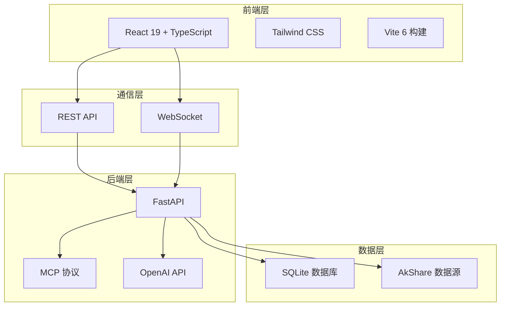

# 🤖 AI股票聊天助手 - 全栈金融分析系统

<div align="center">


**现代化股票分析助手，集成AI智能问答与专业股票池管理**

[🚀 快速开始](#-快速开始) • [📊 功能特性](#-功能特性) • [🏗️ 技术架构](#️-技术架构) • [📱 界面展示](#-界面展示)

</div>

---

## 📋 目录

- [✨ 项目概述](#-项目概述)
- [🚀 快速开始](#-快速开始)
- [📊 功能特性](#-功能特性)
- [🏗️ 技术架构](#️-技术架构)
- [📱 界面展示](#-界面展示)
- [🛠️ 开发指南](#️-开发指南)
- [📈 数据源说明](#-数据源说明)
- [🔧 配置说明](#-配置说明)
- [🚀 部署指南](#-部署指南)
- [🤝 贡献指南](#-贡献指南)

## ✨ 项目概述

AI股票聊天助手是一个基于 **React 19 + FastAPI** 的现代化全栈金融分析系统。系统集成了实时AI智能问答、专业股票池管理、实时行情展示等功能，为个人投资者和金融分析师提供一站式股票分析工具。

### 🎯 核心价值

- **🧠 智能分析**：集成大语言模型，支持自然语言股票查询和分析
- **📊 专业数据**：集成AkShare数据源，支持A股、港股实时行情
- **💼 投资管理**：完整的股票池管理系统，支持持仓和关注列表
- **🎨 现代界面**：响应式设计，完美支持桌面和移动端

## 🚀 快速开始

### 📋 环境要求

- **Node.js** >= 18.0.0
- **Python** >= 3.9
- **Git**

### ⚡ 一键启动

```bash
# 1. 克隆项目
git clone <repository-url>
cd "Claude made stock bot"

# 2. 安装后端依赖
cd backend
pip install -r requirements.txt

# 3. 安装前端依赖
cd ../frontend
npm install

# 4. 一键启动所有服务
cd ..
./start_optimized.sh
```

### 🌐 访问系统

启动成功后，系统将自动运行在：

- **前端界面**：http://localhost:3005 (或自动分配的端口)
- **后端API**：http://localhost:8001
- **API文档**：http://localhost:8001/docs
- **健康检查**：http://localhost:8001/health

## 📊 功能特性

### 🎯 核心功能模块

#### 1. 💬 AI智能问答
- **实时对话**：基于WebSocket的实时AI对话体验
- **股票分析**：支持自然语言查询股票信息和技术分析
- **智能识别**：自动识别股票名称并转换为标准代码
- **多数据源**：集成历史数据、财务报表、新闻资讯等

#### 2. 📈 股票信息库
- **海量数据**：支持 **4600+** 只A股和港股
- **智能搜索**：支持股票代码、名称、拼音多维度搜索
- **实时行情**：集成AkShare实时数据，30秒自动刷新
- **专业展示**：涵盖价格、交易量、估值指标等完整信息

#### 3. 💼 股票池管理
- **投资组合**：支持持仓股票和关注列表分类管理
- **标签系统**：自定义标签，灵活分类股票
- **批量操作**：支持批量添加、编辑、删除操作
- **数据统计**：投资组合统计分析和可视化

#### 4. 🎨 用户体验
- **响应式设计**：完美适配桌面、平板、手机
- **现代UI**：基于Tailwind CSS的现代化界面设计
- **实时更新**：自动数据刷新和状态同步
- **离线支持**：SQLite本地存储，支持离线查看

### ⭐ 特色功能

#### 📊 专业股票详情页
- **实时价格**：大字体价格显示，涨跌幅一目了然
- **基础数据**：昨收、今开、最高、最低，紧凑清晰展示
- **交易指标**：成交量、成交额、振幅、换手率
- **估值分析**：市盈率、市净率、总市值、每股净资产
- **自动刷新**：30秒智能刷新，支持手动刷新控制

#### 🔍 智能搜索体验
- **多维匹配**：支持股票代码(600519)、中文名称(贵州茅台)、拼音搜索
- **即时搜索**：300ms防抖，流畅的搜索体验
- **结果筛选**：按市场(沪深/港股)筛选搜索结果
- **分页展示**：高效的分页数据加载

## 🏗️ 技术架构

### 🖥️ 系统架构图



### 🔧 技术栈详情

#### 前端技术栈
- **React 19** - 最新的前端框架，支持并发特性
- **TypeScript 5.0+** - 类型安全的JavaScript超集
- **Tailwind CSS 4.0+** - 原子化CSS框架，现代化UI设计
- **Vite 6** - 极速的现代化构建工具
- **Lucide React** - 精美的SVG图标库

#### 后端技术栈
- **FastAPI 0.104+** - 现代、高性能的Python Web框架
- **WebSocket** - 实时双向通信支持
- **SQLite** - 轻量级关系型数据库
- **AkShare** - 专业的金融数据接口
- **MCP (Model Context Protocol)** - AI模型上下文协议

### 📁 项目结构

```
Claude made stock bot/
├── 📁 backend/                 # 后端代码
│   ├── 📁 services/            # 业务服务层
│   │   ├── akshare_service.py  # AkShare数据服务
│   │   └── stock_data.py       # 股票数据服务
│   ├── database.py             # 数据库管理
│   └── main.py                 # FastAPI主应用
├── 📁 frontend/                # 前端代码
│   ├── 📁 src/
│   │   ├── 📁 components/      # React组件
│   │   │   ├── StockDetailModal.tsx    # 股票详情弹窗
│   │   │   ├── StockInfoManager.tsx    # 股票信息管理
│   │   │   ├── StockPoolManager.tsx    # 股票池管理
│   │   │   └── ChatInterface.tsx       # AI聊天界面
│   │   ├── 📁 services/        # 前端服务
│   │   │   └── api.ts          # API接口封装
│   │   └── App.tsx             # 主应用组件
├── 📁 config/                  # 配置文件
├── 📄 start_optimized.sh       # 一键启动脚本
├── 📄 requirements.txt         # Python依赖
├── 📄 package.json            # Node.js依赖
└── 📄 README.md               # 项目文档
```

## 📱 界面展示

### 🏠 主界面
- **侧边栏导航**：清晰的功能模块划分
- **响应式布局**：完美适配不同屏幕尺寸
- **现代化设计**：简洁美观的用户界面

### 💬 AI聊天界面
- **实时对话**：流畅的AI对话体验
- **智能分析**：专业的股票分析回复
- **连接状态**：实时显示连接状态

### 📊 股票详情页
- **专业布局**：金融级数据展示
- **实时更新**：30秒自动刷新机制
- **完整信息**：涵盖价格、交易、估值等15+核心指标

### 🔍 股票搜索
- **智能匹配**：多维度搜索支持
- **即时结果**：实时搜索反馈
- **市场筛选**：支持按交易所筛选

## 🛠️ 开发指南

### 🔧 本地开发

#### 1. 后端开发
```bash
cd backend
# 安装依赖
pip install -r requirements.txt

# 启动开发服务器
uvicorn main:app --host 0.0.0.0 --port 8001 --reload
```

#### 2. 前端开发
```bash
cd frontend
# 安装依赖
npm install

# 启动开发服务器
npm run dev
```

### 📝 API接口文档

#### REST API
- `GET /api/stocks/search` - 股票搜索
- `GET /api/stocks/info/{symbol}` - 股票详情
- `GET /api/stocks/realtime/{symbol}` - 实时行情
- `GET /api/stock-pools` - 获取股票池
- `POST /api/stock-pools` - 创建股票池
- `PUT /api/stock-pools/{id}` - 更新股票池
- `DELETE /api/stock-pools/{id}` - 删除股票池

#### WebSocket API
- `/ws` - AI聊天WebSocket连接

### 🎯 数据模型

#### 股票信息模型
```typescript
interface StockInfo {
  symbol: string;      // 股票代码
  name: string;        // 股票名称
  short_name: string;  // 简称
  market: string;      // 市场(SH/SZ/HK)
  industry: string;    // 行业
  sector?: string;     // 板块
  market_cap?: number; // 市值
  pe_ratio?: number;   // 市盈率
  pb_ratio?: number;   // 市净率
}
```

#### 实时行情模型
```typescript
interface RealtimeStockData {
  symbol: string;
  current_price: number;
  change_amount: number;
  change_percent: number;
  volume: number;
  turnover: number;
  open_price: number;
  high_price: number;
  low_price: number;
  prev_close: number;
  timestamp: string;
}
```

## 📈 数据源说明

### 🔌 AkShare集成
- **数据覆盖**：支持沪深A股、港股实时行情
- **数据类型**：股票基础信息、实时价格、历史数据、财务数据
- **更新频率**：实时数据30秒更新，历史数据日更新
- **容错机制**：数据获取失败时提供模拟数据支持

### 📊 数据质量
- **数据源**：专业金融数据提供商
- **准确性**：实时同步交易所数据
- **完整性**：涵盖基础信息、交易数据、财务指标
- **时效性**：毫秒级数据更新

## 🔧 配置说明

### 📋 环境变量配置

创建 `.env` 文件：
```env
# AI配置
BASE_URL=你的API基础URL
API_KEY=你的API密钥
MODEL=你的模型名称

# 数据库配置
DATABASE_URL=sqlite:///stock_pool.db

# 服务配置
BACKEND_HOST=0.0.0.0
BACKEND_PORT=8001
FRONTEND_PORT=3005
```

### ⚙️ 系统配置

#### AkShare配置
```python
# backend/services/akshare_service.py
class AkShareService:
    def __init__(self):
        # 配置数据源参数
        self.update_interval = 30  # 更新间隔(秒)
        self.retry_count = 3       # 重试次数
        self.timeout = 10          # 超时时间
```

#### 前端配置
```typescript
// frontend/src/services/api.ts
const API_BASE_URL = 'http://localhost:8001/api';
const WEBSOCKET_URL = 'ws://localhost:8001/ws';
```

## 🚀 部署指南

### 🐳 Docker部署

```dockerfile
# Dockerfile示例
FROM node:18-alpine AS frontend
WORKDIR /app/frontend
COPY frontend/ .
RUN npm install && npm run build

FROM python:3.9-slim
WORKDIR /app
COPY backend/ ./backend/
COPY --from=frontend /app/frontend/dist ./frontend/dist/
RUN pip install -r backend/requirements.txt
EXPOSE 8001
CMD ["uvicorn", "backend.main:app", "--host", "0.0.0.0", "--port", "8001"]
```

### ☁️ 云服务部署

#### 方案一：Vercel + Railway
- **前端**：部署到Vercel
- **后端**：部署到Railway
- **数据库**：SQLite文件存储

#### 方案二：云服务器
- **服务器**：阿里云/腾讯云ECS
- **反向代理**：Nginx
- **进程管理**：PM2/Supervisor

### 🔄 生产环境优化

```bash
# 生产环境启动
# 后端
gunicorn backend.main:app -w 4 -k uvicorn.workers.UvicornWorker

# 前端构建
cd frontend && npm run build

# Nginx配置
server {
    listen 80;
    location / {
        root /path/to/frontend/dist;
        try_files $uri $uri/ /index.html;
    }
    location /api {
        proxy_pass http://127.0.0.1:8001;
    }
    location /ws {
        proxy_pass http://127.0.0.1:8001;
        proxy_http_version 1.1;
        proxy_set_header Upgrade $http_upgrade;
        proxy_set_header Connection "upgrade";
    }
}
```

## 🤝 贡献指南

### 🎯 贡献方式
1. **Bug报告**：通过Issues报告问题
2. **功能建议**：提出新功能需求
3. **代码贡献**：提交Pull Request
4. **文档改进**：完善项目文档

### 📝 开发规范
- **代码风格**：使用ESLint和Prettier
- **提交规范**：遵循Conventional Commits
- **测试要求**：新功能需要添加相应测试
- **文档更新**：代码变更需要更新相关文档

### 🛠️ 开发流程
```bash
# 1. Fork项目
git clone <your-fork-url>

# 2. 创建功能分支
git checkout -b feature/your-feature

# 3. 开发和测试
npm test

# 4. 提交代码
git commit -m "feat: add your feature"

# 5. 推送分支
git push origin feature/your-feature

# 6. 创建Pull Request
```

---

## 📞 联系我们

- **GitHub Issues**：[报告问题](https://github.com/your-repo/issues)
- **讨论区**：[参与讨论](https://github.com/your-repo/discussions)
- **邮箱**：your-email@example.com

## 📄 许可证

本项目采用 [MIT License](LICENSE) 许可证。

---

<div align="center">

**⭐ 如果这个项目对您有帮助，请给我们一个Star！**

Made with ❤️ by AI股票助手团队

</div>