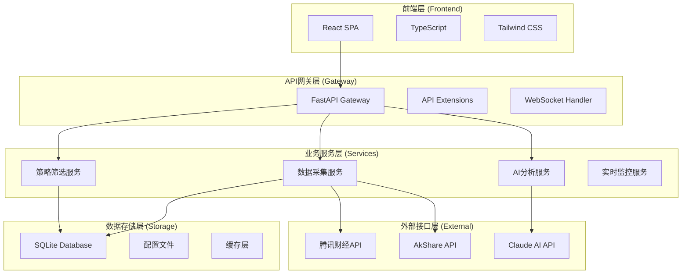
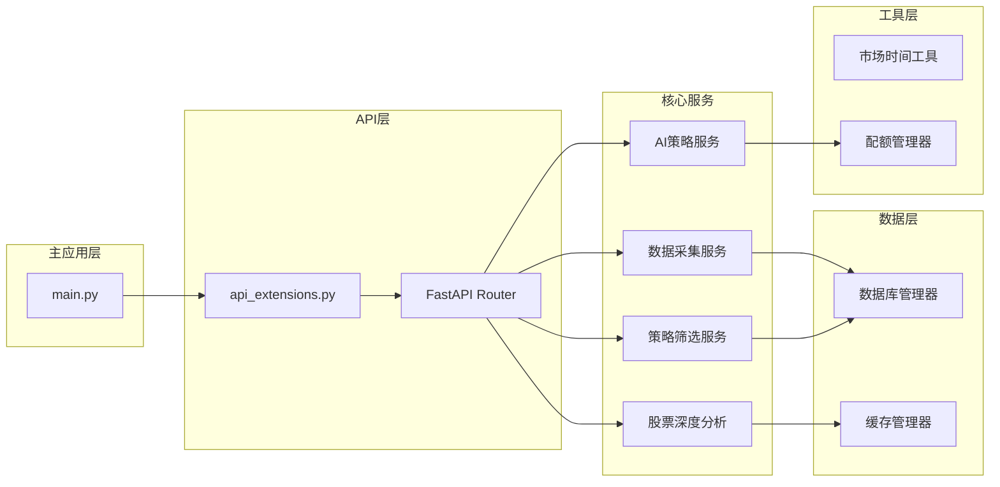
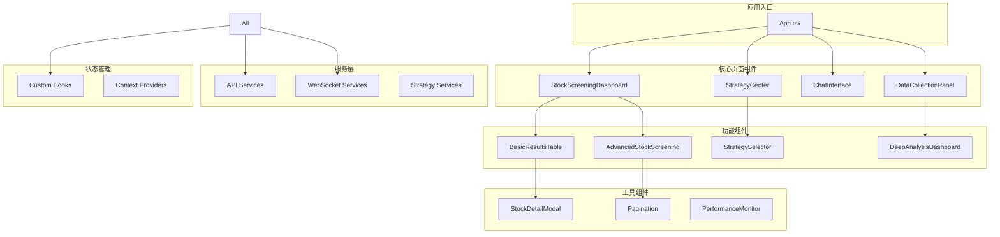
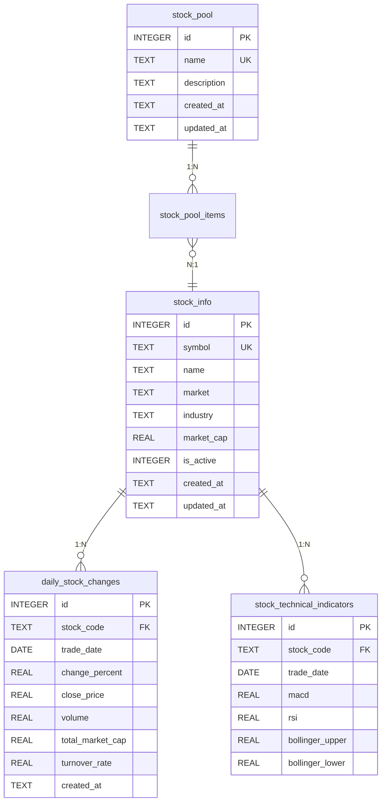
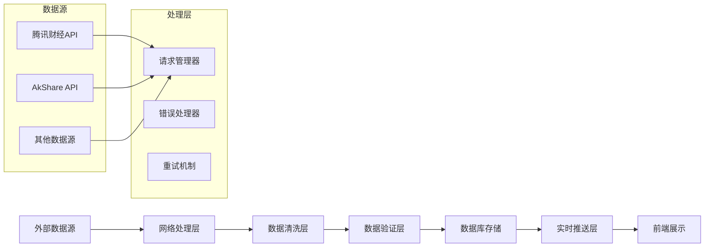
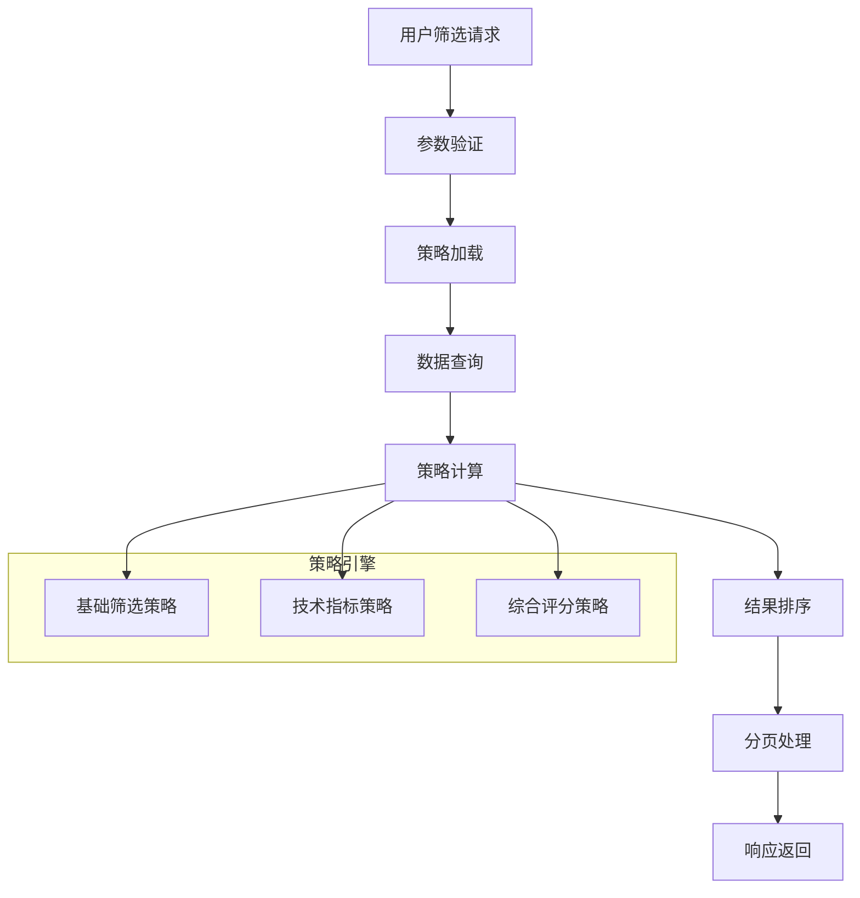
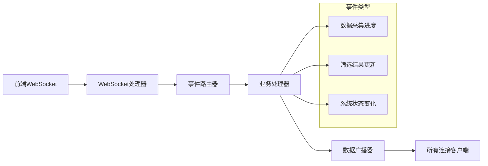
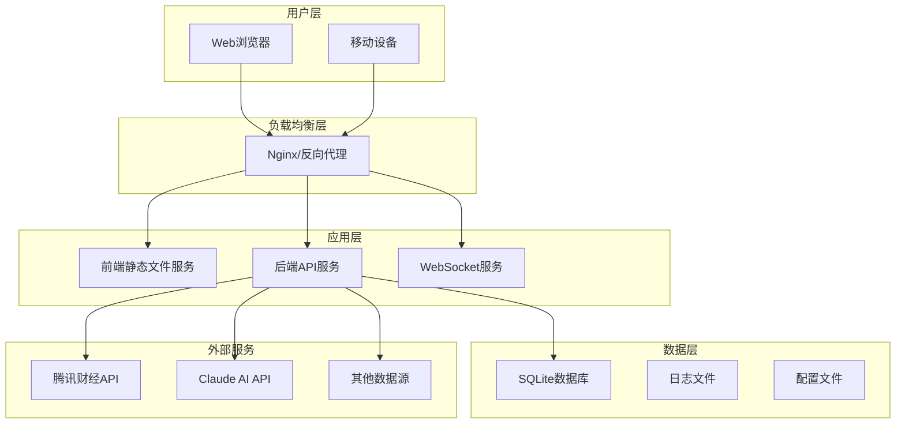
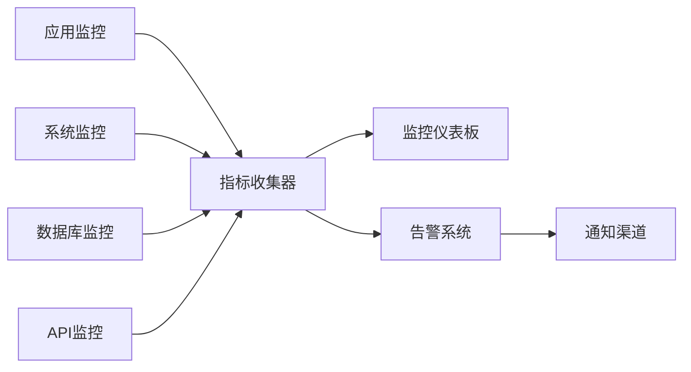

# 🏗️ AI股票聊天助手 - 技术架构文档

**文档版本**: v2.3.0  
**更新日期**: 2025年11月20日  
**架构类型**: 分布式全栈架构

---

## 📋 目录

1. [项目概览](#-项目概览)
2. [整体架构](#-整体架构)
3. [后端架构](#-后端架构)
4. [前端架构](#-前端架构)
5. [数据库设计](#-数据库设计)
6. [API设计](#-api设计)
7. [数据流架构](#-数据流架构)
8. [技术栈详解](#-技术栈详解)
9. [部署架构](#-部署架构)
10. [安全架构](#-安全架构)

---

## 🎯 项目概览

### 📊 系统规模
```
总代码量: 22,847 行
核心文件: 58 个
组件模块: 15 个
数据库表: 8 个
API端点: 50+ 个
支持股票: 10,590 只
```

### 🛠️ 核心功能
- **AI聊天助手**: Claude AI驱动的智能股票分析
- **数据采集系统**: 多数据源统一采集架构
- **股票筛选引擎**: 高级策略筛选和评分
- **实时监控**: WebSocket实时数据推送
- **多市场支持**: A股、港股一体化管理

---

## 🏛️ 整体架构

### 🔧 架构模式


### 📁 目录结构
```
📁 AI股票聊天助手/
├── 📁 backend/                 # 后端服务
│   ├── 📁 services/            # 业务服务模块
│   ├── 📁 utils/              # 工具函数
│   ├── 📄 main.py             # 主应用入口
│   ├── 📄 database.py         # 数据库管理
│   └── 📄 api_extensions.py   # API扩展模块
├── 📁 frontend/               # 前端应用
│   ├── 📁 src/
│   │   ├── 📁 components/     # React组件
│   │   ├── 📁 services/       # API服务
│   │   ├── 📁 hooks/          # 自定义Hooks
│   │   └── 📁 types/          # TypeScript类型
├── 📁 docs/                  # 项目文档
├── 📁 tests/                 # 测试文件
└── 📁 config/                # 配置文件
```

---

## 🔧 后端架构

### 🏗️ 服务架构图


### 📦 核心模块详解

#### 🎯 主应用模块 (`main.py`)
```python
# 核心功能
- FastAPI应用初始化
- 路由配置和中间件
- WebSocket连接管理
- 全局异常处理
- 服务生命周期管理

# 关键特性
- 异步处理支持
- 自动文档生成
- CORS跨域支持
- 健康检查端点
```

#### 🔌 API扩展模块 (`api_extensions.py`)
```python
# 模块化API设计
- 数据状态API
- 股票信息API
- 系统监控API
- 统一数据采集API

# 设计特点
- 独立的APIRouter
- 标准化响应格式
- 统一错误处理
- 详细日志记录
```

#### 📊 数据采集服务 (`services/`)
```
📁 services/
├── 📄 unified_data_collector.py    # 统一数据采集器
├── 📄 tencent_data_service.py      # 腾讯财经API服务
├── 📄 akshare_service.py          # AkShare数据服务
├── 📄 multi_source_data_service.py # 多数据源管理
├── 📄 enhanced_network_handler.py  # 网络请求处理
├── 📄 quota_manager.py            # API配额管理
└── 📄 data_sync_scheduler.py      # 数据同步调度
```

#### 🎯 策略筛选服务
```
📁 services/strategies/
├── 📄 __init__.py                 # 策略自动注册
├── 📄 basic_filter_strategies.py  # 基础筛选策略
├── 📄 trend_following_strategies.py # 趋势跟踪策略
├── 📄 volume_price_strategies.py   # 量价关系策略
├── 📄 pattern_recognition_strategies.py # 模式识别策略
└── 📄 comprehensive_strategy.py    # 综合策略
```

#### 🧠 AI服务架构
```python
# AI集成服务
- Claude API客户端管理
- 智能对话处理
- 策略生成和优化
- 配额管理和限流

# 关键组件
- WebStockAnalysisBot类
- 策略分析引擎
- 深度分析服务
- 自动池管理器
```

---

## 🎨 前端架构

### 🏗️ 组件架构图


### 📂 前端文件结构
```
📁 frontend/src/
├── 📄 App.tsx                    # 主应用组件
├── 📄 main.tsx                   # 应用入口点
├── 📁 components/                # UI组件库
│   ├── 📄 StockScreeningDashboard.tsx  # 股票筛选仪表板
│   ├── 📄 StrategyCenter.tsx           # 策略中心
│   ├── 📄 DataCollectionPanel.tsx     # 数据采集面板
│   ├── 📄 AdvancedStockScreening.tsx  # 高级筛选
│   ├── 📄 BasicResultsTable.tsx       # 结果表格
│   ├── 📄 StrategySelector.tsx         # 策略选择器
│   └── 📄 [其他30+组件...]
├── 📁 services/                  # API服务
│   ├── 📄 api.ts                      # 主API客户端
│   └── 📄 strategyService.ts          # 策略API服务
├── 📁 hooks/                     # 自定义Hooks
│   ├── 📄 useStockPool.ts            # 股票池Hook
│   └── 📄 useWebSocket.ts            # WebSocket Hook
├── 📁 types/                     # TypeScript类型定义
│   └── 📄 index.ts
└── 📁 utils/                     # 工具函数
    └── 📄 marketHours.ts              # 市场时间工具
```

### 🎯 关键组件详解

#### 📊 股票筛选仪表板
```typescript
// StockScreeningDashboard.tsx
功能特性:
- 多条件筛选配置
- 实时结果展示
- 表格排序和分页
- 导出功能支持

技术实现:
- React Hooks状态管理
- TypeScript类型安全
- Tailwind CSS样式
- 响应式设计
```

#### 🎯 策略中心
```typescript
// StrategyCenter.tsx
功能特性:
- 策略卡片展示
- 参数配置界面
- 策略组合功能
- 结果分析展示

组件架构:
- StrategySelector (策略选择)
- StrategyParameterModal (参数配置)
- AdvancedStrategyCards (策略卡片)
- ResultsComparison (结果对比)
```

#### 📈 数据采集面板
```typescript
// DataCollectionPanel.tsx
功能特性:
- 实时进度监控
- 操作日志显示
- 手动触发采集
- 系统状态监控

设计模式:
- 左右分栏布局
- WebSocket实时通信
- 错误处理和恢复
- 用户友好的界面
```

---

## 🗄️ 数据库设计

### 📊 数据库架构图


### 📋 表结构详解

#### 🏢 股票信息表 (`stock_info`)
```sql
CREATE TABLE stock_info (
    id INTEGER PRIMARY KEY AUTOINCREMENT,
    symbol TEXT NOT NULL UNIQUE,        -- 股票代码
    name TEXT NOT NULL,                 -- 股票名称
    short_name TEXT DEFAULT '',         -- 简称
    market TEXT DEFAULT '',             -- 市场(SH/SZ/HK)
    industry TEXT DEFAULT '',           -- 行业
    sector TEXT DEFAULT '',             -- 板块
    market_cap REAL DEFAULT 0.0,       -- 市值(亿元)
    pe_ratio REAL DEFAULT 0.0,         -- 市盈率
    pb_ratio REAL DEFAULT 0.0,         -- 市净率
    dividend_yield REAL DEFAULT 0.0,   -- 股息率
    listing_date TEXT DEFAULT '',      -- 上市日期
    is_active INTEGER DEFAULT 1,       -- 是否活跃
    created_at TEXT NOT NULL,          -- 创建时间
    updated_at TEXT NOT NULL           -- 更新时间
);
```

#### 📈 日交易数据表 (`daily_stock_changes`)
```sql
CREATE TABLE daily_stock_changes (
    id INTEGER PRIMARY KEY AUTOINCREMENT,
    stock_code TEXT NOT NULL,           -- 股票代码
    trade_date DATE NOT NULL,           -- 交易日期
    change_percent REAL NOT NULL,       -- 涨跌幅
    close_price REAL,                   -- 收盘价
    open_price REAL,                    -- 开盘价
    high_price REAL,                    -- 最高价
    low_price REAL,                     -- 最低价
    volume INTEGER,                     -- 成交量
    turnover REAL,                      -- 成交额
    total_market_cap REAL DEFAULT 0.0, -- 总市值(万元)
    circulating_market_cap REAL DEFAULT 0.0, -- 流通市值
    turnover_rate REAL DEFAULT 0.0,    -- 换手率
    pe_ratio REAL DEFAULT 0.0,         -- 市盈率
    pb_ratio REAL DEFAULT 0.0,         -- 市净率
    market TEXT NOT NULL,              -- 市场标识
    created_at TEXT NOT NULL,          -- 创建时间
    UNIQUE(stock_code, trade_date)     -- 唯一约束
);
```

#### 📊 技术指标表 (`stock_technical_indicators`)
```sql
CREATE TABLE stock_technical_indicators (
    id INTEGER PRIMARY KEY AUTOINCREMENT,
    stock_code TEXT NOT NULL,           -- 股票代码
    trade_date DATE NOT NULL,           -- 交易日期
    macd REAL,                          -- MACD指标
    signal_line REAL,                   -- 信号线
    histogram REAL,                     -- MACD柱
    rsi REAL,                           -- RSI指标
    bollinger_upper REAL,              -- 布林带上轨
    bollinger_middle REAL,             -- 布林带中轨
    bollinger_lower REAL,              -- 布林带下轨
    sma_5 REAL,                         -- 5日均线
    sma_10 REAL,                        -- 10日均线
    sma_20 REAL,                        -- 20日均线
    turnover_rate REAL,                 -- 换手率
    created_at TEXT NOT NULL,          -- 创建时间
    UNIQUE(stock_code, trade_date)     -- 唯一约束
);
```

### 🔍 索引优化策略
```sql
-- 核心查询索引
CREATE INDEX idx_daily_changes_date ON daily_stock_changes(trade_date);
CREATE INDEX idx_daily_changes_code ON daily_stock_changes(stock_code);
CREATE INDEX idx_daily_changes_code_date ON daily_stock_changes(stock_code, trade_date);

-- 股票信息索引
CREATE INDEX idx_stock_name ON stock_info(name);
CREATE INDEX idx_stock_market ON stock_info(market);
CREATE INDEX idx_stock_symbol ON stock_info(symbol);

-- 技术指标索引
CREATE INDEX idx_tech_indicators_date ON stock_technical_indicators(trade_date);
CREATE INDEX idx_tech_indicators_code ON stock_technical_indicators(stock_code);
```

---

## 🔌 API设计

### 🏗️ API架构层次
```
┌─────────────────────────────────────┐
│           API Gateway               │
│      (FastAPI + api_extensions)     │
├─────────────────────────────────────┤
│         业务API层                    │
├─────────────────────────────────────┤
│         数据服务层                   │
├─────────────────────────────────────┤
│         数据存储层                   │
└─────────────────────────────────────┘
```

### 📋 API端点总览

#### 🎯 核心业务API
```python
# 股票筛选相关
POST   /api/screening/screen-stocks          # 基础股票筛选
GET    /api/screening/latest-results         # 获取最新筛选结果
POST   /api/advanced-screening/basic         # 高级基础筛选
POST   /api/advanced-screening/strategy      # 策略筛选

# 数据管理相关
GET    /api/stock-info/status               # 股票信息状态
POST   /api/stock-info/full-update          # 股票信息更新
GET    /api/unified-collection/status       # 数据采集状态
POST   /api/unified-collection/force-collect # 强制数据采集

# AI分析相关
POST   /api/chat                            # AI聊天对话
GET    /api/strategies/available            # 可用策略列表
POST   /api/strategies/test                 # 策略测试

# 系统监控相关
GET    /api/system/health-check             # 系统健康检查
GET    /api/system/info                     # 系统信息
GET    /api/quota-status                    # 配额状态
```

#### 🔄 数据同步API
```python
# 数据采集API
POST   /api/data-sync/manual/collection     # 手动数据采集
POST   /api/data-sync/manual/screening      # 手动筛选触发
GET    /api/data-status/update-status       # 数据更新状态

# WebSocket端点
WS     /ws                                  # 实时通信
```

### 📊 API响应格式标准
```python
# 标准响应格式
class ApiResponse(BaseModel):
    success: bool                    # 操作成功标志
    message: str = ""               # 响应消息
    data: Optional[Any] = None      # 响应数据
    error_code: Optional[str] = None # 错误代码
    timestamp: str                   # 时间戳

# 示例响应
{
    "success": true,
    "message": "筛选完成",
    "data": {
        "results": [...],
        "total_count": 100
    },
    "timestamp": "2025-11-20T14:30:00Z"
}
```

---

## 🌊 数据流架构

### 📈 数据采集流程


### 🎯 策略筛选流程


### 🔄 实时通信流程


---

## 💻 技术栈详解

### 🔧 后端技术栈
```yaml
核心框架:
  - FastAPI: 现代Python Web框架
  - uvicorn: ASGI服务器
  - WebSockets: 实时通信

数据处理:
  - pandas: 数据分析和处理
  - numpy: 数值计算
  - SQLite: 轻量级数据库

AI集成:
  - OpenAI: Claude API客户端
  - MCP: 模型控制协议

数据源:
  - AkShare: 中国股票数据
  - aiohttp: 异步HTTP客户端

工具库:
  - python-dotenv: 环境变量管理
  - schedule: 任务调度
  - psutil: 系统监控
```

### 🎨 前端技术栈
```yaml
核心框架:
  - React 18: 用户界面库
  - TypeScript: 类型安全
  - Vite: 构建工具

UI组件:
  - Tailwind CSS: 实用工具优先的CSS框架
  - Lucide React: 现代图标库
  - 自定义组件库

状态管理:
  - React Hooks: 内置状态管理
  - Custom Hooks: 业务逻辑复用

工具链:
  - ESLint: 代码检查
  - Prettier: 代码格式化
  - Vitest: 单元测试
```

### 🔧 开发工具
```yaml
版本控制:
  - Git: 分布式版本控制
  - GitHub: 代码托管

开发环境:
  - Python 3.9+: 后端运行环境
  - Node.js 18+: 前端运行环境
  - SQLite: 本地数据库

测试框架:
  - pytest: Python测试框架
  - pytest-asyncio: 异步测试
  - Vitest: 前端测试框架
  - httpx: HTTP测试客户端
```

---

## 🚀 部署架构

### 🏗️ 部署拓扑图


### 📦 部署配置

#### 🐳 Docker部署配置
```dockerfile
# 后端Dockerfile
FROM python:3.9-slim

WORKDIR /app
COPY backend/ .
RUN pip install -r requirements.txt

EXPOSE 8001
CMD ["uvicorn", "main:app", "--host", "0.0.0.0", "--port", "8001"]
```

```dockerfile
# 前端Dockerfile
FROM node:18-alpine

WORKDIR /app
COPY frontend/ .
RUN npm install && npm run build

FROM nginx:alpine
COPY --from=0 /app/dist /usr/share/nginx/html
EXPOSE 80
```

#### 🔧 环境配置
```bash
# .env配置示例
# API配置
OPENAI_API_KEY=your_api_key
OPENAI_API_BASE=https://api.anthropic.com

# 数据源配置
TENCENT_API_ENABLED=true
AKSHARE_API_ENABLED=true

# 数据库配置
DATABASE_PATH=./backend/stock_pool.db

# 服务配置
HOST=0.0.0.0
PORT=8001
DEBUG=false

# 日志配置
LOG_LEVEL=INFO
LOG_FILE=./logs/app.log
```

---

## 🔒 安全架构

### 🛡️ 安全措施
```yaml
API安全:
  - 请求频率限制
  - API密钥管理
  - 输入验证和清理
  - CORS跨域控制

数据安全:
  - 数据库访问控制
  - 敏感信息加密存储
  - 备份和恢复策略
  - 审计日志记录

网络安全:
  - HTTPS强制使用
  - WebSocket安全连接
  - 防火墙配置
  - DDoS防护
```

### 🔐 配额和限流
```python
# API配额管理
class QuotaManager:
    def __init__(self):
        self.limits = {
            "claude_api": 1000,      # 每日Claude API调用限制
            "akshare_api": 5000,     # 每日AkShare调用限制
            "strategy_screening": 100  # 每日策略筛选限制
        }
    
    def check_quota(self, service: str) -> bool:
        # 检查配额是否可用
        pass
    
    def record_request(self, service: str):
        # 记录API调用
        pass
```

---

## 📈 性能优化

### ⚡ 性能指标
```yaml
响应时间:
  - API平均响应: <100ms
  - 数据库查询: <10ms
  - 前端渲染: <50ms

并发能力:
  - 同时在线用户: 100+
  - 并发API请求: 50+
  - WebSocket连接: 20+

数据处理:
  - 单次筛选股票: 10,000+
  - 数据采集速度: 1000股票/分钟
  - 实时数据推送延迟: <1秒
```

### 🔧 优化策略
```python
# 数据库优化
- 索引优化
- 查询优化
- 连接池管理
- 缓存策略

# 前端优化
- 组件懒加载
- 虚拟滚动
- 代码分割
- 资源压缩

# 后端优化
- 异步处理
- 批量操作
- 内存管理
- 连接复用
```

---

## 📊 监控和日志

### 📈 监控架构


### 📝 日志体系
```python
# 日志配置
import logging

logging.basicConfig(
    level=logging.INFO,
    format='%(asctime)s - %(name)s - %(levelname)s - %(message)s',
    handlers=[
        logging.FileHandler('app.log'),
        logging.StreamHandler()
    ]
)

# 日志类别
- 应用日志: 业务逻辑记录
- 访问日志: API请求记录
- 错误日志: 异常和错误记录
- 性能日志: 性能指标记录
```

---

## 🔮 未来架构演进

### 🚀 短期规划 (v2.4.0)
```yaml
架构优化:
  - 微服务拆分
  - 消息队列引入
  - Redis缓存层
  - 容器化部署

功能扩展:
  - 港股数据源集成
  - AI策略生成
  - 移动端适配
  - 实时推荐系统
```

### 🌟 长期愿景 (v3.0.0)
```yaml
技术升级:
  - 云原生架构
  - Kubernetes部署
  - 分布式数据库
  - 机器学习集成

业务扩展:
  - 多语言支持
  - 国际市场数据
  - 社交化功能
  - 移动应用开发
```

---

## 📚 开发指南

### 🛠️ 开发环境搭建
```bash
# 1. 克隆项目
git clone <repository>
cd "Claude made stock bot"

# 2. 后端环境
cd backend
python -m venv .venv
source .venv/bin/activate  # Windows: .venv\Scripts\activate
pip install -r requirements.txt

# 3. 前端环境
cd ../frontend
npm install

# 4. 启动服务
# 后端
cd ../backend && python main.py

# 前端
cd ../frontend && npm run dev
```

### 📋 开发规范
```yaml
代码规范:
  - Python: PEP 8规范
  - TypeScript: ESLint + Prettier
  - 提交信息: Conventional Commits

测试规范:
  - 单元测试覆盖率: >80%
  - 集成测试: 核心功能
  - E2E测试: 关键用户流程

文档规范:
  - 代码注释: 英文
  - 用户文档: 中文
  - API文档: 自动生成
```

---

## 📞 技术支持

### 🔗 相关资源
- **架构设计**: [本文档]
- **API文档**: [docs/06-api.md](./docs/06-api.md)
- **部署指南**: [docs/08-deployment.md](./docs/08-deployment.md)
- **故障排除**: [docs/09-troubleshooting.md](./docs/09-troubleshooting.md)

### 🛠️ 开发工具
- **代码编辑器**: VSCode推荐
- **API测试**: Postman/Insomnia
- **数据库管理**: SQLite Browser
- **版本控制**: Git + GitHub

---

**🏆 这是一个现代化、可扩展、高性能的全栈股票分析系统架构！**

*通过模块化设计、微服务理念和现代技术栈，为用户提供卓越的股票投资分析体验。*

---

*文档维护: 开发团队*  
*最后更新: 2025年11月20日*  
*版本: v2.3.0*