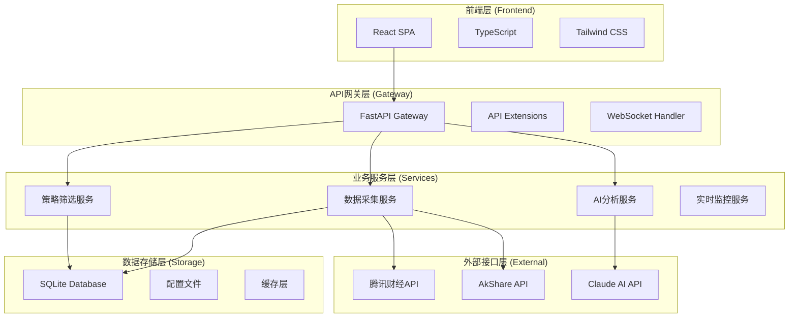

# 🏗️ 架构设计

**文档版本**: v2.3.0  
**更新日期**: 2025年11月20日  
**架构类型**: 分布式全栈架构

## 🎯 系统架构概览

AI股票聊天助手采用现代化的前后端分离架构，结合了微服务理念和事件驱动模式，确保系统的可扩展性和维护性。

### 📊 系统规模
```
总代码量: 22,847 行
核心文件: 58 个
组件模块: 15 个
数据库表: 8 个
API端点: 50+ 个
支持股票: 10,590 只
```



## 🔧 技术选型理念

### 1. **前端技术选型**
- **React 18**: 成熟的组件化框架，优秀的生态系统
- **TypeScript**: 提供类型安全，提升代码质量
- **Tailwind CSS**: 快速开发，一致的设计语言
- **Vite**: 快速的构建工具，优秀的开发体验

### 2. **后端技术选型**
- **FastAPI**: 高性能、自动文档、异步支持
- **Python**: 丰富的数据分析库生态
- **SQLite**: 轻量级、无需配置、适合单机部署
- **Pydantic**: 数据验证和序列化

### 3. **通信协议选型**
- **HTTP/REST**: 标准的API通信协议
- **WebSocket**: 实时双向通信
- **MCP**: 统一的模型上下文协议

## 📁 项目目录结构

```
Claude made stock bot/
├── 📄 package.json                   # 项目配置和脚本
├── 📄 requirements.txt               # Python依赖
├── 📁 frontend/                      # 前端React应用
│   ├── src/
│   │   ├── components/              # 可复用组件
│   │   ├── hooks/                   # 自定义Hooks
│   │   ├── services/               # API服务层
│   │   ├── types/                  # TypeScript类型定义
│   │   └── App.tsx                 # 应用入口
│   ├── vite.config.ts              # Vite配置
│   └── package.json                # 前端依赖
├── 📁 backend/                      # 后端FastAPI服务
│   ├── main.py                     # 应用入口点
│   ├── database.py                 # 数据访问层
│   └── services/                   # 业务服务层
├── 📁 docs/                        # 项目文档
└── 📄 CLAUDE.md                    # 开发者指南
```

## ⚛️ 前端架构详解

### 组件架构设计
```typescript
// 组件层次结构
App
├── Layout                          // 布局组件
│   ├── Sidebar                    // 侧边栏导航
│   └── MainContent               // 主内容区域
├── ChatInterface                 // 聊天界面
├── StockPoolManager             // 股票池管理
├── StockScreeningDashboard      // 股票筛选面板
├── DeepAnalysisDashboard       // 深度分析面板
└── PerformanceMonitor          // 性能监控
```

### 状态管理架构
```typescript
// 使用自定义Hooks管理状态
const useStockPool = () => {
  const [stockPools, setStockPools] = useState<StockPool[]>([]);
  const [loading, setLoading] = useState(false);
  const [error, setError] = useState<string | null>(null);
  
  // CRUD操作
  const createStockPool = async (data: StockPoolCreate) => { ... };
  const updateStockPool = async (id: number, data: StockPoolUpdate) => { ... };
  const deleteStockPool = async (id: number) => { ... };
  
  return { stockPools, loading, error, createStockPool, updateStockPool, deleteStockPool };
};
```

### API服务层设计
```typescript
// 统一的API客户端
const api = axios.create({
  baseURL: process.env.REACT_APP_API_BASE_URL || 'http://localhost:8001',
  timeout: 30000,
});

// 专门的业务API
export const stockPoolAPI = {
  getAll: () => api.get<ApiResponse<StockPool[]>>('/stock-pools'),
  create: (data: StockPoolCreate) => api.post<ApiResponse<StockPool>>('/stock-pools', data),
  update: (id: number, data: StockPoolUpdate) => api.put<ApiResponse<StockPool>>(`/stock-pools/${id}`, data),
  delete: (id: number) => api.delete(`/stock-pools/${id}`),
};
```

## 🔙 后端架构详解

### FastAPI应用结构
```python
# main.py - 应用入口
from fastapi import FastAPI, WebSocket
from fastapi.middleware.cors import CORSMiddleware

app = FastAPI(
    title="AI股票聊天助手",
    version="2.2.0",
    description="基于AI的智能股票投资分析平台"
)

# 中间件配置
app.add_middleware(
    CORSMiddleware,
    allow_origins=["*"],
    allow_credentials=True,
    allow_methods=["*"],
    allow_headers=["*"],
)

# 路由注册
app.include_router(stock_pool_router, prefix="/api")
app.include_router(strategy_router, prefix="/api")
```

### 业务服务层架构
```python
# 服务依赖注入模式
class StockAnalysisService:
    def __init__(self, db_manager: DatabaseManager):
        self.db_manager = db_manager
        self.akshare_service = AkShareService()
        self.ai_client = OpenAIClient()
    
    async def generate_strategy(self, stock_pool_id: int) -> StrategyAnalysis:
        # 数据收集
        stock_data = await self.collect_stock_data(stock_pool_id)
        
        # AI分析
        strategy = await self.ai_client.generate_strategy(stock_data)
        
        # 结果存储
        await self.db_manager.save_strategy_analysis(strategy)
        
        return strategy
```

### 数据访问层设计
```python
# database.py - 数据访问层
class DatabaseManager:
    def __init__(self, db_path: str):
        self.db_path = db_path
        self.init_database()
    
    async def add_stock_pool(self, stock_pool: StockPool) -> int:
        """添加股票到池中"""
        with sqlite3.connect(self.db_path) as conn:
            cursor = conn.cursor()
            cursor.execute(INSERT_STOCK_POOL_SQL, stock_pool.to_tuple())
            return cursor.lastrowid
    
    async def get_stock_pools(self, pool_type: str = None) -> List[StockPool]:
        """获取股票池列表"""
        with sqlite3.connect(self.db_path) as conn:
            cursor = conn.cursor()
            cursor.execute(SELECT_STOCK_POOLS_SQL, (pool_type,) if pool_type else ())
            return [StockPool.from_tuple(row) for row in cursor.fetchall()]
```

## 🔄 数据流架构

### 1. **请求处理流程**
```
用户请求 → 前端组件 → API服务层 → HTTP客户端 → FastAPI路由 → 业务服务 → 数据访问层 → 数据库
    ↓
响应数据 ← 前端状态 ← API响应 ← HTTP响应 ← 业务逻辑 ← 数据查询 ← 数据库结果
```

### 2. **WebSocket通信流程**
```
用户输入 → ChatInterface → WebSocket连接 → FastAPI WebSocket处理器 → AI服务 → 流式响应
    ↓
实时更新 ← 消息展示 ← WebSocket消息 ← 消息广播 ← 结果处理 ← AI模型响应
```

### 3. **数据同步流程**
```
定时任务 → 调度器 → 数据收集服务 → 外部数据源 → 数据处理 → 数据库存储 → 前端更新通知
```

## 🔌 外部集成架构

### MCP协议集成
```python
# MCP服务器集成
class MCPIntegration:
    def __init__(self):
        self.akshare_server = MCPServer("akshare")
        self.openai_server = MCPServer("openai")
    
    async def get_stock_data(self, symbol: str):
        return await self.akshare_server.call_tool("get_stock_info", {"symbol": symbol})
    
    async def generate_analysis(self, prompt: str):
        return await self.openai_server.call_tool("chat_completion", {"prompt": prompt})
```

### AkShare数据源集成
```python
# 数据源服务
class AkShareService:
    def __init__(self):
        import akshare as ak
        self.ak = ak
        self.cache = TTLCache(maxsize=1000, ttl=300)  # 5分钟缓存
    
    async def get_stock_realtime(self, symbol: str):
        cache_key = f"realtime_{symbol}"
        if cache_key in self.cache:
            return self.cache[cache_key]
        
        data = self.ak.stock_zh_a_spot_em()
        self.cache[cache_key] = data
        return data
```

## 🔐 安全架构设计

### 1. **前端安全措施**
- CSP (Content Security Policy) 配置
- XSS防护和输入验证
- HTTPS强制使用
- 敏感信息不在前端存储

### 2. **后端安全措施**
- CORS跨域配置
- SQL注入防护（参数化查询）
- 请求频率限制
- API密钥安全管理

### 3. **数据安全**
- 数据库访问权限控制
- 敏感数据加密存储
- 定期数据备份
- 审计日志记录

## 📊 性能架构优化

### 1. **前端性能优化**
- 代码分割和懒加载
- 组件虚拟化
- 图片和资源压缩
- CDN加速

### 2. **后端性能优化**
- 异步处理和并发控制
- 数据库连接池
- 缓存策略 (Redis/内存缓存)
- API响应压缩

### 3. **数据库性能优化**
- 索引优化
- 查询优化
- 批量操作
- 连接池管理

## 🔄 部署架构

### 1. **开发环境**
```bash
# 前端开发服务器
npm run dev          # http://localhost:3000

# 后端开发服务器  
uvicorn main:app --reload --port 8001
```

### 2. **生产环境**
```yaml
# docker-compose.yml
version: '3.8'
services:
  frontend:
    build: ./frontend
    ports:
      - "80:80"
    depends_on:
      - backend
  
  backend:
    build: ./backend
    ports:
      - "8001:8001"
    environment:
      - DATABASE_URL=/data/stock_pool.db
    volumes:
      - ./data:/data
```

### 3. **监控和日志**
- 应用性能监控 (APM)
- 错误追踪和报告
- 业务指标监控
- 日志聚合和分析

## 🚀 扩展性设计

### 1. **水平扩展**
- 微服务拆分策略
- 负载均衡配置
- 数据库分片方案
- 缓存集群部署

### 2. **功能扩展**
- 插件化架构设计
- 事件驱动架构
- 消息队列集成
- 第三方服务集成

### 3. **数据扩展**
- 多数据源支持
- 数据仓库集成
- 实时数据流处理
- 大数据分析平台

---

**下一步**: 查看 [功能模块](03-features.md) 了解系统各功能模块的详细实现。