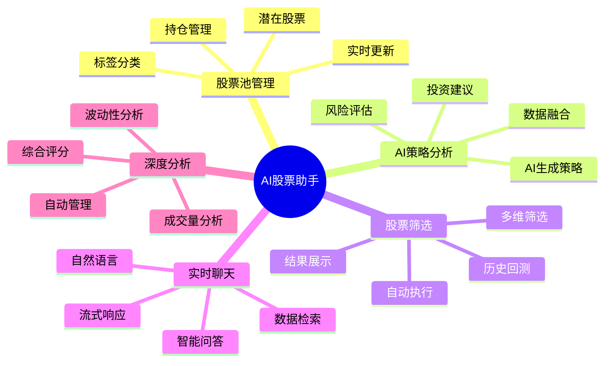

# 🚀 功能模块详解

## 🎯 功能模块总览

AI股票聊天助手包含五大核心功能模块，每个模块都经过精心设计，提供完整的投资分析和管理能力。



## 📊 股票池管理模块

### 🎯 模块概述
股票池管理是系统的核心模块，提供完整的股票投资组合管理功能，支持持仓股票和潜在关注股票的分类管理。

### ✨ 核心功能

#### 1. **双池管理系统**
- **持仓池 (holding)**：管理已购买的股票
  - 记录持股数量、平均成本
  - 计算当前市值和盈亏
  - 支持分批买入记录
  
- **关注池 (potential)**：管理待观察的股票
  - 跟踪感兴趣的股票
  - 设置关注原因和标签
  - 支持转换为持仓

#### 2. **智能标签系统**
```typescript
// 标签管理示例
const stockTags = {
  industry: ['科技', '医药', '新能源', '消费'],
  strategy: ['价值投资', '成长股', '周期股', '防御股'],
  risk: ['低风险', '中等风险', '高风险'],
  custom: ['用户自定义标签']
};
```

#### 3. **实时价格更新**
- 自动获取最新股价
- 计算实时盈亏状况
- 价格变动提醒
- 历史价格趋势

### 🔧 技术实现

#### 数据模型
```python
@dataclass
class StockPool:
    stock_code: str                      # 股票代码
    stock_name: str                      # 股票名称  
    pool_type: str                       # holding|potential
    shares: int = 0                      # 持股数量
    avg_cost: float = 0.0               # 平均成本
    current_price: float = 0.0          # 当前价格
    market_value: float = 0.0           # 市值
    tags: Optional[List[str]] = None    # 标签列表
    notes: str = ""                     # 备注信息
    created_at: str = ""                # 创建时间
    updated_at: str = ""                # 更新时间
```

#### API接口
- `GET /api/stock-pools` - 获取股票池列表
- `POST /api/stock-pools` - 添加股票
- `PUT /api/stock-pools/{id}` - 更新股票
- `DELETE /api/stock-pools/{id}` - 删除股票
- `POST /api/stock-pools/batch-update-prices` - 批量更新价格

### 📱 用户界面

#### 主界面功能
- **列表视图**：表格形式展示所有股票
- **卡片视图**：卡片形式展示详细信息
- **筛选器**：按池类型、标签、盈亏状况筛选
- **排序功能**：按价格、盈亏、添加时间排序

#### 操作功能
- **添加股票**：搜索并添加新股票
- **批量操作**：批量删除、标签修改
- **导入导出**：支持Excel格式
- **快速搜索**：支持代码、名称、拼音搜索

## 🤖 AI策略分析模块

### 🎯 模块概述
AI策略分析模块是系统的智能核心，结合实时数据和AI模型，为每只持仓股票生成专业的投资策略分析报告。

### ✨ 核心功能

#### 1. **实时数据融合**
- **技术指标获取**：RSI、MACD、BOLL等技术指标
- **基本面数据**：PE、PB、ROE等财务指标
- **市场环境分析**：大盘走势、板块表现
- **实时价格更新**：最新股价、成交量数据

#### 2. **AI策略生成引擎**
```python
class AIStrategyGenerator:
    def __init__(self, openai_client):
        self.client = openai_client
        self.model = "qwen-coder-plus"
    
    async def generate_strategy(self, stock_data: Dict) -> StrategyAnalysis:
        # 构建结构化提示
        prompt = self._build_strategy_prompt(stock_data)
        
        # 调用AI模型
        response = await self.client.chat.completions.create(
            model=self.model,
            messages=[
                {"role": "system", "content": self._get_system_prompt()},
                {"role": "user", "content": prompt}
            ],
            temperature=0.1,
            response_format={"type": "json_object"}
        )
        
        return self._parse_strategy_response(response)
```

#### 3. **量化评估体系**
- **综合评分**：1-10分量化评分系统
- **风险等级**：低、中、高风险分类
- **投资建议**：买入、持有、减仓、卖出
- **目标价位**：基于分析的价格区间

### 🔧 技术实现

#### 数据收集流程
```python
async def collect_comprehensive_data(self, stock_code: str) -> Dict:
    """并发收集多维度数据"""
    tasks = [
        self.get_technical_indicators(stock_code),    # 技术指标
        self.get_fundamental_data(stock_code),        # 基本面数据
        self.get_market_context(stock_code),          # 市场环境
        self.get_price_history(stock_code, days=30),  # 价格历史
        self.get_news_sentiment(stock_code),          # 新闻情感
    ]
    
    results = await asyncio.gather(*tasks, return_exceptions=True)
    return self._combine_analysis_data(results)
```

#### 策略分析结果
```python
@dataclass
class StrategyAnalysis:
    comprehensive_score: float          # 综合评分(1-10)
    risk_level: str                    # 风险等级
    action_recommendation: str         # 操作建议
    target_price_min: float           # 目标价位下限
    target_price_max: float           # 目标价位上限
    analysis_summary: str             # 分析摘要
    technical_analysis: str           # 技术分析
    fundamental_analysis: str         # 基本面分析
    key_metrics: str                  # 关键指标(JSON)
    risk_warnings: str                # 风险提示(JSON)
    action_plan: str                  # 行动计划(JSON)
```

### 📱 用户界面

#### 策略展示
- **全屏模态框**：沉浸式策略展示
- **标签页导航**：分类展示分析内容
- **可视化指标**：图表展示关键指标
- **历史策略**：策略分析历史记录

## 🔍 股票筛选模块

### 🎯 模块概述
股票筛选模块通过量化算法自动识别市场中的投资机会，支持多维度筛选条件和历史回测验证。该模块包含完整的数据收集、筛选分析和结果展示功能。

### 📅 自动数据收集机制

#### **每日自动任务时间表**
系统通过数据同步调度器自动执行以下任务：

| 时间 | 任务 | 描述 | 执行条件 |
|------|------|------|----------|
| 02:00 | 股票基础信息同步 | 更新股票代码、名称等基础信息 | 每日执行 |
| 03:00 | 缓存清理 | 清理过期的数据缓存 | 每日执行 |
| 08:30 | 开盘前健康检查 | 检查数据源状态和系统健康 | 仅交易日 |
| 15:10 | A股收盘后健康检查 | A股市场收盘后的状态检查 | 仅交易日 |
| 16:10 | 港股收盘后健康检查 | 港股市场收盘后的状态检查 | 仅交易日 |
| **17:00** | **📊 每日股票涨跌数据收集** | **收集当日所有股票的价格和成交量数据** | **仅交易日** |
| **18:00** | **🔍 执行股票筛选** | **基于收集的数据执行筛选算法** | **仅交易日** |

#### **数据收集策略**
```python
async def _collect_daily_stock_data(self):
    """每日数据收集策略"""
    # 1. 检查数据完整性
    existing_count = await self._check_data_completeness(yesterday)
    
    if existing_count < 1000:  # 数据不足阈值
        # 2. 执行数据收集
        collected_count = await screening_service.collect_daily_data(yesterday)
        
        # 3. 数据质量验证
        if collected_count > 4000:
            logger.info(f"✅ 成功收集 {collected_count} 条完整数据")
        else:
            logger.warning(f"⚠️ 数据收集不完整，仅收集到 {collected_count} 条")
    else:
        logger.info(f"✅ 数据已存在，共 {existing_count} 条")
```

#### **数据收集接口优先级**
系统采用多层次的数据收集策略，确保数据完整性：

1. **实时数据接口** (优先级1)
   ```python
   # 使用东方财富实时行情接口
   df = akshare_service.ak.stock_zh_a_spot_em()
   # 优点：一次性获取全市场数据（5000+条）
   # 成功率：95%+
   ```

2. **批量历史数据接口** (优先级2)
   ```python
   # 逐个获取股票历史数据
   for stock_code in stock_codes:
       hist_data = akshare_service.ak.stock_zh_a_hist(stock_code)
   # 优点：精确的历史数据
   # 缺点：成功率较低（20-30%），耗时长
   ```

3. **备用股票列表** (优先级3)
   ```python
   # 使用预定义的核心股票列表
   default_stocks = ['600519', '000001', '300750', ...]  # 20只核心股票
   # 用途：当其他方法都失败时的兜底方案
   ```

### ✨ 核心功能

#### 1. **多维度筛选引擎**
- **连续涨幅筛选**：识别连续上涨的强势股票
- **成交量配合**：分析量价关系
- **技术形态**：识别技术突破形态
- **基本面过滤**：基于财务指标过滤

#### 2. **自动化执行**
```python
# 定时筛选任务配置
class DataSyncScheduler:
    def setup_schedule(self):
        # 每日17:00收集数据
        schedule.every().day.at("17:00").do(
            self._conditional_daily_data_collection
        ).tag('daily_data_collection')
        
        # 每日18:00执行筛选
        schedule.every().day.at("18:00").do(
            self._conditional_stock_screening
        ).tag('stock_screening')
    
    def _conditional_daily_data_collection(self):
        """智能数据收集"""
        market_status = getMarketStatusSummary()
        
        # 只在交易日执行
        if market_status['isWeekday'] and not market_status['isHoliday']:
            asyncio.run(self._run_sync_task('daily_data_collection'))
```

#### 3. **用户操作功能**
- **🔄 刷新结果**：手动刷新最新筛选结果
- **🎯 智能分析**：自动处理筛选结果（深度分析+添加到关注池）
- **📊 批量分析**：对所有筛选结果执行深度分析
- **🔧 初始化数据**：手动补充历史数据（7天回溯）
- **▶️ 手动筛选**：立即执行筛选（数据收集+筛选分析）
- **⚙️ 自定义筛选**：使用用户设定的条件进行筛选

#### 4. **数据收集状态监控**
```python
# 数据完整性检查
def check_data_quality(self, trade_date: str) -> Dict:
    """检查数据质量"""
    return {
        'total_stocks': stock_count,
        'data_completeness': completeness_ratio,
        'collection_time': collection_timestamp,
        'success_rate': api_success_rate,
        'data_source': primary_data_source
    }
```

### 📊 **初始化数据 vs 日常运行**

#### **何时需要手动"初始化数据"**
✅ **需要使用的情况**：
- 🆕 系统首次安装和配置
- 📉 数据丢失或损坏需要恢复
- ⏰ 连续多日数据缺失需要补充
- 🔄 系统重装后恢复历史数据
- 🛠️ 调试和测试需要完整数据集

❌ **无需每天使用**：
- ⏰ 系统每天17:00自动收集当日数据
- 🔍 系统每天18:00自动执行筛选
- 📈 正常运行期间无需人工干预

#### **自动 vs 手动对比**
| 功能 | 自动执行 | 手动操作 |
|------|----------|----------|
| **数据收集** | 每日17:00自动 | "初始化数据"按钮 |
| **筛选分析** | 每日18:00自动 | "手动筛选"按钮 |
| **执行条件** | 仅交易日执行 | 任何时候可执行 |
| **数据范围** | 当日数据 | 可指定天数回溯 |
| **适用场景** | 日常运行 | 数据恢复/初始化 |

### 🔧 技术实现

#### 筛选算法核心
```python
async def screen_strong_rise_stocks(self, criteria: ScreeningCriteria) -> List[ScreeningResult]:
    """筛选强势上涨股票"""
    # 获取股票基础列表
    stock_list = await self._get_stock_universe(criteria.market_filter)
    
    # 并发筛选处理
    screening_tasks = []
    batch_size = 50
    
    for i in range(0, len(stock_list), batch_size):
        batch = stock_list[i:i + batch_size]
        task = self._screen_stock_batch(batch, criteria)
        screening_tasks.append(task)
    
    # 执行并发筛选
    batch_results = await asyncio.gather(*screening_tasks, return_exceptions=True)
    
    # 合并和排序结果
    return self._filter_and_sort_results(batch_results, criteria)
```

#### 筛选条件配置
```python
@dataclass
class ScreeningCriteria:
    screening_type: str = "strong_rise_3d"
    min_consecutive_days: int = 3
    min_rise_percent: float = 7.0
    min_volume: int = 0
    market_filter: List[str] = field(default_factory=lambda: ['SH', 'SZ'])
```

### 📱 用户界面
- **条件配置面板**：可视化设置筛选条件
- **结果展示表格**：分页展示筛选结果
- **历史记录**：查看历史筛选结果
- **一键导入**：将筛选结果添加到股票池

## 💬 实时聊天模块

### 🎯 模块概述
实时聊天模块提供自然语言交互能力，用户可以通过对话方式查询股票信息、获取分析建议。

### ✨ 核心功能

#### 1. **自然语言理解**
- 理解股票相关查询
- 识别用户意图和实体
- 支持多种查询模式

#### 2. **智能数据检索**
```python
async def process_query(self, query: str, websocket: WebSocket):
    """处理用户查询"""
    # 使用MCP协议获取数据
    tools_available = await self.mcp_client.list_tools()
    
    # 调用AI模型进行分析
    response = await self.openai_client.chat.completions.create(
        model="qwen-coder-plus",
        messages=[
            {"role": "system", "content": system_prompt},
            {"role": "user", "content": query}
        ],
        tools=tools_available,
        stream=True
    )
    
    # 流式响应
    async for chunk in response:
        await websocket.send_text(chunk.choices[0].delta.content)
```

#### 3. **流式响应**
- 实时输出AI回复
- 支持长文本分段传输
- 优化用户体验

### 📱 用户界面
- **聊天消息流**：时间线式消息展示
- **输入框**：支持多行文本输入
- **快捷指令**：常用查询模板
- **历史记录**：保存聊天历史

## 📈 深度分析模块

### 🎯 模块概述
深度分析模块提供专业的股票技术分析，通过波动性分析和成交量分析，为投资决策提供量化支持。

### ✨ 核心功能

#### 1. **波动性分析引擎**
- **横盘整理检测**：识别低波动横盘模式
- **突破信号识别**：检测价格突破信号
- **波动性评分**：量化波动性特征

#### 2. **成交量分析引擎**
- **成交量突破检测**：识别异常成交量
- **量价关系分析**：分析价格和成交量相关性
- **资金流向分析**：判断资金流入流出

#### 3. **综合评分系统**
```python
# 综合评分计算
overall_score = (
    volatility_result.volatility_score * 0.6 +    # 波动性权重60%
    volume_result.volume_score * 0.4              # 成交量权重40%
)

# 投资等级划分
if overall_score >= 8.5:
    investment_grade = 'A'      # 强烈推荐
elif overall_score >= 7.0:
    investment_grade = 'B'      # 推荐
elif overall_score >= 5.5:
    investment_grade = 'C'      # 观察
else:
    investment_grade = 'D'      # 回避
```

### 🔧 技术实现

#### 波动性分析
```python
class VolatilityAnalyzer:
    def _detect_sideways_consolidation(self, price_data: List[PriceData]) -> Dict:
        """滑动窗口检测横盘整理"""
        for i in range(len(price_data) - self.min_sideways_days):
            window = price_data[i:i + self.min_sideways_days]
            
            # 计算价格波动率
            max_price = max(data.close for data in window)
            min_price = min(data.close for data in window)
            volatility = (max_price - min_price) / min_price
            
            if volatility <= self.sideways_threshold:
                return self._create_consolidation_result(window)
        
        return None
```

#### 成交量分析
```python
class VolumeAnalyzer:
    def _detect_volume_breakout(self, volume_data: List[VolumeData]) -> Dict:
        """成交量突破检测算法"""
        # 计算30日平均成交量
        avg_volume_30d = sum(data.volume for data in volume_data[-30:]) / 30
        
        recent_volume = volume_data[-1].volume
        volume_ratio = recent_volume / avg_volume_30d
        
        # 突破检测
        if volume_ratio >= self.volume_breakout_threshold:
            return {
                'has_breakout': True,
                'breakout_ratio': volume_ratio,
                'consecutive_days': self._count_consecutive_high_volume(volume_data)
            }
        
        return {'has_breakout': False}
```

### 📱 用户界面
- **分析结果面板**：综合展示分析结果
- **可视化图表**：波动性和成交量图表
- **详细报告**：分项分析详情
- **批量分析**：支持批量股票分析

## 🔄 模块间协作

### 数据流转
```
股票筛选 → 自动添加 → 股票池管理 → 触发分析 → AI策略分析
    ↓           ↓              ↓             ↓
历史记录    深度分析      实时更新      策略存储
```

### 事件驱动
- 股票添加事件 → 触发价格更新
- 筛选完成事件 → 通知前端刷新
- 分析完成事件 → 保存结果并通知

### 状态同步
- WebSocket实时通信
- 定期数据同步
- 前端状态管理

---

**下一步**: 查看 [开发指南](04-development.md) 了解具体的开发流程和最佳实践。