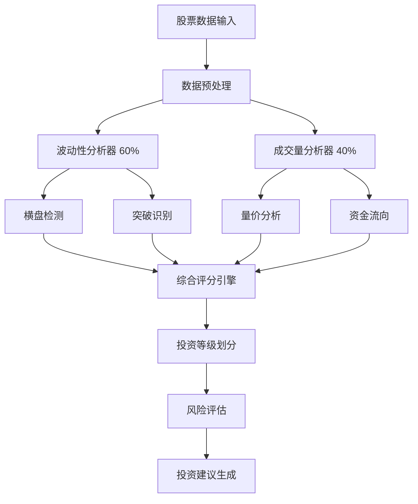

# 📊 算法详解

## 🎯 算法架构总览

AI股票聊天助手的核心竞争力在于其强大的量化分析算法系统。我们采用多维度分析方法，通过波动性分析、成交量分析和智能评分机制，系统性识别具有投资价值的股票机会。



## 📈 深度分析系统

### 💡 系统设计理念
深度分析系统是项目的核心创新功能，采用模块化设计，实现了数据收集、量化分析、结果展示的完整闭环。

#### 核心组件架构
```
StockDeepAnalysisService (主控制器)
├── VolatilityAnalyzer (波动性分析器)     - 权重60%
├── VolumeAnalyzer (成交量分析器)         - 权重40%  
├── AutoPoolManager (自动股票池管理器)    - 智能筛选
└── DatabaseManager (数据存储层)         - 结果持久化
```

## 📊 波动性分析算法

### 🎯 核心策略：低波动横盘突破识别
波动性分析专注于识别具有突破潜力的低波动整理形态，这类股票通常具有较好的风险收益比。

```python
class VolatilityAnalyzer:
    """波动性分析引擎 - 专注识别横盘整理和突破信号"""
    
    def __init__(self):
        self.sideways_threshold = 0.20      # 横盘波动阈值20%
        self.min_sideways_days = 15         # 最少横盘15天
        self.breakout_threshold = 0.02      # 突破确认2%
        self.confirmation_days = 2          # 突破确认天数
```

### 横盘整理检测算法
使用滑动窗口技术检测价格的横盘整理模式：

```python
def _detect_sideways_consolidation(self, price_data: List[PriceData]) -> Dict:
    """滑动窗口检测横盘整理"""
    
    for i in range(len(price_data) - self.min_sideways_days):
        window = price_data[i:i + self.min_sideways_days]
        
        # 计算价格波动率
        max_price = max(data.close for data in window)
        min_price = min(data.close for data in window)
        volatility = (max_price - min_price) / min_price
        
        if volatility <= self.sideways_threshold:
            # 检测到横盘整理
            consolidation_period = {
                'start_date': window[0].date,
                'end_date': window[-1].date,
                'days': len(window),
                'volatility': volatility,
                'support_level': min_price,
                'resistance_level': max_price,
                'quality_score': self._calculate_consolidation_quality(window)
            }
            return consolidation_period
    
    return None

def _calculate_consolidation_quality(self, window: List[PriceData]) -> float:
    """计算横盘整理质量评分"""
    # 价格分布均匀性
    price_range = max(data.close for data in window) - min(data.close for data in window)
    avg_price = sum(data.close for data in window) / len(window)
    
    # 计算价格偏离度
    deviations = [abs(data.close - avg_price) / avg_price for data in window]
    avg_deviation = sum(deviations) / len(deviations)
    
    # 质量评分：偏离度越小，质量越高
    quality_score = max(0, 1 - avg_deviation * 10)
    return min(quality_score, 1.0)
```

### 突破信号检测算法
识别价格突破横盘区间的有效信号：

```python
def _detect_breakout_signals(self, price_data: List[PriceData], 
                           support_level: float, 
                           resistance_level: float) -> Dict:
    """突破信号识别"""
    
    for i in range(len(price_data) - self.confirmation_days):
        current_price = price_data[i].close
        
        # 向上突破检测
        if current_price > resistance_level * (1 + self.breakout_threshold):
            # 确认机制：连续2天维持突破
            confirmed = all(
                price_data[i + j].close > resistance_level 
                for j in range(self.confirmation_days)
            )
            
            if confirmed:
                # 计算突破强度
                breakout_strength = (current_price - resistance_level) / resistance_level
                
                # 分析突破成交量
                volume_confirmation = self._analyze_breakout_volume(price_data[i:i+3])
                
                return {
                    'direction': 'upward',
                    'breakout_date': price_data[i].date,
                    'breakout_price': current_price,
                    'strength': breakout_strength,
                    'volume_confirmed': volume_confirmation,
                    'confidence': self._calculate_breakout_confidence(breakout_strength, volume_confirmation)
                }
    
    return None

def _calculate_breakout_confidence(self, strength: float, volume_confirmed: bool) -> float:
    """计算突破信号置信度"""
    base_confidence = min(strength / 0.1, 1.0)  # 基于突破强度
    volume_bonus = 0.2 if volume_confirmed else 0  # 成交量确认加成
    
    return min(base_confidence + volume_bonus, 1.0)
```

### 波动性评分机制 (10分制)
基于多个维度计算综合的波动性评分：

```python
def _calculate_volatility_score(self, analysis_result: Dict) -> float:
    """波动性综合评分算法"""
    
    score = 0.0
    
    # 1. 横盘质量评分 (4分) - 40%权重
    if analysis_result.get('sideways_consolidation'):
        consolidation = analysis_result['sideways_consolidation']
        
        # 时间因子：横盘时间越长分数越高 (0-2分)
        time_factor = min(consolidation['days'] / 30, 1.0)
        time_score = time_factor * 2
        
        # 稳定性因子：波动越小分数越高 (0-2分)
        volatility = consolidation['volatility']
        stability_factor = max(0, (20 - volatility * 100) / 20)
        stability_score = stability_factor * 2
        
        # 质量因子：整理质量评分 (0-1分)
        quality_score = consolidation.get('quality_score', 0)
        
        score += time_score + stability_score + quality_score
    
    # 2. 突破信号评分 (3分) - 30%权重
    if analysis_result.get('breakout_signal'):
        breakout = analysis_result['breakout_signal']
        if breakout['direction'] == 'upward':
            # 基础突破分数 (0-2分)
            strength_score = min(breakout['strength'] / 0.05, 1.0) * 2
            
            # 置信度加成 (0-1分)
            confidence_score = breakout['confidence']
            
            score += strength_score + confidence_score
        elif breakout['direction'] == 'downward':
            score -= 2.0  # 向下突破扣分
    
    # 3. 历史波动率评分 (2分) - 20%权重
    historical_vol = analysis_result.get('historical_volatility', 0)
    if 10 <= historical_vol <= 30:      # 适中波动率
        score += 2.0
    elif historical_vol < 10:           # 低波动率
        score += 1.5
    elif historical_vol > 50:           # 高波动率扣分
        score -= 1.0
    
    # 4. 价格稳定性评分 (1分) - 10%权重
    price_volatility = analysis_result.get('price_volatility', 0)
    if price_volatility <= 25:
        score += 1.0
    elif price_volatility > 50:
        score -= 0.5
    
    return round(min(max(score, 0), 10.0), 1)
```

## 📈 成交量分析算法

### 🎯 核心分析维度
成交量分析关注量价关系、资金流向和成交量形态，判断市场参与度和资金动向。

```python
class VolumeAnalyzer:
    """成交量分析引擎 - 分析量价关系和资金流向"""
    
    def __init__(self):
        self.volume_breakout_threshold = 2.0    # 成交量突破2倍
        self.high_volume_threshold = 1.5        # 高成交量1.5倍
        self.correlation_window = 20            # 相关性计算窗口
        self.min_correlation = 0.3              # 最小相关性阈值
```

### 成交量突破检测
识别异常放量和成交量突破信号：

```python
def _detect_volume_breakout(self, volume_data: List[VolumeData]) -> Dict:
    """成交量突破检测算法"""
    
    # 计算多期平均成交量
    avg_volume_30d = sum(data.volume for data in volume_data[-30:]) / 30
    avg_volume_10d = sum(data.volume for data in volume_data[-10:]) / 10
    avg_volume_5d = sum(data.volume for data in volume_data[-5:]) / 5
    
    recent_volume = volume_data[-1].volume
    volume_ratio = recent_volume / avg_volume_30d
    
    # 突破检测
    if volume_ratio >= self.volume_breakout_threshold:
        # 检查持续性
        consecutive_days = 0
        for i in range(len(volume_data) - 1, -1, -1):
            if volume_data[i].volume >= avg_volume_30d * self.high_volume_threshold:
                consecutive_days += 1
            else:
                break
        
        # 分析放量类型
        breakout_type = self._classify_volume_breakout(
            recent_volume, avg_volume_5d, avg_volume_10d, avg_volume_30d
        )
        
        # 计算突破强度
        breakout_strength = self._calculate_volume_strength(
            volume_ratio, consecutive_days, breakout_type
        )
        
        return {
            'has_breakout': True,
            'breakout_ratio': volume_ratio,
            'consecutive_days': consecutive_days,
            'avg_volume_30d': avg_volume_30d,
            'breakout_type': breakout_type,
            'strength': breakout_strength
        }
    
    return {'has_breakout': False}

def _classify_volume_breakout(self, current: int, avg_5d: int, avg_10d: int, avg_30d: int) -> str:
    """分类成交量突破类型"""
    if current > avg_5d * 3:
        return 'explosive'      # 爆发性放量
    elif current > avg_10d * 2:
        return 'significant'    # 显著放量
    elif current > avg_30d * 1.5:
        return 'moderate'       # 温和放量
    else:
        return 'normal'         # 正常水平
```

### 量价关系分析
使用统计相关性分析量价配合情况：

```python
def _analyze_price_volume_correlation(self, 
                                    price_data: List[PriceData],
                                    volume_data: List[VolumeData]) -> Dict:
    """量价相关性分析"""
    
    # 计算价格变化率和成交量变化率
    price_changes = []
    volume_changes = []
    
    for i in range(1, len(price_data)):
        price_change = (price_data[i].close - price_data[i-1].close) / price_data[i-1].close
        volume_change = (volume_data[i].volume - volume_data[i-1].volume) / volume_data[i-1].volume
        
        price_changes.append(price_change)
        volume_changes.append(volume_change)
    
    # 皮尔逊相关系数计算
    correlation = self._calculate_correlation(price_changes, volume_changes)
    
    # 量价关系判定
    if correlation >= self.min_correlation:
        if correlation > 0:
            trend = 'bullish'      # 量价齐升
            interpretation = '价升量增，多头趋势'
        else:
            trend = 'bearish'      # 量价齐跌
            interpretation = '价跌量减，空头趋势'
    else:
        trend = 'divergence'       # 量价背离
        interpretation = '量价背离，需要关注'
    
    # 计算量价配合度评分
    coordination_score = self._calculate_coordination_score(correlation, price_changes, volume_changes)
    
    return {
        'correlation': correlation,
        'price_volume_trend': trend,
        'interpretation': interpretation,
        'is_coordinated': abs(correlation) >= self.min_correlation,
        'coordination_score': coordination_score
    }

def _calculate_coordination_score(self, correlation: float, price_changes: List[float], volume_changes: List[float]) -> float:
    """计算量价配合度评分"""
    # 基础相关性评分
    base_score = abs(correlation) * 5  # 0-5分
    
    # 趋势一致性评分
    positive_price_days = sum(1 for change in price_changes[-10:] if change > 0)
    positive_volume_days = sum(1 for change in volume_changes[-10:] if change > 0)
    consistency = abs(positive_price_days - positive_volume_days) / 10
    consistency_score = (1 - consistency) * 3  # 0-3分
    
    # 强度匹配度评分
    avg_price_change = abs(sum(price_changes[-10:]) / 10)
    avg_volume_change = abs(sum(volume_changes[-10:]) / 10)
    strength_ratio = min(avg_price_change, avg_volume_change) / max(avg_price_change, avg_volume_change)
    strength_score = strength_ratio * 2  # 0-2分
    
    return min(base_score + consistency_score + strength_score, 10.0)
```

### 资金流向分析 (A/D Line)
使用累积分布线分析资金流向：

```python
def _analyze_money_flow(self, price_data: List[PriceData]) -> Dict:
    """累积分布线分析 - 判断资金流向"""
    
    ad_line_values = []
    ad_line = 0
    money_flow_volume_total = 0
    
    for data in price_data:
        # 资金流量乘数计算
        if data.high != data.low:
            money_flow_multiplier = (
                ((data.close - data.low) - (data.high - data.close)) / 
                (data.high - data.low)
            )
        else:
            money_flow_multiplier = 0
        
        # 资金流量计算
        money_flow_volume = money_flow_multiplier * data.volume
        money_flow_volume_total += money_flow_volume
        ad_line += money_flow_volume
        ad_line_values.append(ad_line)
    
    # 趋势判断
    recent_avg = sum(ad_line_values[-10:]) / 10      # 近10日均值
    earlier_avg = sum(ad_line_values[-30:-10]) / 20  # 前20日均值
    
    # 流向判断
    if recent_avg > earlier_avg * 1.05:
        direction = 'inflow'       # 资金流入
        strength = (recent_avg - earlier_avg) / abs(earlier_avg)
    elif recent_avg < earlier_avg * 0.95:
        direction = 'outflow'      # 资金流出
        strength = (earlier_avg - recent_avg) / abs(earlier_avg)
    else:
        direction = 'balanced'     # 平衡
        strength = 0
    
    # 流向趋势分析
    trend_slope = self._calculate_ad_line_slope(ad_line_values[-20:])
    
    return {
        'money_flow_direction': direction,
        'flow_strength': min(abs(strength), 1.0),
        'ad_line_trend': 'up' if trend_slope > 0 else 'down',
        'trend_strength': abs(trend_slope),
        'total_flow_volume': money_flow_volume_total
    }

def _calculate_ad_line_slope(self, ad_values: List[float]) -> float:
    """计算A/D线趋势斜率"""
    if len(ad_values) < 2:
        return 0
    
    x = list(range(len(ad_values)))
    y = ad_values
    
    # 线性回归计算斜率
    n = len(ad_values)
    sum_x = sum(x)
    sum_y = sum(y)
    sum_xy = sum(x[i] * y[i] for i in range(n))
    sum_x2 = sum(x_val ** 2 for x_val in x)
    
    slope = (n * sum_xy - sum_x * sum_y) / (n * sum_x2 - sum_x ** 2)
    return slope
```

### 成交量评分机制 (10分制)
基于多个维度计算成交量分析评分：

```python
def _calculate_volume_score(self, analysis_result: Dict) -> float:
    """成交量综合评分算法"""
    
    score = 0.0
    
    # 1. 成交量突破评分 (3分) - 30%权重
    if analysis_result.get('volume_breakout', {}).get('has_breakout'):
        breakout = analysis_result['volume_breakout']
        
        # 突破强度评分 (0-2分)
        ratio = breakout['breakout_ratio']
        if ratio >= 5:
            strength_score = 2.0
        elif ratio >= 3:
            strength_score = 1.5
        elif ratio >= 2:
            strength_score = 1.0
        else:
            strength_score = 0.5
        
        # 持续性评分 (0-1分)
        persistence = min(breakout['consecutive_days'] / 5, 1.0)
        
        score += strength_score + persistence
    
    # 2. 量价关系评分 (2.5分) - 25%权重
    correlation_analysis = analysis_result.get('price_volume_correlation', {})
    trend = correlation_analysis.get('price_volume_trend', 'divergence')
    coordination_score = correlation_analysis.get('coordination_score', 0)
    
    if trend == 'bullish':
        score += 2.5 * (coordination_score / 10)
    elif trend == 'bearish':
        score += 1.0 * (coordination_score / 10)  # 下跌趋势分数较低
    elif trend == 'divergence':
        score -= 1.0  # 量价背离扣分
    
    # 3. 资金流向评分 (2.5分) - 25%权重
    money_flow = analysis_result.get('money_flow', {})
    direction = money_flow.get('money_flow_direction', 'balanced')
    flow_strength = money_flow.get('flow_strength', 0)
    
    if direction == 'inflow':
        score += 2.5 * flow_strength
    elif direction == 'outflow':
        score -= 1.5 * flow_strength
    
    # 4. 成交量形态评分 (2分) - 20%权重
    # 基于成交量分布和稳定性
    volume_pattern_score = self._analyze_volume_pattern(analysis_result)
    score += volume_pattern_score
    
    return round(min(max(score, 0), 10.0), 1)

def _analyze_volume_pattern(self, analysis_result: Dict) -> float:
    """分析成交量形态特征"""
    pattern_score = 0.0
    
    # 成交量稳定性
    volume_breakout = analysis_result.get('volume_breakout', {})
    if volume_breakout.get('breakout_type') == 'moderate':
        pattern_score += 1.0  # 温和放量较好
    elif volume_breakout.get('breakout_type') == 'explosive':
        pattern_score += 0.5  # 爆发性放量需观察后续
    
    # A/D线趋势
    money_flow = analysis_result.get('money_flow', {})
    if money_flow.get('ad_line_trend') == 'up':
        pattern_score += 1.0
    elif money_flow.get('ad_line_trend') == 'down':
        pattern_score -= 0.5
    
    return min(max(pattern_score, 0), 2.0)
```

## 🎯 综合深度分析服务

### 核心控制器
```python
class StockDeepAnalysisService:
    """深度分析主控制器"""
    
    def __init__(self):
        self.volatility_analyzer = VolatilityAnalyzer()
        self.volume_analyzer = VolumeAnalyzer()
        self.auto_pool_manager = AutoPoolManager()
        self.volatility_weight = 0.6    # 波动性权重60%
        self.volume_weight = 0.4        # 成交量权重40%
    
    async def analyze_stock(self, stock_code: str) -> DeepAnalysisResult:
        """执行股票深度分析"""
        
        # 1. 数据收集
        price_data, volume_data = await self._collect_analysis_data(stock_code)
        
        # 2. 并发分析
        volatility_task = self.volatility_analyzer.analyze(price_data)
        volume_task = self.volume_analyzer.analyze(price_data, volume_data)
        
        volatility_result, volume_result = await asyncio.gather(
            volatility_task, volume_task
        )
        
        # 3. 综合评估
        overall_score = (
            volatility_result.volatility_score * self.volatility_weight +
            volume_result.volume_score * self.volume_weight
        )
        
        # 4. 投资等级划分
        investment_grade = self._determine_investment_grade(overall_score)
        
        # 5. 关键特征识别
        key_features = self._identify_key_features(volatility_result, volume_result)
        
        # 6. 风险评估
        risk_level, risk_factors = self._assess_risk_level(volatility_result, volume_result)
        
        # 7. 投资建议生成
        recommendation = self._generate_recommendation(overall_score, risk_level)
        
        return DeepAnalysisResult(
            stock_code=stock_code,
            overall_score=overall_score,
            investment_grade=investment_grade,
            volatility_analysis=volatility_result,
            volume_analysis=volume_result,
            key_features=key_features,
            risk_level=risk_level,
            recommendation=recommendation,
            analysis_timestamp=datetime.now().isoformat()
        )
```

### 投资等级划分算法
```python
def _determine_investment_grade(self, overall_score: float) -> str:
    """投资等级智能划分"""
    
    if overall_score >= 8.5:
        return 'A'      # 强烈推荐 - 优质投资机会
    elif overall_score >= 7.0:
        return 'B'      # 推荐 - 较好投资机会
    elif overall_score >= 5.5:
        return 'C'      # 观察 - 谨慎关注
    else:
        return 'D'      # 回避 - 不建议投资
```

### 关键特征识别算法
```python
def _identify_key_features(self, volatility_result: Dict, volume_result: Dict) -> Dict:
    """关键投资特征识别"""
    
    # 低波动突破特征
    is_low_volatility_breakout = (
        volatility_result.get('sideways_consolidation') and
        volatility_result.get('breakout_signal', {}).get('direction') == 'upward' and
        volatility_result.get('sideways_period_days', 0) >= 20
    )
    
    # 量价配合特征
    is_volume_price_coordinated = (
        volume_result.get('volume_breakout', {}).get('has_breakout') and
        volume_result.get('price_volume_correlation', {}).get('price_volume_trend') == 'bullish' and
        volume_result.get('money_flow', {}).get('money_flow_direction') == 'inflow'
    )
    
    # 技术形态特征
    has_technical_pattern = (
        volatility_result.get('volatility_score', 0) >= 7.0 or
        volume_result.get('volume_score', 0) >= 7.0
    )
    
    # 值得关注判定
    is_worthy_of_attention = (
        is_low_volatility_breakout or 
        is_volume_price_coordinated or
        has_technical_pattern
    )
    
    return {
        'is_low_volatility_breakout': is_low_volatility_breakout,
        'is_volume_price_coordinated': is_volume_price_coordinated,
        'has_technical_pattern': has_technical_pattern,
        'is_worthy_of_attention': is_worthy_of_attention,
        'pattern_type': self._classify_pattern_type(volatility_result, volume_result)
    }

def _classify_pattern_type(self, volatility_result: Dict, volume_result: Dict) -> str:
    """分类技术形态类型"""
    if volatility_result.get('breakout_signal'):
        return 'breakout_pattern'      # 突破形态
    elif volume_result.get('volume_breakout', {}).get('has_breakout'):
        return 'volume_pattern'        # 成交量形态
    elif volatility_result.get('sideways_consolidation'):
        return 'consolidation_pattern' # 整理形态
    else:
        return 'unclear_pattern'       # 形态不明
```

## 🔍 股票筛选算法

### 多维度筛选引擎
```python
class StockScreeningService:
    """股票筛选服务 - 多维度量化筛选"""
    
    async def screen_strong_rise_stocks(self, criteria: ScreeningCriteria) -> List[ScreeningResult]:
        """筛选连续强势上涨股票"""
        
        # 获取股票基础列表
        stock_list = await self._get_stock_universe(criteria.market_filter)
        
        # 并发筛选处理
        screening_tasks = []
        batch_size = 50  # 每批处理50只股票
        
        for i in range(0, len(stock_list), batch_size):
            batch = stock_list[i:i + batch_size]
            task = self._screen_stock_batch(batch, criteria)
            screening_tasks.append(task)
        
        # 执行并发筛选
        batch_results = await asyncio.gather(*screening_tasks, return_exceptions=True)
        
        # 合并结果
        all_results = []
        for result in batch_results:
            if isinstance(result, list):
                all_results.extend(result)
        
        # 排序和去重
        filtered_results = self._filter_and_sort_results(all_results, criteria)
        
        return filtered_results

def _analyze_consecutive_rises(self, hist_data: List[Dict], criteria: ScreeningCriteria) -> Dict:
    """分析连续涨幅 - 核心筛选逻辑"""
    if len(hist_data) < criteria.min_consecutive_days:
        return {'is_qualified': False}
    
    # 按日期排序（最新的在前）
    sorted_data = sorted(hist_data, key=lambda x: x['trade_date'], reverse=True)
    
    consecutive_rises = []
    total_volume = 0
    rise_quality_scores = []
    
    # 分析最近N天的连续涨幅
    for i in range(criteria.min_consecutive_days):
        day_data = sorted_data[i]
        change_percent = day_data['change_percent']
        
        if change_percent <= 0:
            return {'is_qualified': False}
        
        # 计算涨幅质量评分
        quality_score = self._calculate_rise_quality(day_data, sorted_data[i:i+5])
        
        consecutive_rises.append({
            'date': day_data['trade_date'],
            'change_percent': change_percent,
            'volume': day_data['volume'],
            'close_price': day_data['close_price'],
            'quality_score': quality_score
        })
        
        total_volume += day_data['volume']
        rise_quality_scores.append(quality_score)
    
    # 计算平均涨幅和质量
    avg_rise_percent = sum(day['change_percent'] for day in consecutive_rises) / len(consecutive_rises)
    avg_volume = total_volume // len(consecutive_rises)
    avg_quality = sum(rise_quality_scores) / len(rise_quality_scores)
    
    # 检查是否满足筛选条件
    is_qualified = (
        avg_rise_percent >= criteria.min_rise_percent and
        avg_volume >= criteria.min_volume and
        avg_quality >= 0.6  # 质量阈值
    )
    
    return {
        'is_qualified': is_qualified,
        'consecutive_days': len(consecutive_rises),
        'avg_rise_percent': round(avg_rise_percent, 2),
        'total_volume': total_volume,
        'avg_volume': avg_volume,
        'avg_quality': round(avg_quality, 2),
        'daily_changes': consecutive_rises
    }

def _calculate_rise_quality(self, day_data: Dict, context_data: List[Dict]) -> float:
    """计算单日涨幅质量评分"""
    quality_score = 0.0
    
    # 1. 涨幅适中性 (0-0.3分)
    change_percent = day_data['change_percent']
    if 2 <= change_percent <= 8:
        quality_score += 0.3
    elif 8 < change_percent <= 15:
        quality_score += 0.2
    elif change_percent > 15:
        quality_score += 0.1  # 涨幅过大质量较低
    
    # 2. 成交量配合度 (0-0.3分)
    if len(context_data) >= 2:
        prev_volume = context_data[1]['volume']
        current_volume = day_data['volume']
        volume_ratio = current_volume / prev_volume if prev_volume > 0 else 1
        
        if 1.2 <= volume_ratio <= 3.0:
            quality_score += 0.3
        elif volume_ratio > 3.0:
            quality_score += 0.2
    
    # 3. 价格位置 (0-0.2分)
    # 基于近期价格计算相对位置
    if len(context_data) >= 5:
        recent_prices = [data['close_price'] for data in context_data]
        current_price = day_data['close_price']
        price_percentile = (current_price - min(recent_prices)) / (max(recent_prices) - min(recent_prices))
        
        if 0.7 <= price_percentile <= 0.9:
            quality_score += 0.2
        elif price_percentile > 0.9:
            quality_score += 0.1
    
    # 4. 趋势连续性 (0-0.2分)
    if len(context_data) >= 3:
        trend_consistency = self._check_trend_consistency(context_data[:3])
        quality_score += trend_consistency * 0.2
    
    return min(quality_score, 1.0)
```

## ⚙️ 自动股票池管理算法

### 智能筛选配置
```python
@dataclass
class AutoPoolConfig:
    """自动池管理配置"""
    min_overall_score: float = 6.0                    # 最低综合评分
    min_volatility_score: float = 6.5                 # 最低波动性评分
    min_volume_score: float = 5.5                     # 最低成交量评分
    require_low_volatility_breakout: bool = True      # 必须低波动突破
    require_volume_coordination: bool = True          # 必须量价配合
    min_sideways_days: int = 20                       # 最少横盘天数
    allowed_investment_grades: List[str] = ['A', 'B'] # 允许投资等级
    max_risk_level: str = "medium"                    # 最高风险等级
    max_auto_additions_per_day: int = 10              # 每日最大添加数量
```

### 多重筛选算法
```python
def _filter_qualified_stocks(self, analysis_results: List[DeepAnalysisResult]) -> List[DeepAnalysisResult]:
    """多重条件筛选算法"""
    
    qualified_stocks = []
    daily_addition_count = 0
    
    for result in analysis_results:
        # 检查每日添加限制
        if daily_addition_count >= self.config.max_auto_additions_per_day:
            break
        
        # 基础评分检查
        if not (result.overall_score >= self.config.min_overall_score and
                result.volatility_analysis.volatility_score >= self.config.min_volatility_score and
                result.volume_analysis.volume_score >= self.config.min_volume_score):
            continue
        
        # 投资等级检查
        if result.investment_grade not in self.config.allowed_investment_grades:
            continue
        
        # 风险等级检查
        if not self._is_risk_level_acceptable(result.risk_level):
            continue
        
        # 特征要求检查
        if self.config.require_low_volatility_breakout:
            if not (result.key_features.is_low_volatility_breakout and
                    result.volatility_analysis.sideways_period_days >= self.config.min_sideways_days):
                continue
        
        if self.config.require_volume_coordination:
            if not result.key_features.is_volume_price_coordinated:
                continue
        
        # 重复性检查
        if await self._is_already_in_pool(result.stock_code):
            continue
        
        # 市场环境检查
        market_sentiment = await self._check_market_sentiment()
        if market_sentiment == 'bearish' and result.risk_level == 'high':
            continue
        
        qualified_stocks.append(result)
        daily_addition_count += 1
    
    return qualified_stocks
```

## 📊 算法性能指标

### 评分体系总结
```python
# 波动性评分权重分配 (总分10分)
横盘质量评分:    4分 (40%) - 时间因子 + 稳定性因子 + 质量因子
突破信号评分:    3分 (30%) - 方向 + 强度 + 置信度
历史波动率评分:  2分 (20%) - 适中波动率偏好
价格稳定性评分:  1分 (10%) - 相对稳定性

# 成交量评分权重分配 (总分10分)  
成交量突破评分:  3分 (30%) - 突破强度 + 持续性
量价关系评分:    2.5分 (25%) - 配合度 + 相关性
资金流向评分:    2.5分 (25%) - 流向 + 强度
成交量形态评分:  2分 (20%) - 形态特征

# 综合评分计算
总评分 = 波动性评分 × 60% + 成交量评分 × 40%

# 投资等级标准
A级: 8.5+ 分 (强烈推荐)
B级: 7.0-8.4 分 (推荐)  
C级: 5.5-6.9 分 (观察)
D级: <5.5 分 (回避)
```

### 关键阈值配置
```python
# 核心参数设置
算法参数配置 = {
    "横盘检测": {
        "波动阈值": "20%",
        "最小天数": "15天",
        "检测窗口": "滑动窗口"
    },
    "突破确认": {
        "突破幅度": "2%",
        "确认天数": "2天", 
        "强度评估": "基于突破幅度"
    },
    "成交量分析": {
        "突破倍数": "2.0倍",
        "高量阈值": "1.5倍",
        "相关性阈值": "0.3"
    },
    "风险控制": {
        "高波动率": ">40%",
        "资金流出": "<-5%",
        "量价背离": "相关性<0.3"
    }
}
```

这套深度分析算法通过多维度技术分析、智能量化评分和自动化管理，为股票投资提供了系统性的决策支持。算法特别专注于识别低风险、高潜力的横盘突破投资机会，结合严格的风险控制机制，为投资者提供科学、可靠的投资建议。

---

**下一步**: 查看其他专项文档了解更多实现细节，或参考 [故障排除](09-troubleshooting.md) 解决常见问题。