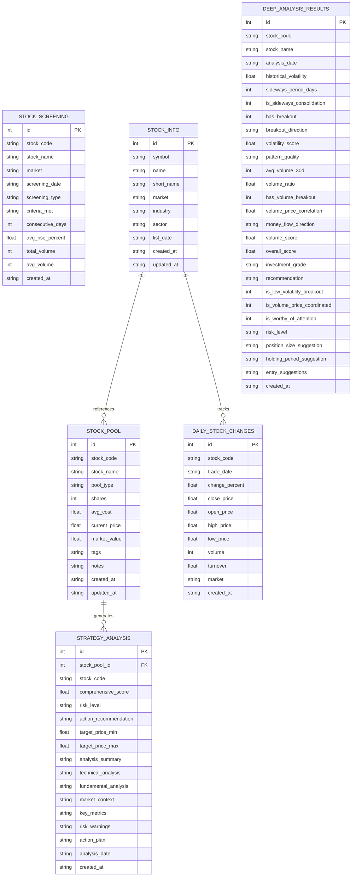

# 💾 数据库设计

## 🎯 数据库概述

AI股票聊天助手使用SQLite作为主要数据存储解决方案，设计了完整的数据模型来支持股票池管理、策略分析、筛选结果等核心功能。

### 数据库特性
- **数据库引擎**: SQLite 3.35+
- **文件位置**: `backend/stock_pool.db`
- **字符编码**: UTF-8
- **事务支持**: ACID完整性
- **并发控制**: 读写锁机制

## 📊 数据模型架构



## 📋 表结构详解

### 1. 股票池表 (stock_pool)
存储用户的股票投资组合信息。

```sql
CREATE TABLE stock_pool (
    id INTEGER PRIMARY KEY AUTOINCREMENT,
    stock_code TEXT NOT NULL,                    -- 股票代码
    stock_name TEXT NOT NULL,                    -- 股票名称
    pool_type TEXT NOT NULL CHECK(pool_type IN ('holding', 'potential')), -- 池类型
    shares INTEGER DEFAULT 0,                    -- 持股数量
    avg_cost REAL DEFAULT 0.0,                  -- 平均成本
    current_price REAL DEFAULT 0.0,             -- 当前价格
    market_value REAL DEFAULT 0.0,              -- 市值
    tags TEXT DEFAULT '',                       -- 标签(JSON格式)
    notes TEXT DEFAULT '',                      -- 备注信息
    created_at TEXT NOT NULL,                   -- 创建时间
    updated_at TEXT NOT NULL,                   -- 更新时间
    UNIQUE(stock_code, pool_type)               -- 复合唯一索引
);

-- 索引
CREATE INDEX idx_stock_pool_type ON stock_pool(pool_type);
CREATE INDEX idx_stock_pool_code ON stock_pool(stock_code);
CREATE INDEX idx_stock_pool_created ON stock_pool(created_at);
```

**数据示例**:
```sql
INSERT INTO stock_pool VALUES (
    1, '000001', '平安银行', 'holding', 1000, 12.50, 13.20, 13200.00,
    '["银行股", "价值投资"]', '长期持有', 
    '2025-09-25T10:00:00', '2025-09-25T15:30:00'
);
```

### 2. AI策略分析表 (strategy_analysis)
存储AI生成的投资策略分析结果。

```sql
CREATE TABLE strategy_analysis (
    id INTEGER PRIMARY KEY AUTOINCREMENT,
    stock_pool_id INTEGER NOT NULL,             -- 关联股票池ID
    stock_code TEXT NOT NULL,                   -- 股票代码
    comprehensive_score REAL,                   -- 综合评分(1-10)
    risk_level TEXT,                           -- 风险等级(low/medium/high)
    action_recommendation TEXT,                 -- 操作建议(buy/hold/reduce/sell)
    target_price_min REAL,                     -- 目标价位下限
    target_price_max REAL,                     -- 目标价位上限
    analysis_summary TEXT,                     -- 分析摘要
    technical_analysis TEXT,                   -- 技术分析
    fundamental_analysis TEXT,                 -- 基本面分析
    market_context TEXT,                       -- 市场环境
    key_metrics TEXT,                          -- 关键指标(JSON)
    risk_warnings TEXT,                        -- 风险提示(JSON)
    action_plan TEXT,                          -- 行动计划(JSON)
    analysis_date TEXT NOT NULL,               -- 分析日期
    created_at TEXT NOT NULL,                  -- 创建时间
    FOREIGN KEY (stock_pool_id) REFERENCES stock_pool(id) ON DELETE CASCADE
);

-- 索引
CREATE INDEX idx_strategy_stock_pool ON strategy_analysis(stock_pool_id);
CREATE INDEX idx_strategy_stock_code ON strategy_analysis(stock_code);
CREATE INDEX idx_strategy_date ON strategy_analysis(analysis_date);
CREATE INDEX idx_strategy_score ON strategy_analysis(comprehensive_score);
```

### 3. 股票筛选结果表 (stock_screening)
存储股票筛选算法的执行结果。

```sql
CREATE TABLE stock_screening (
    id INTEGER PRIMARY KEY AUTOINCREMENT,
    stock_code TEXT NOT NULL,                   -- 股票代码
    stock_name TEXT NOT NULL,                   -- 股票名称
    market TEXT NOT NULL,                       -- 市场(SH/SZ/HK)
    screening_date TEXT NOT NULL,               -- 筛选日期
    screening_type TEXT NOT NULL,               -- 筛选类型
    criteria_met TEXT,                          -- 满足条件(JSON)
    consecutive_days INTEGER,                   -- 连续天数
    avg_rise_percent REAL,                      -- 平均涨幅
    total_volume INTEGER,                       -- 总成交量
    avg_volume INTEGER,                         -- 平均成交量
    created_at TEXT NOT NULL                    -- 创建时间
);

-- 索引
CREATE INDEX idx_screening_date ON stock_screening(screening_date);
CREATE INDEX idx_screening_type ON stock_screening(screening_type);
CREATE INDEX idx_screening_code ON stock_screening(stock_code);
CREATE INDEX idx_screening_rise ON stock_screening(avg_rise_percent);
CREATE UNIQUE INDEX idx_screening_unique ON stock_screening(stock_code, screening_date, screening_type);
```

### 4. 股票基础信息表 (stock_info)
存储股票的基础信息和元数据。

```sql
CREATE TABLE stock_info (
    id INTEGER PRIMARY KEY AUTOINCREMENT,
    symbol TEXT UNIQUE NOT NULL,                -- 股票代码
    name TEXT NOT NULL,                         -- 股票全称
    short_name TEXT,                            -- 股票简称
    market TEXT NOT NULL,                       -- 交易市场
    industry TEXT,                              -- 行业分类
    sector TEXT,                                -- 板块分类
    list_date TEXT,                             -- 上市日期
    created_at TEXT NOT NULL,                   -- 创建时间
    updated_at TEXT NOT NULL                    -- 更新时间
);

-- 索引
CREATE UNIQUE INDEX idx_stock_info_symbol ON stock_info(symbol);
CREATE INDEX idx_stock_info_market ON stock_info(market);
CREATE INDEX idx_stock_info_industry ON stock_info(industry);
CREATE INDEX idx_stock_info_name ON stock_info(name);
```

### 5. 每日股价变动表 (daily_stock_changes)
存储股票每日的价格和成交量数据。

```sql
CREATE TABLE daily_stock_changes (
    id INTEGER PRIMARY KEY AUTOINCREMENT,
    stock_code TEXT NOT NULL,                   -- 股票代码
    trade_date TEXT NOT NULL,                   -- 交易日期
    change_percent REAL NOT NULL,               -- 涨跌幅(%)
    close_price REAL,                           -- 收盘价
    open_price REAL,                            -- 开盘价
    high_price REAL,                            -- 最高价
    low_price REAL,                             -- 最低价
    volume INTEGER,                             -- 成交量
    turnover REAL,                              -- 成交额
    market TEXT,                                -- 市场
    created_at TEXT NOT NULL,                   -- 创建时间
    UNIQUE(stock_code, trade_date)              -- 复合唯一索引
);

-- 索引
CREATE INDEX idx_daily_date ON daily_stock_changes(trade_date);
CREATE INDEX idx_daily_code ON daily_stock_changes(stock_code);
CREATE INDEX idx_daily_change ON daily_stock_changes(change_percent);
CREATE INDEX idx_daily_volume ON daily_stock_changes(volume);
```

### 6. 深度分析结果表 (deep_analysis_results)
存储深度分析算法的详细结果。

```sql
CREATE TABLE deep_analysis_results (
    id INTEGER PRIMARY KEY AUTOINCREMENT,
    stock_code TEXT NOT NULL,                   -- 股票代码
    stock_name TEXT NOT NULL,                   -- 股票名称
    analysis_date DATE NOT NULL,                -- 分析日期
    
    -- 波动性分析结果
    historical_volatility REAL,                 -- 历史波动率
    sideways_period_days INTEGER,              -- 横盘天数
    is_sideways_consolidation INTEGER,         -- 是否横盘整理
    has_breakout INTEGER,                      -- 是否突破
    breakout_direction TEXT,                   -- 突破方向
    volatility_score REAL,                    -- 波动性评分
    pattern_quality TEXT,                     -- 模式质量
    
    -- 成交量分析结果
    avg_volume_30d INTEGER,                   -- 30日平均成交量
    volume_ratio REAL,                        -- 成交量倍数
    has_volume_breakout INTEGER,              -- 成交量突破
    volume_price_correlation REAL,            -- 量价相关性
    money_flow_direction TEXT,                -- 资金流向
    volume_score REAL,                        -- 成交量评分
    
    -- 综合评估结果
    overall_score REAL,                       -- 综合评分
    investment_grade TEXT,                    -- 投资等级
    recommendation TEXT,                      -- 推荐建议
    is_low_volatility_breakout INTEGER,      -- 低波动突破
    is_volume_price_coordinated INTEGER,     -- 量价配合
    is_worthy_of_attention INTEGER,          -- 值得关注
    risk_level TEXT,                         -- 风险等级
    
    -- 投资建议
    position_size_suggestion TEXT,           -- 仓位建议
    holding_period_suggestion TEXT,          -- 持有期建议
    entry_suggestions TEXT,                  -- 入场建议(JSON)
    
    created_at TEXT NOT NULL                 -- 创建时间
);

-- 索引
CREATE INDEX idx_deep_stock_code ON deep_analysis_results(stock_code);
CREATE INDEX idx_deep_analysis_date ON deep_analysis_results(analysis_date);
CREATE INDEX idx_deep_investment_grade ON deep_analysis_results(investment_grade);
CREATE INDEX idx_deep_overall_score ON deep_analysis_results(overall_score);
CREATE INDEX idx_deep_worthy ON deep_analysis_results(is_worthy_of_attention);
```

## 🔧 数据库初始化

### 初始化脚本
```python
# database.py - 数据库初始化
import sqlite3
import os
from datetime import datetime

class DatabaseManager:
    def __init__(self, db_path: str = "stock_pool.db"):
        self.db_path = db_path
        self.init_database()
    
    def init_database(self):
        """初始化数据库表结构"""
        with sqlite3.connect(self.db_path) as conn:
            cursor = conn.cursor()
            
            # 创建所有表
            self._create_stock_pool_table(cursor)
            self._create_strategy_analysis_table(cursor)
            self._create_stock_screening_table(cursor)
            self._create_stock_info_table(cursor)
            self._create_daily_stock_changes_table(cursor)
            self._create_deep_analysis_results_table(cursor)
            
            # 创建索引
            self._create_indexes(cursor)
            
            conn.commit()
    
    def _create_stock_pool_table(self, cursor):
        """创建股票池表"""
        cursor.execute('''
            CREATE TABLE IF NOT EXISTS stock_pool (
                id INTEGER PRIMARY KEY AUTOINCREMENT,
                stock_code TEXT NOT NULL,
                stock_name TEXT NOT NULL,
                pool_type TEXT NOT NULL CHECK(pool_type IN ('holding', 'potential')),
                shares INTEGER DEFAULT 0,
                avg_cost REAL DEFAULT 0.0,
                current_price REAL DEFAULT 0.0,
                market_value REAL DEFAULT 0.0,
                tags TEXT DEFAULT '',
                notes TEXT DEFAULT '',
                created_at TEXT NOT NULL,
                updated_at TEXT NOT NULL,
                UNIQUE(stock_code, pool_type)
            )
        ''')
```

## 📊 数据操作示例

### 常用查询操作
```sql
-- 获取持仓股票列表
SELECT * FROM stock_pool 
WHERE pool_type = 'holding' 
ORDER BY market_value DESC;

-- 获取最新策略分析
SELECT sa.*, sp.stock_name 
FROM strategy_analysis sa
JOIN stock_pool sp ON sa.stock_pool_id = sp.id
WHERE sa.analysis_date >= date('now', '-7 days')
ORDER BY sa.comprehensive_score DESC;

-- 获取强势股票筛选结果
SELECT * FROM stock_screening 
WHERE screening_type = 'strong_rise_3d' 
  AND screening_date = (
    SELECT MAX(screening_date) 
    FROM stock_screening 
    WHERE screening_type = 'strong_rise_3d'
  )
ORDER BY avg_rise_percent DESC;

-- 获取值得关注的深度分析结果
SELECT * FROM deep_analysis_results 
WHERE is_worthy_of_attention = 1 
  AND overall_score >= 7.0
ORDER BY overall_score DESC, analysis_date DESC;
```

### 数据统计查询
```sql
-- 股票池统计
SELECT 
    pool_type,
    COUNT(*) as count,
    SUM(market_value) as total_value,
    AVG(current_price) as avg_price
FROM stock_pool 
GROUP BY pool_type;

-- 筛选结果统计
SELECT 
    screening_date,
    screening_type,
    COUNT(*) as stock_count,
    AVG(avg_rise_percent) as avg_rise,
    MAX(avg_rise_percent) as max_rise
FROM stock_screening 
WHERE screening_date >= date('now', '-30 days')
GROUP BY screening_date, screening_type
ORDER BY screening_date DESC;

-- 深度分析评级分布
SELECT 
    investment_grade,
    COUNT(*) as count,
    AVG(overall_score) as avg_score,
    MIN(overall_score) as min_score,
    MAX(overall_score) as max_score
FROM deep_analysis_results 
WHERE analysis_date >= date('now', '-7 days')
GROUP BY investment_grade
ORDER BY investment_grade;
```

## 🔧 数据维护

### 数据清理策略
```sql
-- 清理90天前的筛选结果
DELETE FROM stock_screening 
WHERE screening_date < date('now', '-90 days');

-- 清理180天前的每日数据
DELETE FROM daily_stock_changes 
WHERE trade_date < date('now', '-180 days');

-- 清理60天前的深度分析结果
DELETE FROM deep_analysis_results 
WHERE analysis_date < date('now', '-60 days');
```

### 数据备份脚本
```bash
#!/bin/bash
# backup_database.sh

DB_PATH="backend/stock_pool.db"
BACKUP_DIR="backup"
TIMESTAMP=$(date +"%Y%m%d_%H%M%S")
BACKUP_FILE="${BACKUP_DIR}/stock_pool_${TIMESTAMP}.db"

# 创建备份目录
mkdir -p $BACKUP_DIR

# 执行备份
sqlite3 $DB_PATH ".backup ${BACKUP_FILE}"

# 压缩备份文件
gzip $BACKUP_FILE

echo "数据库已备份到: ${BACKUP_FILE}.gz"

# 保留最近30天的备份文件
find $BACKUP_DIR -name "*.gz" -mtime +30 -delete
```

### 数据库性能优化
```sql
-- 重建索引
REINDEX;

-- 优化数据库
VACUUM;

-- 分析表统计信息
ANALYZE;

-- 检查数据库完整性
PRAGMA integrity_check;

-- 查看数据库大小
SELECT 
    name,
    COUNT(*) as row_count,
    (SELECT COUNT(*) FROM pragma_table_info(name)) as column_count
FROM sqlite_master 
WHERE type = 'table' 
  AND name NOT LIKE 'sqlite_%'
GROUP BY name
ORDER BY row_count DESC;
```

## 🔐 数据安全

### 访问权限控制
```python
# 数据库连接安全配置
def get_connection(self):
    """获取安全的数据库连接"""
    conn = sqlite3.connect(
        self.db_path,
        timeout=20.0,
        check_same_thread=False
    )
    conn.execute('PRAGMA foreign_keys = ON')
    conn.execute('PRAGMA journal_mode = WAL')
    return conn
```

### 数据验证规则
```python
def validate_stock_pool_data(data):
    """验证股票池数据"""
    if not data.get('stock_code'):
        raise ValueError("股票代码不能为空")
    
    if data.get('shares', 0) < 0:
        raise ValueError("持股数量不能为负数")
    
    if data.get('avg_cost', 0) < 0:
        raise ValueError("平均成本不能为负数")
    
    if data.get('pool_type') not in ['holding', 'potential']:
        raise ValueError("池类型必须是 holding 或 potential")
```

---

数据库设计遵循了规范化原则，确保数据一致性和完整性，同时通过合理的索引设计保证了查询性能。所有时间字段统一使用ISO 8601格式存储，便于国际化和时区处理。