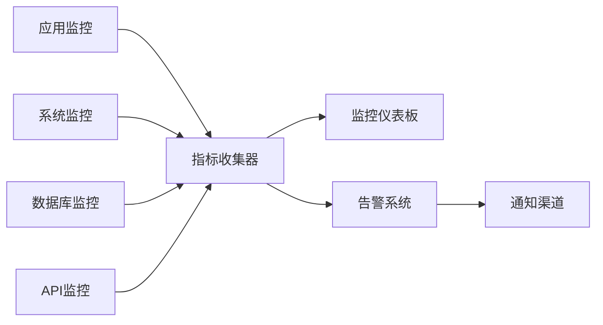

# 📊 性能监控

**文档版本**: v2.3.0  
**更新日期**: 2025年11月20日  
**监控类型**: 全方位性能监控

## 🎯 监控概述

本文档详细介绍了AI股票聊天助手的性能监控体系，包括应用性能、系统资源、数据质量等多个维度的监控策略。

## 📈 监控架构



## ⚡ 性能指标

### 📊 响应时间
```yaml
响应时间:
  - API平均响应: <100ms
  - 数据库查询: <10ms
  - 前端渲染: <50ms

并发能力:
  - 同时在线用户: 100+
  - 并发API请求: 50+
  - WebSocket连接: 20+

数据处理:
  - 单次筛选股票: 10,000+
  - 数据采集速度: 1000股票/分钟
  - 实时数据推送延迟: <1秒
```

### 🔧 优化策略
```python
# 数据库优化
- 索引优化
- 查询优化
- 连接池管理
- 缓存策略

# 前端优化
- 组件懒加载
- 虚拟滚动
- 代码分割
- 资源压缩

# 后端优化
- 异步处理
- 批量操作
- 内存管理
- 连接复用
```

## 📊 应用监控配置

### Prometheus指标
```python
# monitoring.py
import psutil
import logging
from prometheus_client import Counter, Histogram, Gauge, start_http_server

# Prometheus指标
REQUEST_COUNT = Counter('http_requests_total', 'HTTP requests', ['method', 'endpoint'])
REQUEST_LATENCY = Histogram('http_request_duration_seconds', 'HTTP request latency')
ACTIVE_CONNECTIONS = Gauge('websocket_connections_active', 'Active WebSocket connections')
SYSTEM_CPU = Gauge('system_cpu_percent', 'System CPU usage')
SYSTEM_MEMORY = Gauge('system_memory_percent', 'System memory usage')

class MonitoringService:
    def __init__(self):
        self.setup_logging()
        if os.getenv('ENABLE_METRICS', 'false').lower() == 'true':
            self.start_metrics_server()
    
    def setup_logging(self):
        """配置日志"""
        logging.basicConfig(
            level=getattr(logging, os.getenv('LOG_LEVEL', 'INFO').upper()),
            format='%(asctime)s - %(name)s - %(levelname)s - %(message)s',
            handlers=[
                logging.FileHandler(os.getenv('LOG_FILE', 'logs/app.log')),
                logging.StreamHandler()
            ]
        )
    
    def start_metrics_server(self):
        """启动Prometheus指标服务器"""
        metrics_port = int(os.getenv('METRICS_PORT', '9090'))
        start_http_server(metrics_port)
        logging.info(f"Metrics server started on port {metrics_port}")
    
    def collect_system_metrics(self):
        """收集系统指标"""
        SYSTEM_CPU.set(psutil.cpu_percent())
        SYSTEM_MEMORY.set(psutil.virtual_memory().percent)
```

## 📝 日志体系

### 日志配置
```python
# 日志配置
import logging

logging.basicConfig(
    level=logging.INFO,
    format='%(asctime)s - %(name)s - %(levelname)s - %(message)s',
    handlers=[
        logging.FileHandler('app.log'),
        logging.StreamHandler()
    ]
)

# 日志类别
- 应用日志: 业务逻辑记录
- 访问日志: API请求记录
- 错误日志: 异常和错误记录
- 性能日志: 性能指标记录
```

### 日志轮转配置
```bash
# /etc/logrotate.d/stock-bot
/app/logs/*.log {
    daily
    missingok
    rotate 30
    compress
    delaycompress
    notifempty
    create 644 stockbot stockbot
    postrotate
        pm2 reload stock-bot-api
    endscript
}
```

## 🚨 健康检查

### 应用健康检查
```python
# health_check.py
from fastapi import APIRouter
import sqlite3
import requests

router = APIRouter()

@router.get("/health")
async def health_check():
    """应用健康检查"""
    checks = {
        "database": check_database(),
        "external_api": check_external_apis(),
        "memory": check_memory_usage(),
        "disk": check_disk_space()
    }
    
    all_healthy = all(checks.values())
    status_code = 200 if all_healthy else 503
    
    return {"status": "healthy" if all_healthy else "unhealthy", "checks": checks}

def check_database():
    """检查数据库连接"""
    try:
        with sqlite3.connect("/app/data/stock_pool.db") as conn:
            conn.execute("SELECT 1")
        return True
    except:
        return False
```

## 📊 数据质量监控

### 数据质量评分
当前系统数据质量评分：**85.7/100** (B级良好)

#### 分项评分
- **数据完整性**: 100.0/100 (优秀)
- **数据时效性**: 45.3/100 (需改进) 
- **数据覆盖率**: 97.4/100 (优秀)
- **数据准确性**: 100.0/100 (优秀)

#### 监控指标
```python
# 数据质量监控指标
DATA_COMPLETENESS = Gauge('data_completeness_percent', '数据完整性百分比')
DATA_FRESHNESS = Gauge('data_freshness_hours', '数据新鲜度（小时）')
DATA_ACCURACY = Gauge('data_accuracy_percent', '数据准确性百分比')
STOCK_COUNT = Gauge('total_stocks_monitored', '监控股票总数')
```

## 🔧 性能优化

### 数据库性能
```bash
#!/bin/bash
# db_performance_monitor.sh

DB_PATH="/app/data/stock_pool.db"

# 查询性能测试
echo "正在测试数据库查询性能..."

# 基础查询测试
time sqlite3 $DB_PATH "SELECT COUNT(*) FROM daily_stock_changes WHERE trade_date >= '2025-11-15'"

# 复杂查询测试
time sqlite3 $DB_PATH "
SELECT s.market, AVG(d.close_price), COUNT(*)
FROM stock_info s
JOIN daily_stock_changes d ON s.symbol = d.stock_code
WHERE d.trade_date >= '2025-11-15' AND s.is_active = 1
GROUP BY s.market"

echo "数据库性能测试完成"
```

### API响应时间监控
```python
# api_performance.py
import time
from functools import wraps

def monitor_performance(func):
    @wraps(func)
    async def wrapper(*args, **kwargs):
        start_time = time.time()
        
        try:
            result = await func(*args, **kwargs)
            duration = time.time() - start_time
            REQUEST_LATENCY.observe(duration)
            REQUEST_COUNT.labels(method='GET', endpoint=func.__name__).inc()
            return result
        except Exception as e:
            duration = time.time() - start_time
            logging.error(f"API错误: {func.__name__} - {str(e)[:100]} (耗时: {duration:.3f}s)")
            raise
    
    return wrapper
```

## 🚨 告警系统

### 告警规则配置
```yaml
# alerting_rules.yml
groups:
  - name: stock_bot_alerts
    rules:
      - alert: HighResponseTime
        expr: histogram_quantile(0.95, http_request_duration_seconds) > 0.5
        for: 5m
        labels:
          severity: warning
        annotations:
          summary: "API响应时间过高"
          
      - alert: DatabaseConnectivityLoss
        expr: up{job="stock-bot-db"} == 0
        for: 1m
        labels:
          severity: critical
        annotations:
          summary: "数据库连接失败"
          
      - alert: DataFreshnessIssue
        expr: data_freshness_hours > 24
        for: 10m
        labels:
          severity: warning
        annotations:
          summary: "数据更新滞后超过24小时"
```

### 故障恢复脚本
```bash
#!/bin/bash
# failover.sh - 故障切换脚本

# 检查主服务状态
if ! curl -f http://localhost:8001/health; then
    echo "主服务异常，启动恢复流程"
    
    # 停止异常服务
    pm2 stop stock-bot-api
    
    # 检查并修复数据库
    sqlite3 /app/data/stock_pool.db "PRAGMA integrity_check;"
    
    # 重启服务
    pm2 start stock-bot-api
    
    # 发送告警
    curl -X POST https://hooks.slack.com/your-webhook \
      -H 'Content-type: application/json' \
      --data '{"text":"Stock Bot服务已自动恢复"}'
fi
```

## 📋 监控检查清单

### 日常监控检查
- [ ] API响应时间 < 100ms
- [ ] 数据库查询性能正常
- [ ] WebSocket连接稳定
- [ ] 内存使用率 < 80%
- [ ] CPU使用率 < 70%
- [ ] 磁盘空间充足
- [ ] 日志文件正常轮转

### 数据质量检查
- [ ] 数据完整性 > 95%
- [ ] 数据时效性 < 24小时
- [ ] 异常数据记录 < 1%
- [ ] API调用成功率 > 99%
- [ ] 港股数据更新状态
- [ ] A股数据覆盖率 > 95%

### 系统安全检查
- [ ] SSL证书有效期
- [ ] API访问频率正常
- [ ] 防火墙规则生效
- [ ] 备份任务执行正常
- [ ] 日志无异常错误
- [ ] 系统资源监控正常

---

**维护建议**: 
1. 每日检查系统运行状态
2. 每周分析性能趋势
3. 每月优化数据库性能
4. 定期更新监控规则

通过完善的性能监控体系，确保AI股票聊天助手系统稳定运行，及时发现并解决性能瓶颈。