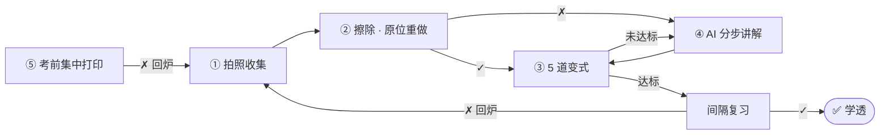

# 学透 · 北京初三数理错题闭环（设计阶段）

> **错一题，透一类。**
> 面向北京初三学生的数学、物理错题工具：拍照收集 → 擦除重做 → 举一反三 → 分步讲解 → 考前打印 → 循环迭代，**直到学透**。

**状态**：🎨 设计稿 v0.1（2026-10-13），尚未开发，等待评审和关键决策（见下文）
**代号**：`mistake-mastery`
**范围**：北京 · 初三 · 数学 + 物理 · 2026–2027 学年（2027 年 6 月中考）

---

## 一页纸

| | |
|---|---|
| **用户** | 初三学生（在纸上作答）+ 家长（拿手机操作、付费） |
| **痛点** | 抄错题太耗时；原卷写满了没法重做；换个数又错；考前找不全；同一个坑反复掉 |
| **核心机制** | 每道错题都要过**三道关**：① 原题关（空白卷原位重做）→ ② 变式关（5 道变式做对 ≥ 4 道，综合题必须对）→ ③ 时间关（间隔 7 天以上复习仍然做对）。三关都过 = **✅ 学透**；任何一关失败 → **回炉，轮次 +1** |
| **差异化** | A4 擦除还原、原位重做（不是小票纸）；5 级变式阶梯 + 程序化出题 + 跨厂商交叉校验；苏格拉底式讲解；**北京中考题位本地化**（数学第 16、26、27、28 题，物理实验探究和科普阅读） |
| **形态** | 微信小程序（家长主力）+ H5（电脑打印、平板讲解） |
| **技术** | FastAPI + PostgreSQL/pgvector + Celery；境内 OCR 和去手写云 API；境内已备案大模型（经 LLM 网关多模型路由）；HTML + Chromium 确定性排版生成 PDF |
| **节奏** | 2 周验证 → 8 周 MVP → 期末季内测（2027 年 1 月）→ 一模前正式上线（2027 年 4 月） |

---

## 文档导航

| # | 文档 | 内容 |
|---|------|------|
| 01 | [产品需求（PRD）](docs/01-product-requirements.md) | 背景、用户、原则、六步功能详述、"学透"定义、MVP 范围、指标 |
| 02 | [交互与体验](docs/02-ux-design.md) | 信息架构、关键流程、页面线框、打印模板规范、文案语气 |
| 03 | [系统架构](docs/03-system-architecture.md) | 技术选型、图像管线、擦除方案、排版引擎、回传批改、成本模型 |
| 04 | [数据模型与接口](docs/04-data-model-and-api.md) | ER 图、表结构、题目 JSON、REST 接口 |
| 05 | [AI 设计](docs/05-ai-design.md) | 任务与模型路由、交叉校验、变式生成与质检、苏格拉底式讲解、评测体系 |
| 06 | [掌握度与复习算法](docs/06-mastery-algorithm.md) | 错题状态机、三关判定、考试感知调度、每日学透单、知识点掌握度 |
| 07 | [北京课程与考情](docs/07-beijing-curriculum.md) | 中考结构、题位标签、知识点树、错因字典、教材版本、学年日历 |
| 08 | [合规、供应商与竞品](docs/08-compliance-and-landscape.md) | 未成年人、生成式 AI、双减合规清单；擦除、OCR、大模型候选；竞品对比 |
| 09 | [路线图与验证计划](docs/09-roadmap.md) | 阶段 0 验证项、MVP 迭代计划、内测、团队配置、风险 |

建议阅读顺序：**README → 01 → 02 → 06**（产品视角）；**03 → 04 → 05**（技术视角）；07、08 按需查阅。

---

## 🔶 需要拍板的决策

开工前需要确定以下事项。每项都给出了推荐方案，确认或修改即可。

| # | 决策 | 推荐 | 备选 | 影响 |
|---|------|------|------|------|
| **D1** | 客户端形态 | **Taro：一套代码出微信小程序 + H5** | 先只做 H5/PWA，验证最快，但家长入口不如小程序方便 | S1 起的前端工作 |
| **D2** | 代码放在哪里 | **开发前新建独立仓库**（与股票项目没有领域交集）；本仓库只保留这套设计文档 | 继续放在本仓库的 `mistake-mastery/` 子目录 | 工程组织、CI、权限 |
| **D3** | 云与 AI 主供应商 | **阿里云（OSS + 百炼通义）为主，火山方舟（豆包）做跨厂商校验**，DeepSeek 做纯文本仲裁 | 腾讯云 + 混元/豆包 | 部署、延迟、合同 |
| **D4** | 擦除供应商 | 阶段 0 对比**百度、有道、TextIn** 后再定 | — | 第 ② 步体验 |
| **D5** | 打印硬件 | **家用 A4 打印机优先**（原位重做依赖 A4） | 同时适配热敏错题打印机（P2） | 排版模板 |
| **D6** | 运营主体与资质 | **尽快确定公司主体**，启动 ICP 和小程序备案、生成式 AI 登记 | — | 上线时间（合规是关键路径） |
| **D7** | 教研资源 | **数学、物理各 1 名兼职教研**（北京初三一线或退休教师） | 外包标注 | 知识点树、方法卡、评测集、每周抽检 |
| **D8** | 商业模式 | 免费额度 + 会员（月、学期、"初三全年"） | 硬件捆绑；学校或机构版 | 计费模块、ICP 经营许可证 |

---

## 关键假设（待阶段 0 验证）

1. 擦除 API 在北京试卷（几何图、电路图、红笔批改）上的免修补率可以达到 80% 以上。
2. "程序化出题 + 跨厂商交叉校验"能把变式题错误率压到 2% 以下（MVP 目标 < 1%）。
3. 家长愿意每周花 10–15 分钟拍照和打印，换来孩子每天约 20 分钟的纸面练习。
4. "学透"的三关机制能被家长和孩子理解并认可，愿意持续回填结果。
5. 北京本地化（题位、教材、考试日历）是付费意愿的关键驱动因素。
