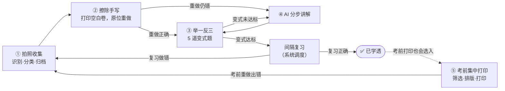

# 01 · 产品需求文档（PRD）

**项目代号**：mistake-mastery（暂定名「学透」）
**一句话定位**：给**我家初三孩子**用的数学、物理错题工具，目标是把错题**学透**，不只是收集起来。
**性质**：**家庭自用，非商业**。只有一个家庭使用，不对外提供服务。
**文档状态**：设计稿 v0.2（2026-10-13），从 v0.1 的"商业产品"设定调整为"家庭自用"

---

## 1. 为什么要做

### 1.1 初三学生的错题困境

| 环节 | 现状 | 代价 |
|------|------|------|
| 收集 | 手抄错题本，或剪贴、拍照存进相册 | 抄一道几何综合题要 10–15 分钟，抄完就没时间做了 |
| 重做 | 原卷上已经写满答案和红笔批注，没法直接重做 | 只能"看懂"答案，"看懂"了不等于"会做" |
| 迁移 | 换个数、换个情境又错 | 错的是"一类题"，练的却只有"一道题" |
| 求助 | 不会的题要等第二天问老师，或者家长也讲不清 | 卡点越积越多 |
| 复习 | 考前在一摞卷子里翻错题 | 找不全，优先级也排不出来 |
| 反复 | 复习时又错了，但没人记录 | 同一个坑反复掉 |

### 1.2 为什么不直接用现成工具

现成工具各管一段（详见 [08 §4](08-privacy-vendors-and-tools.md)）：夸克扫描王能去手写，错题打印机能打印，学习机能推相似题。但没有一个能把这几段串成闭环：

1. **"学透"没有判定标准**：错题收进去以后没有状态，不知道哪道已经掌握、哪道还会再错。
2. **不贴合北京中考**：北京数学的新定义题、几何综合题，物理的实验探究题、科普阅读题，命题风格独特，通用的相似题针对性不足。
3. **不能按自家孩子定制**：练多少、怎么排、打印成什么样，都由别人决定。

> **在自己的工具做好之前**，第 ② 步可以先用夸克扫描王的"试卷去手写"顶上，期中复习不必等。

### 1.3 核心想法

> **错一题，透一类。**
> 每道错题都有状态、有轮次、有判定标准，直到真正掌握。

---

## 2. 使用者

### 2.1 角色

| 角色 | 在系统中的角色 | 诉求 | 约束 |
|------|----------------|------|------|
| **孩子**（初三，14–15 岁） | 做题的人，主要在**纸上**完成 | 少花时间、练得有效、不会的能马上弄懂 | 手机使用受限；晚上作业已经很满 |
| **家长（我）** | **操作者**：拍照、打印、回填、看进度，也负责维护这套系统 | 省心、看得到进步、知道薄弱点 | 时间碎片化；自己未必能讲清楚每道题 |

> **关键洞察**：初三阶段，**家长拿手机，孩子拿笔**。系统的数字化部分主要由家长在手机上操作，学习本身尽量回到纸面，这和中考仍是纸笔考试一致。

### 2.2 需要先填好的孩子信息

| 信息 | 用途 | 当前值 |
|------|------|--------|
| 所在区 | 预填教材版本、各区一模和二模日期 | 待填 |
| 数学、物理教材版本 | 章节映射、考试范围筛选 | 待填（见 [07 §7](07-beijing-curriculum.md)） |
| 本学期考试日期 | 考试感知复习、考前打印提醒 | 期中约 11 月初，期末约 1 月中旬（待按学校通知修正） |
| 每天可用于错题的时间 | 每日学透单的时长预算 | 默认 20 分钟 |

### 2.3 使用场景

| 场景 | 频率 | 主要操作 | 对应步骤 |
|------|------|----------|----------|
| 周测或月考卷子发回 | 每周 2–3 次 | 整页拍照，挑出错题 | ① ② |
| 日常作业中的错题 | 每天 | 单题拍照 | ① |
| 周末集中巩固 | 每周 | 打印变式练习单 | ③ |
| 孩子遇到不会的题 | 随时 | 拍照请 AI 分步讲解 | ④ |
| 期中、期末、一模、二模前 | 每学期 3–4 次 | 筛选错题，一键排版打印 | ⑤ |
| 复习中又做错 | 持续 | 回填结果，自动回炉 | ⑥ |

---

## 3. 设计原则

1. **纸笔优先**：输入是纸，输出也是纸，手机只是中枢。孩子在纸上作答的时间要多于看屏幕的时间。
2. **以"学透"为终点**：每道错题都有明确状态，直到达到"学透"标准（见 §6）。
3. **控量**：每天只推最该练的几道题，宁少勿滥。
4. **AI 要可信，但家长兜底**：AI 给出的答案和变式题先经过双模型交叉校验；校验不通过的标"⚠ 待核"，由家长确认（拍答案页、问老师或手动输入）。
5. **引导而不是代劳**：讲解默认一步步引导，不直接甩答案。这里不是出于合规考虑，而是因为"自己想出来"才学得会。
6. **贴合北京中考**：知识点、题型和命题风格对齐北京中考与各区模拟考（见 [07-北京课程与考情](07-beijing-curriculum.md)）。
7. **够用就好**：只服务一个家庭，不为规模、计费、运营做任何设计；能手动的环节先手动，用顺手了再自动化。
8. **数据留在家里**：系统运行在家里的电脑上，照片和记录都存在本地；送给 AI 接口的只有题目图片和文字。

---

## 4. 核心闭环

> 第 ⑥ 步"循环迭代"不是一个单独的页面，而是贯穿整个闭环的**回炉机制**：任何环节再次做错，这道题都回到 ①，开始新一轮（轮次 +1），并继承之前的全部历史。

---

## 5. 功能需求

"版本"一列表示计划在哪个版本做（见 [09-路线图](09-roadmap.md)）：**v0.1** 期中前，**v0.2** 11 月，**v0.3** 期末前，**v0.4** 寒假，**以后** 待定。

### F1 · 拍照收集：AI 自动识别、分类、归档

**用户故事**：卷子发回来，我拍一下，系统就帮我切出错题、认出题目、归到对应知识点，不用我手动输入。

| # | 功能点 | 说明 | 版本 |
|---|--------|------|------|
| F1.1 | 单题拍照 | 拍照并框选一道题；支持从相册导入 | v0.1 |
| F1.2 | 整页拍照 + 自动切题 | 一张照片含多道题时，自动切成独立题目；切错了可以手动框选 | v0.1 |
| F1.3 | 多页来源卷 | 一份试卷多页连续拍摄，归为同一份"来源卷" | v0.1 |
| F1.4 | 透视矫正与增强 | 自动矫正倾斜、去阴影；太模糊时提示重拍 | v0.1 |
| F1.5 | 红笔批改识别，自动预选错题 | 识别老师的 ✗、半对、扣分标记，预先勾选错题 | v0.4 |
| F1.6 | 题目结构化识别 | 题干、选项、小问、图形、孩子的作答、老师批注分层提取；公式转为 LaTeX | v0.1 |
| F1.7 | 自动分类 | 学科、**知识点（多标签）**、题型、难度、北京中考题位（如"类第 28 题新定义"） | v0.1 |
| F1.8 | 正确答案 | 优先用卷面上老师给的答案或答案页照片，其次 AI 解答；v0.1 先用单模型并标"⚠ 待核"，v0.2 起交叉校验 | v0.1 / v0.2 |
| F1.9 | 错因标注 | AI 对比孩子的作答和正确答案，给出错因建议；一键确认或修改 | v0.2 |
| F1.10 | 来源标注 | 作业、周测、月考、期中、期末、一模、二模，以及考试名称和日期 | v0.1 |
| F1.11 | 去重合并 | 同一道题重复录入时自动合并，错误次数 +1 | v0.2 |
| F1.12 | 批量确认页 | 处理完后用卡片列表展示识别出的题目，逐个修改或一键全部确认 | v0.1 |

**够用标准**：一份 3 页的月考卷，从拍完到确认归档，我的操作不超过 3 分钟；大部分题不需要手动改分类。

### F2 · 一键擦除手写：打印空白卷，原位重做

**用户故事**：孩子拿到一张和原卷一模一样、但没有任何笔迹的卷子，在原来的位置上重新做一遍，就像重新考一次。

| # | 功能点 | 说明 | 版本 |
|---|--------|------|------|
| F2.1 | 整页擦除（原卷还原） | 去除所有手写笔迹（黑笔、铅笔、红笔批改、涂改），保留印刷内容和原始版式 | v0.1 |
| F2.2 | 图形内擦除 | **几何图上手画的辅助线、标注**和电路图上的涂画也要擦掉，同时保住印刷线条 | v0.1（取决于擦除接口的效果） |
| F2.3 | 擦除预览与修补 | 前后对比；"补擦"画笔清理残留笔迹，"恢复"画笔找回误擦的印刷内容 | v0.1 预览 / v0.2 修补 |
| F2.4 | 错题重做单 | 只输出选中的错题，每题保持原貌，作答区大小参照原卷 | v0.1 |
| F2.5 | 纸张适配 | 原卷常见 8K、B4、A3 双栏等大幅面，可等比缩放到 A4，或按 A3 输出 | v0.1 |
| F2.6 | 页面二维码 | 每页印一个二维码，孩子做完后家长用手机一扫，直接打开这次打印的回填页 | v0.2 |
| F2.7 | 打印方式 | 生成 PDF，在电脑上打印，或在手机上用系统打印（AirPrint、Mopria） | v0.1 |

**够用标准**：大多数页面擦完不需要修补；修补一页不超过 1 分钟。

### F3 · 举一反三：AI 出 5 道变式题，练到彻底掌握

**用户故事**：原题重做对了以后，孩子再做几道"换汤不换药"的题，确认真的会了，而不是记住了这道题的答案。

**变式阶梯（每组 5 题）**

| 题号 | 层级 | 变式手法 | 目的 |
|------|------|----------|------|
| 1 | 同构巩固 | 结构不变，只换数据或字母 | 确认方法掌握 |
| 2 | 同构巩固 | 换表述方式或已知条件的给出形式 | 排除"背答案" |
| 3 | 迁移变式 | 换情境（如滑轮换成杠杆，三角形换成四边形） | 方法迁移 |
| 4 | 迁移变式 | 改设问方向（正向求解改为逆向求参、存在性问题等） | 理解深化 |
| 5 | 综合提升 | 与关联知识点综合，按北京中考题风格命制 | 实战对接 |

| # | 功能点 | 说明 | 版本 |
|---|--------|------|------|
| F3.1 | 生成 5 道变式 | 按上表阶梯生成，难度围绕原题上下浮动 | v0.2 |
| F3.2 | 正确性校验 | 1–2 层级用程序化出题（答案由程序算出）；3–5 层级由第二家模型盲解比对，数值和表达式用 sympy 核验；**未通过的题不出** | v0.2 |
| F3.3 | 图形题变式 | 复用原图只改数据，或降级为无图变式；程序化绘图（几何、电路）放到寒假再做 | v0.2 降级 / v0.4 完整 |
| F3.4 | 变式练习单 | 打印成练习单，答案和解析单独一页 | v0.2 |
| F3.5 | 掌握判定与追加 | 5 题做对 ≥ 4 题且第 5 题（综合题）做对，判为"变式达标"；否则先讲解，再针对做错的层级**追加 3 道** | v0.2 |
| F3.6 | 标记有问题的题 | 发现变式题有错，点"有问题"，这道题作废并重新出一道 | v0.2 |
| F3.7 | 导入真题做"同类题" | 把手头的北京各区模拟卷 PDF 导入成私人题库，出变式时优先从里面找同知识点的真题（仅限自家学习使用） | 以后 |

### F4 · AI 分步讲解：拍照让 AI 一步步讲清楚

**用户故事**：孩子遇到还不会的题，AI 像老师一样一步步引导他想明白，而不是直接把答案甩给他。

| # | 功能点 | 说明 | 版本 |
|---|--------|------|------|
| F4.1 | 发起方式 | 从错题详情发起；从变式练习中发起；直接拍一道新题发起 | v0.3 |
| F4.2 | 分步引导 | "审题（已知、所求）→ 联想考点与方法 → 关键一步提示 → 完整过程 → 方法总结与易错点"，每一步点了才显示下一步 | v0.3 |
| F4.3 | 追问 | 每一步都可以问"这一步为什么"，或说"我还是不懂"，AI 换一种讲法 | v0.3 |
| F4.4 | 诊断式讲解 | 拍下孩子自己的解题过程，AI 定位**具体错在哪一步**，从那一步开始讲 | v0.4 |
| F4.5 | 规范作答指导 | 按北京中考评分习惯讲步骤分：数学解答题的关键步骤，物理计算题"公式—代入—结果—单位" | v0.3 |
| F4.6 | 公式渲染 | LaTeX 渲染（KaTeX） | v0.3 |
| F4.7 | 置信度兜底 | 校验不通过时提示"这道题 AI 把握不足，建议问老师"，不硬讲 | v0.3 |
| F4.8 | 家长模式 | 家长可以直接看完整解析，用来自己先弄懂再讲给孩子 | v0.3 |

### F5 · 考前集中打印：筛选整学期错题，一键排版打印

**用户故事**：期末考试前，我一键打印出本学期考试范围内、孩子还没掌握的错题，排版整齐，直接给孩子做。

| # | 功能点 | 说明 | 版本 |
|---|--------|------|------|
| F5.1 | 多维筛选 | 时间范围、学科、知识点、错因、状态（未学透、反复错、全部）、错误次数 ≥ N、来源 | v0.3 |
| F5.2 | 预设 | "期末冲刺（按考试范围）""反复错 TOP 30""本月新错题""一模前高频错" | v0.3 |
| F5.3 | 排版选项 | 纸张（A4/A3）、单栏或双栏、作答留白（按原卷、固定高度或不留）、是否附答案页、是否附变式题、按知识点分节并生成目录 | v0.3 |
| F5.4 | 排版质量 | 一道题不跨页；图文不分离；页眉含日期和范围；带页码 | v0.3 |
| F5.5 | 题量与时长预估 | 显示"共 32 题，约需 95 分钟"，建议拆成几份 | v0.3 |
| F5.6 | 打印记录 | 保存每次打印的筛选条件和题目清单，可以重新打印 | v0.1 |

### F6 · 循环迭代：复习中又做错，回到步骤 ①

| # | 功能点 | 说明 | 版本 |
|---|--------|------|------|
| F6.1 | 结果回填 | 扫页面二维码打开回填页，对照答案页逐题勾 ✓/✗/半对 | v0.2 |
| F6.2 | 回炉 | 任何环节做错，这道题回到 ①，轮次 +1，状态重置为"待重做"，历史完整保留 | v0.2 |
| F6.3 | 错题旅程 | 每道错题一条时间线：第 1 轮录入 → 重做 ✗ → 讲解 → 变式 4/5 → 复习 ✓ → 第 2 轮…… | v0.2 |
| F6.4 | 考试日历驱动 | 录入期末、一模、二模日期，考前压缩复习间隔，确保考试范围内的错题都复习过 | v0.3 |
| F6.5 | 每日学透单 | 每天生成一页 A4：今日重做 + 变式 + 到期复习，控制在约 20 分钟 | v0.4 |
| F6.6 | 拍照回传，AI 批改 | 拍下做完的打印单，AI 自动判对错，不用手动勾 | 以后 |

### F0 · 基础

| # | 功能点 | 说明 | 版本 |
|---|--------|------|------|
| F0.1 | 访问密码 | 一个家庭密码即可，不做账号体系 | v0.1 |
| F0.2 | 孩子档案 | 年级、区、教材版本、考试日历；可以建多个档案（例如以后弟弟妹妹也用） | v0.1 |
| F0.3 | 设置 | 填写各家 AI 接口的密钥；每日时长预算；"学透"参数 | v0.1 |
| F0.4 | 学情看板 | 学透数量、知识点掌握度、反复错 TOP 10、错因分布 | v0.3 简版 |
| F0.5 | 周小结 | 一页：本周新增错题、学透数量、薄弱知识点、下周建议 | v0.4 |
| F0.6 | 备份 | 一键导出全部数据（数据库 + 图片）；定期自动备份到网盘目录 | v0.1 |

---

## 6. "学透"的定义

一道错题从录入到"学透"，必须依次通过**三道关**：

| 关卡 | 判定条件 | 证明的是 |
|------|----------|----------|
| ① 原题关 | 在空白卷上原位重做正确 | 这道题会做了 |
| ② 变式关 | 5 道变式做对 ≥ 4 题，且综合题做对 | 这类题会做了 |
| ③ 时间关 | 间隔 ≥ 7 天后的复习题（原题或新变式）做对 | 过一段时间还会做 |

三关全部通过，状态变为 **✅ 已学透**。已学透的题仍会以低频率进入考前打印。任何一关失败都会触发回炉。参数（题数、间隔天数）都可以在设置里调整。完整状态机与调度算法见 [06-掌握度与复习算法](06-mastery-algorithm.md)。

---

## 7. 怎么判断有没有用

不追求漂亮的数据，只看孩子身上的变化，每月看一次：

| 看什么 | 怎么看 |
|--------|--------|
| 学透了多少 | 每周新学透的错题数，以及"已学透"占全部错题的比例 |
| 学透是不是真的 | 已学透的题在之后的考试或复习中**再错的比例**（越低越好） |
| 薄弱点在不在缩小 | 知识点掌握度看板上红色格子的变化 |
| 考试上的体现 | 区统考、一模、二模中，**同类题位**的得分变化（比如数学第 26–28 题、物理实验探究题） |
| 孩子愿不愿意用 | 每日学透单的完成情况；孩子自己的反馈 |

---

## 8. 运行成本

只有一个孩子使用，AI 接口和擦除接口的费用很低：估计**每月 5–20 元**（明细见 [03 §9](03-system-architecture.md)），各平台的新用户免费额度可能就够用一段时间。硬件用家里现有的电脑和打印机。

---

## 9. 非功能要求

| 维度 | 要求 |
|------|------|
| 速度 | 一页卷子从上传到能确认，1 分钟以内；变式出题几分钟内完成即可（后台处理，做完提醒）；讲解要流式输出，不能干等 |
| 可靠性 | 不追求高可用；电脑关机时用不了也能接受。AI 接口出错时换备用模型，或者提示稍后重试 |
| 隐私 | 数据存在家里的电脑上；不暴露到公网；送给 AI 接口前裁掉卷头（姓名、学校） |
| 易用 | 手机竖屏操作为主；打印件灰度友好（家用打印机多数只打黑白） |
| 可维护 | 家长能在 Claude Code 的帮助下改代码；配置用文件和设置页，不需要运维知识 |
