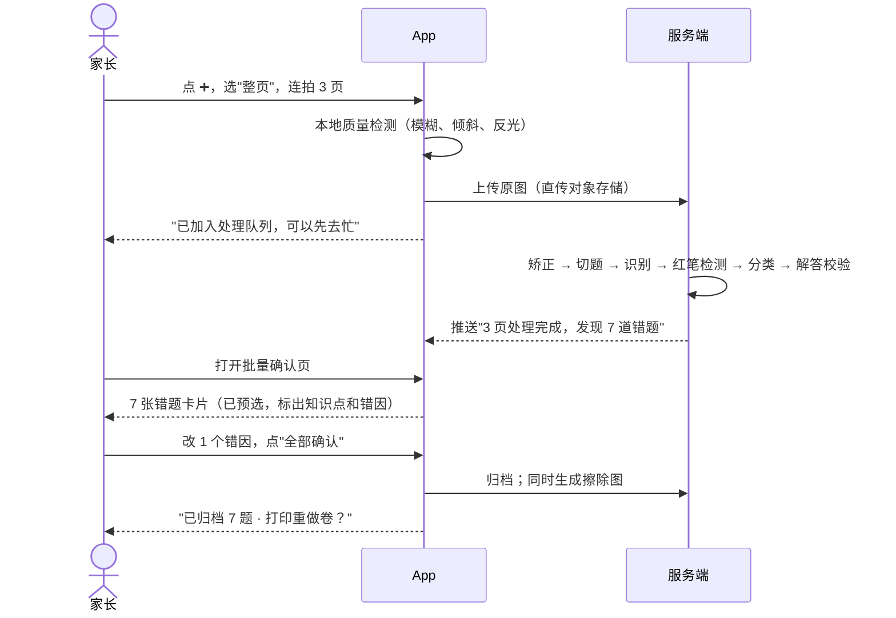
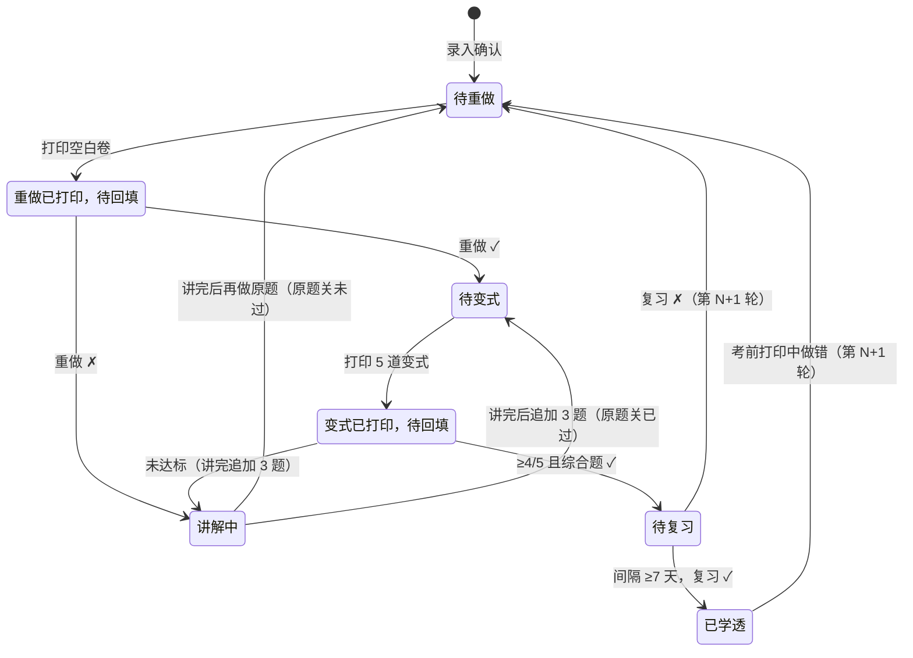
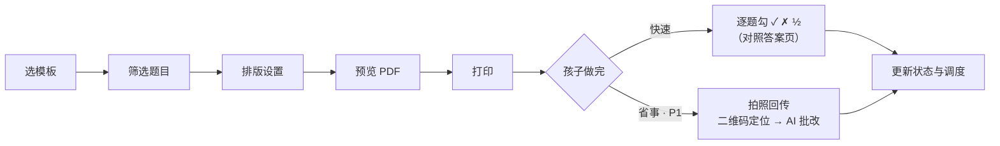

# 02 · 交互与体验设计

> 设计对象：**家长是操作者，学生在纸上作答**。手机端界面优先服务家长的碎片时间；学生的屏幕使用集中在 AI 讲解（手机或平板）。

---

## 1. 设计目标

| 目标 | 衡量方式 |
|------|----------|
| 录入快 | 从打开 App 到错题归档 ≤ 3 步、≤ 60 秒（不含等待识别的时间） |
| 打印快 | 从首页到拿到 PDF ≤ 2 次点击（"今日学透单""重做本页"） |
| 状态清楚 | 任意一道错题都能一眼看出"走到第几关、下一步是什么" |
| 不制造焦虑 | 不做排名、不与其他孩子比较；"回炉"表述为"再来一轮"，不说"失败" |

---

## 2. 信息架构

```
学透
├── 🏠 今日（首页）
│   ├── 考试倒计时（如：距海淀一模 23 天）
│   ├── 今日学透单（一键打印）
│   ├── 待处理：待确认 n ｜ 待重做 n ｜ 待回填 n
│   └── 本周学透进度
├── 📚 错题本
│   ├── 数学 ／ 物理（切换）
│   ├── 视图：按知识点 ｜ 按来源卷 ｜ 按状态 ｜ 按时间
│   ├── 筛选：错因、状态、错误次数、来源
│   └── 错题详情 → 旅程时间线、原图/擦除图、操作区
├── ➕ 拍照（中间大按钮）
│   ├── 单题模式 ／ 整页模式
│   └── 处理队列 → 批量确认页
├── 🖨 打印
│   ├── 模板：原卷还原 ｜ 错题重做单 ｜ 变式练习单 ｜ 考前错题集 ｜ 今日学透单
│   ├── 筛选与排版 → 预览 → 生成 PDF
│   └── 打印记录 → 回填结果 ／ 扫描回传
└── 👤 我的
    ├── 孩子档案（年级、区、学校、教材版本、考试日历）
    ├── 学情看板 ／ 家长周报
    ├── 会员
    └── 隐私与数据（导出、删除、监护人同意记录）
```

**底部导航**：今日 ｜ 错题本 ｜ ➕ ｜ 打印 ｜ 我的

---

## 3. 页面清单

| 编号 | 页面 | 主要用户 | 优先级 |
|------|------|----------|--------|
| P01 | 引导页 + 监护人同意 + 孩子档案 | 家长 | P0 |
| P02 | 今日（首页） | 家长 | P0 |
| P03 | 相机（单题／整页） | 家长 | P0 |
| P04 | 处理队列 | 家长 | P0 |
| P05 | 批量确认页 | 家长 | P0 |
| P06 | 错题本列表 | 家长 | P0 |
| P07 | 错题详情（含旅程） | 家长、学生 | P0 |
| P08 | 擦除预览与修补 | 家长 | P0 |
| P09 | 变式组详情 | 家长、学生 | P0 |
| P10 | AI 分步讲解 | 学生 | P0 |
| P11 | 打印中心（模板、筛选、排版） | 家长 | P0 |
| P12 | PDF 预览与打印 | 家长 | P0 |
| P13 | 结果回填 | 家长、学生 | P0 |
| P14 | 回传扫描 | 家长 | P1 |
| P15 | 学情看板 | 家长 | P0 简版 |
| P16 | 考试日历 | 家长 | P1 |
| P17 | 家长周报 | 家长 | P1 |

---

## 4. 关键流程

### 4.1 录入流程（① 拍照收集）



### 4.2 单题闭环（② → ③ → ④ → 复习）



> 简化示意。追加变式 2 次仍未达标会转为"顽固错题"，提示请教老师。完整规则见 [06 §2](06-mastery-algorithm.md)。

### 4.3 打印与回填（纸面闭环）



---

## 5. 关键页面线框

### P02 · 今日（首页）

```
┌──────────────────────────────────┐
│ 小雨 · 初三          [切换孩子 ▾] │
│ ┌──────────────────────────────┐ │
│ │ 📅 距 海淀一模 还有 23 天       │ │
│ │    考试范围内未学透：数学 12  物理 8 │
│ └──────────────────────────────┘ │
│                                  │
│ 今日学透单  约 20 分钟              │
│ ┌──────────────────────────────┐ │
│ │ 重做 2 题 · 变式 5 题 · 复习 3 题 │ │
│ │ [ 🖨 一键打印 ]   [ 查看明细 ]   │ │
│ └──────────────────────────────┘ │
│                                  │
│ 待处理                            │
│  [待确认 7]  [待重做 4]  [待回填 2] │
│                                  │
│ 本周学透  ●●●●●○○  5 题             │
│ 本周新增错题 14 · 回炉 2            │
│                                  │
├──────────────────────────────────┤
│  今日   错题本   (➕)   打印   我的  │
└──────────────────────────────────┘
```

### P05 · 批量确认页

```
┌──────────────────────────────────┐
│ ← 确认错题（7）     [全部确认 ✓]   │
│ 来源：2026 海淀九上期中 · 数学  [改] │
├──────────────────────────────────┤
│ ☑ 第 8 题  选择题                  │
│ ┌────────────┐ 知识点：             │
│ │ [题目截图]   │ 二次函数图象与系数关系 │
│ │             │ 错因：[审题失误 ▾]   │
│ └────────────┘ 答案：C（卷面红笔）  │
│                     置信度 ●●●     │
├──────────────────────────────────┤
│ ☑ 第 27 题 几何综合（类中考27题）   │
│ ┌────────────┐ 知识点：             │
│ │ [题目截图]   │ 旋转 · 全等三角形     │
│ │ [几何图]     │ 错因：[方法不会 ▾]   │
│ └────────────┘ 答案：AI 解答 ⚠ 待核 │
├──────────────────────────────────┤
│ ☐ 第 12 题（未扣分，AI 判为做对）    │
│   …                              │
└──────────────────────────────────┘
```

- 每张卡片可展开编辑题目文本、知识点和答案。
- "⚠ 待核"表示 AI 解答未通过交叉校验，需要家长拍答案页或手动输入答案。

### P07 · 错题详情（旅程）

```
┌──────────────────────────────────┐
│ ← 数学 · 第 27 题      第 2 轮 🔁   │
│ [原图] [擦除图] [题目文本]          │
│ ┌──────────────────────────────┐ │
│ │        （题目图片）            │ │
│ └──────────────────────────────┘ │
│ 知识点  旋转 · 全等 · 等腰直角三角形 │
│ 错因    方法不会 → 辅助线想不到      │
│ 来源    2026 海淀九上期中 · 第 27 题 │
│                                  │
│ 学透进度   原题 ✓ ─ 变式 ✓ ─ 时间 ◯ │
│                                  │
│ 旅程                              │
│ ● 10/08 第 1 轮 · 录入（期中）      │
│ ● 10/09 重做 ✗ → AI 讲解（4 步）    │
│ ● 10/10 重做 ✓                    │
│ ● 10/12 变式 3/5 ✗ → 追加 3 题 3/3 ✓│
│ ● 10/19 复习 ✗ → 回炉              │
│ ● 10/20 第 2 轮 · 重做 ✓  ← 当前    │
│                                  │
│ [🖨 打印重做] [🔁 举一反三] [💡 讲解] │
└──────────────────────────────────┘
```

### P08 · 擦除预览与修补

```
┌──────────────────────────────────┐
│ ← 擦除预览       第 2/3 页   [完成] │
│ ┌──────────────────────────────┐ │
│ │ 原图  ◀═══════╋═══════▶ 擦除后 │ │
│ │                ┃              │ │
│ │   （拖动滑块对比）               │ │
│ └──────────────────────────────┘ │
│ 工具： [🧽 补擦]  [↩ 恢复]  [🔍 放大] │
│ 画笔大小 ──●──────                 │
│ 输出： (●) 整页还原  ( ) 只要错题    │
└──────────────────────────────────┘
```

### P10 · AI 分步讲解

```
┌──────────────────────────────────┐
│ ← AI 讲解 · 物理 电学计算    AI 生成 │
│ ┌──────────────────────────────┐ │
│ │ （题目图片 + 电路图）           │ │
│ └──────────────────────────────┘ │
│ ① 审题 ✓                          │
│   已知：U=6V，R₁=10Ω，滑片在 b 端…  │
│   所求：电流表示数的变化范围          │
│ ② 想一想：用到哪些规律？            │
│   💬 提示：滑片移动时，哪些量不变？   │
│   [我想到了，看下一步]  [再给点提示]  │
│ ③ 🔒 关键一步                      │
│ ④ 🔒 完整过程                      │
│ ⑤ 🔒 方法总结与易错点               │
│ ─────────────────────────────── │
│ [📷 拍我的解题过程]   [🎤/⌨ 追问…]  │
└──────────────────────────────────┘
```

- 每一步先让孩子自己想；"再给点提示"会逐级展开，最多 3 级，之后直接给出这一步。
- 讲解结束后会询问："要不要现在做 1 道同类题检验一下？"由此接入 ③。

### P11 · 打印中心

```
┌──────────────────────────────────┐
│ 打印                              │
│ 模板                              │
│ [原卷还原] [错题重做单] [变式练习单]  │
│ [考前错题集✓] [今日学透单]           │
│                                  │
│ 快捷预设                           │
│ (期中冲刺) (一模高频错) (反复错TOP30) │
│                                  │
│ 筛选                              │
│ 学科    [数学 ✓] [物理 ✓]           │
│ 时间    本学期 ▾                   │
│ 范围    第 21–24 章 ▾              │
│ 状态    [未学透 ✓] [反复错 ✓] [已学透] │
│ 错因    全部 ▾      错误次数 ≥ [1]  │
│                                  │
│ 排版    A4 · 双栏 · 按原卷留白 · 附答案页 │
│         按知识点分节 · 生成目录        │
│                                  │
│ 已选 32 题 · 约 95 分钟 · 12 页       │
│ [ 预览 PDF ]                       │
└──────────────────────────────────┘
```

---

## 6. 打印模板规范

所有模板共用：页眉（孩子姓名可选、日期、模板名、范围）；页脚（页码、回传二维码、"学透"标识）；AI 生成的内容带"AI 生成"标识；**灰度友好**（不靠颜色传递信息）。

| 模板 | 内容 | 版式要点 |
|------|------|----------|
| **原卷还原** | 擦除后的整页原卷 | 保持原版式与比例；8K/B4/A3 原卷可等比缩到 A4，或按原尺寸 A3 输出；只在页边空白处加二维码 |
| **错题重做单** | 选中的错题（擦除后的截图） | 每题保留原貌；作答区高度 = 原卷作答区高度（由版面分析估算）；题间分隔线；一道题不跨页 |
| **变式练习单** | 一组或多组变式题 | 题目用文本重新排版（LaTeX 渲染）；标出阶梯层级（巩固、迁移、综合）；答案和解析在单独一页，或扫码查看 |
| **考前错题集** | 筛选出的多道错题，可附变式 | 封面 + 目录（按知识点分节）+ 正文 + 答案页；每节开头写知识点要点（1–3 行） |
| **今日学透单** | 今日重做、变式、到期复习 | **固定一页 A4**；顶部写"今日约 20 分钟"；分三区；底部大号回传码 |

### 6.1 回传码与题号锚点

```
┌────────────────────────────────────────────┐
│ 学透 · 错题重做单   2026-10-13   数学 · 小雨 │
├────────────────────────────────────────────┤
│ ⌜1⌟  [题目]                                 │
│      ……                                    │
│      （作答区）                              │
│ ⌞  ⌟                                       │
│ ⌜2⌟  [题目]                                 │
│ ……                                         │
├────────────────────────────────────────────┤
│ 第 1/3 页                   ▣ ← 回传二维码  │
└────────────────────────────────────────────┘
```

- **二维码**内容为 `print_job_id + page_no` 的短链（不含任何个人信息）。
- **⌜n⌟ 角标**是每道题作答区的定位锚点。回传扫描时据此把照片切回到每一道题，再交给 AI 批改，不需要重新做版面分析。

---

## 7. 文案与语气

| 场景 | ❌ 不要这样写 | ✅ 这样写 |
|------|-------------|-----------|
| 复习做错 | "失败！该题未掌握" | "这道题再来一轮 🔁，这次重点看'辅助线怎么想到'" |
| 变式未达标 | "正确率 60%，不合格" | "已经对了 3 道！第 4、5 道的设问方式还不熟，先看看讲解" |
| 学透 | "已完成" | "✅ 学透了！从录入到学透用了 12 天" |
| AI 拿不准 | （硬讲） | "这道题 AI 把握不足，建议请教老师。已帮你标记" |
| 家长周报 | "本周孩子错了 14 道题" | "本周新学透 5 道；'二次函数与几何综合'还需要加把劲" |

---

## 8. 状态与异常

| 状态 | 处理 |
|------|------|
| 识别中 | 处理队列显示进度（矫正 → 切题 → 识别 → 分类）；可以离开页面，完成后推送通知 |
| 拍得不清楚 | 本地预检拦截："有点模糊，靠近一点再拍"；服务端检测失败时提示重拍，并指出是哪一页 |
| 切题错误 | 批量确认页可以"合并相邻题"或"拆分本题"，也可以手动框选 |
| AI 答案不确定 | 卡片标"⚠ 待核"；引导拍答案页或手动输入答案；没有答案的错题不能生成变式 |
| 变式生成失败 | "这道题暂时出不了合格的变式（图形太复杂）"，提供"找同类题"（题库，P1） |
| 网络中断 | 照片本地暂存，联网后自动上传 |

---

## 9. 学生使用的考量

- **无手机也能用**：学生的核心动作（重做、变式、复习）全在纸上；回填可以由家长代勾。
- **讲解在平板或家长手机上进行**：P10 页面适配平板横屏，字号更大。
- **学生模式**（P1）：家长可以开启只读加讲解的学生模式，隐藏会员、设置、看板等，不显示错误次数等可能带来压力的数字。
