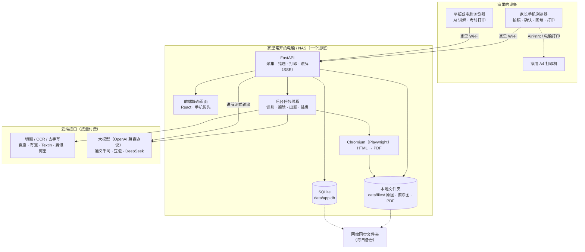
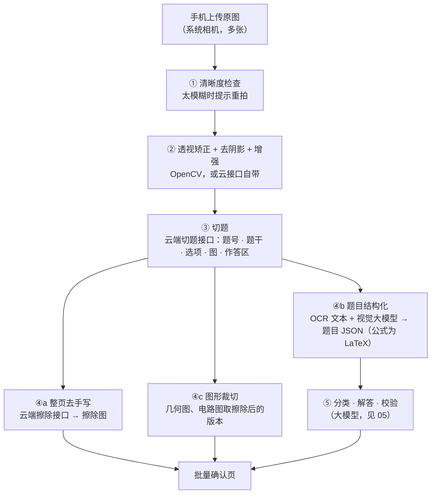
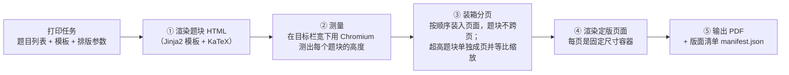

# 03 · 系统架构

> 原则：**一个进程、一个数据库文件、一个数据文件夹**，跑在家里的电脑上，手机浏览器访问。重活（识别、擦除、出题）交给云端 AI 接口，本地只做编排、存储和排版。
> 只服务一个家庭，所以不用消息队列、对象存储、多租户和监控体系。

---

## 1. 架构总览



---

## 2. 技术选型

| 层 | 选型 | 理由 | 不选什么、为什么 |
|----|------|------|------------------|
| 前端 | **React + Vite + TypeScript**，手机优先的网页，可以"添加到主屏幕"（PWA） | 和本仓库股票项目一致；手机浏览器直接打开，不需要上架、审核或备案 | 微信小程序：要注册主体、走审核和备案，对自家用没有必要 |
| 拍照 | 网页调起系统相机：`<input type="file" accept="image/*" capture="environment" multiple>` | 最简单；画质由系统相机保证 | 自己写取景框：成本高，收益小 |
| 后端 | **FastAPI（Python 3.11+）**，单进程同时提供接口和前端页面 | 图像处理、符号计算的生态都在 Python | — |
| 数据库 | **SQLite**（WAL 模式）+ SQLAlchemy 2 | 单个文件，备份就是复制文件；本仓库已在用 | PostgreSQL：一个家庭的数据量用不上 |
| 后台任务 | **进程内任务队列**：`jobs` 表 + 一个工作线程池；进程重启后自动把未完成的任务重新入队 | 不需要 Redis、Celery 这些额外服务 | Celery：要多跑几个服务，维护负担大 |
| 文件存储 | 本地目录 `data/files/` | 简单 | 对象存储：没必要 |
| 图像预处理 | OpenCV | 透视矫正、去阴影、清晰度检查 | — |
| 切题、OCR、去手写 | **云端接口**，经适配器接入，可切换 | 擦除质量直接决定体验，自己训练模型不划算 | 自己训练擦除模型：数据和精力投入远超收益 |
| 大模型 | **国内平台的模型**（通义千问、豆包、DeepSeek 等），经 OpenAI 兼容协议调用 | 在北京直连稳定、中文数理能力强、价格低；与股票项目调用通义的方式相同 | Claude、OpenAI 的接口不支持中国大陆地区使用 |
| 数学校验 | sympy，放在带超时的子进程里运行 | 核验变式题和 AI 解答的计算结果 | — |
| PDF 排版 | **HTML 模板 + KaTeX + Chromium（Playwright）** | 熟悉的 Web 技术；数学公式渲染成熟；能精确知道每道题的位置 | LaTeX：模板难改 |
| 运行方式 | `docker compose up`，或直接 `uv run` | 一条命令启动 | — |

---

## 3. 运行在哪里

| 方案 | 适合 | 优点 | 缺点 |
|------|------|------|------|
| **A. 家里常开的电脑、Mac mini 或 NAS（推荐）** | 家里有一台不关机的机器 | 随时可用；数据在家里 | 需要一台常开的设备 |
| B. 平时用的笔记本 | 没有常开设备 | 零成本 | 笔记本开着时才能用 |
| C. 云服务器 | 经常在外面也要用 | 随时随地可用 | 数据不在家里；要自己做好访问保护 |

- 手机和电脑连同一个 Wi-Fi，浏览器访问 `http://<电脑的局域网地址>:8000` 即可。
- **在外面也想用**：给电脑和手机都装 Tailscale（或 ZeroTier），在虚拟内网里访问，**不要把端口直接暴露到公网**。
- **访问保护**：设置一个家庭密码（F0.1）；会话保存在浏览器里，不用每次都输。

---

## 4. 模块划分

代码按领域分模块，都在同一个进程里：

| 模块 | 职责 |
|------|------|
| `capture` | 上传、来源卷、识别任务编排、批量确认 |
| `mistakes` | 错题、状态机、作答记录、错题旅程 |
| `mastery` | 掌握度、复习调度、每日学透单、回炉规则 |
| `variants` | 变式出题、校验、作废重出 |
| `tutor` | 讲解会话、流式输出、追问 |
| `printing` | 打印任务、模板、排版、二维码 |
| `curriculum` | 知识点树、题型、错因字典、北京题位（从 YAML 文件加载） |
| `settings` | 孩子档案、考试日历、接口密钥、参数 |
| `jobs` | 进程内任务队列、重试、进度查询 |

---

## 5. 图像处理管线



### 5.1 各阶段的产物

| 阶段 | 产物 | 存放 |
|------|------|------|
| 原图 | `pages/{id}/original.jpg` | `data/files/` |
| ② 矫正 | `pages/{id}/corrected.jpg` | `data/files/` |
| ③ 切题 | 每道题的位置、题号、子区域 | `question_instances.bbox`、`source_pages.layout` |
| ④a 擦除 | `pages/{id}/erased.png`（整页）、每题的擦除截图 | `data/files/` |
| ④b 结构化 | 题干、选项、小问（Markdown + LaTeX） | `questions` |
| ④c 图形 | `figures/{id}.png` | `data/files/` |

### 5.2 作答区估算

"原位重做"要求作答空间和原卷一致。切题时取"本题最后一行印刷内容"到"下一题题号"之间的区域作为作答区，按纸张尺寸换算成毫米，记在 `question_instances.answer_area_mm`。错题重做单按这个高度留白。

### 5.3 送出去之前裁掉卷头

送给云端接口之前，先把卷头（姓名、班级、学号、学校）区域裁掉或涂白。原图只存在家里的电脑上。

---

## 6. 手写擦除

擦除是整个系统中**最影响体验、也最依赖外部能力**的环节。

### 6.1 难点

| 难点 | 例子 |
|------|------|
| 笔迹压在印刷文字上 | 在题干上画线、圈点；在选项字母上打勾 |
| 笔迹压在印刷图形上 | **几何图上手画的辅助线和标注**；电路图上画的电流方向 |
| 铅笔笔迹浅 | 颜色接近印刷体 |
| 红笔批改 | 大面积 ✗、分数、评语 |
| 涂改 | 涂黑的块、修正带残影 |

### 6.2 方案

1. **先挑接口**：用孩子自己的 10 页真实卷子（数学几何图、物理电路图、红笔批改都要有），在百度、有道、TextIn 三家的去手写接口上各跑一遍，肉眼对比，选最好的一家（候选与价格见 [08 §3.1](08-privacy-vendors-and-tools.md)）。
2. **修补工具兜底**：擦除预览页提供"补擦"和"恢复"两支画笔，处理接口的少量失误。
3. **退路**：某一页效果不好时，可以用夸克扫描王的"试卷去手写"处理后再上传。

> 不做：自己训练擦除模型。可用的开源数据集只限非商用；即使能用，标注和训练的投入对一个家庭来说也远超收益。

---

## 7. AI 调用

详细设计见 [05-AI 设计](05-ai-design.md)。工程约定：

- **统一客户端**：用 OpenAI 兼容协议调用各家模型，按任务从配置文件里选模型；超时重试；主模型失败时换备用模型。
- **结构化输出**：非对话类任务都要求按 JSON Schema 输出，服务端用 Pydantic 校验，失败重试一次。
- **调用日志**：每次调用记入 `ai_calls` 表（任务、模型、提示词版本、tokens、耗时、费用估算），出问题时可以回查，每月也能看到花了多少钱。
- **缓存**：以"题目内容哈希 + 任务 + 提示词版本"为键缓存结果，重跑时不重复付费。

---

## 8. 打印排版引擎

### 8.1 先测量再装箱，确定性分页



- **为什么自己分页**：这样能精确知道每道题在第几页、什么位置。页面二维码打开的回填页靠这份清单按页列出题目；以后做"拍照回传批改"时，也靠它把照片切回到每道题。
- **页面元素**：页眉（日期、范围）、页脚（页码、二维码）、题号角标 ⌜n⌟；预留四角定位标，给以后的回传批改用。
- **清晰度**：题目截图按 300 DPI 等效尺寸嵌入；擦除图保存为 PNG。
- **灰度友好**：不用浅色细线；"AI 生成"的标识用文字，不只靠颜色。
- **目录**：装箱时已经知道每节在第几页，一次就能生成目录。
- **性能**：常驻一个 Chromium 实例；50 题的考前错题集在半分钟左右生成即可。

---

## 9. 运行成本（一个孩子，每月）

**数字是量级估算，以实际账单为准。**

| 用量项 | 月用量（估） | 单价量级 | 月成本（估） |
|--------|--------------|----------|--------------|
| 整页切题 + OCR | 40 页 | ¥0.02–0.10 / 页 | ¥1–4 |
| 整页去手写 | 30 页 | ¥0.006–0.05 / 页 | ¥0.2–1.5 |
| 结构化识别 + 分类 + 解答 + 交叉校验 | 60 题 | ¥0.03–0.10 / 题 | ¥2–6 |
| 变式组（出题 + 盲解 + 质检） | 15 组 | ¥0.15–0.50 / 组 | ¥2–7.5 |
| 讲解 | 20 次 | ¥0.02–0.10 / 次 | ¥0.4–2 |
| **合计** | | | **约 ¥5–20 / 月** |

- 去手写可以买资源包（例如有道 1 万次约 60 元，够用整个初三），具体以官网为准。
- 各大模型平台通常有新用户免费额度，开始阶段可能完全免费。

---

## 10. 日常维护

| 事项 | 做法 |
|------|------|
| 启动 | `docker compose up -d`；电脑开机自动启动 |
| 备份 | 每天凌晨把 `data/` 目录（数据库 + 图片）打包复制到网盘同步文件夹；设置页也能一键导出 |
| 升级 | `git pull` 后重启；数据库结构变更由启动时的迁移脚本自动执行 |
| 出问题 | 查看 `data/logs/` 里的日志；AI 相关问题查 `ai_calls` 表 |
| 密钥 | 各家接口的密钥放在 `.env` 文件里（不提交到 git），或在设置页填写 |

---

## 11. 代码目录规划

```
mistake-mastery/
├── README.md
├── docs/                      # 本套设计文档
├── app/                       # 后端（FastAPI）
│   ├── main.py                # 入口：接口 + 前端静态页面 + 后台任务
│   ├── core/                  # 配置、数据库、密码校验、任务队列、日志
│   ├── modules/
│   │   ├── capture/ mistakes/ mastery/ variants/
│   │   ├── tutor/ printing/ curriculum/ settings/
│   ├── adapters/
│   │   ├── ocr/               # 切题、OCR、去手写的各家接口适配器
│   │   └── llm/               # 大模型客户端（OpenAI 兼容）
│   ├── prompts/               # 提示词（YAML，带版本号）
│   ├── templates/print/       # 打印模板（Jinja2 + CSS）
│   └── curriculum/            # 知识点树、错因字典（YAML，见 07）
├── web/                       # 前端（React + Vite）
├── tests/                     # 状态机、调度、分页等单元测试
├── evals/                     # 小型评测集：孩子卷子上的题 + 标准答案（见 05 §6）
├── data/                      # 运行数据（不提交到 git）：app.db、files/、logs/、backups/
├── docker-compose.yml
└── .env.example               # 接口密钥模板
```
