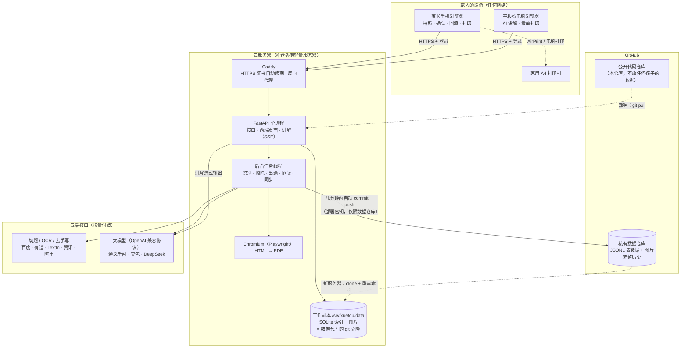
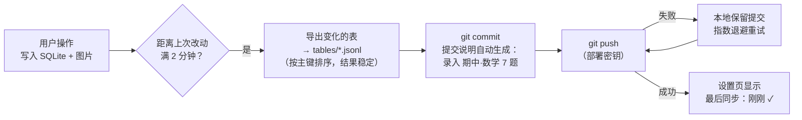
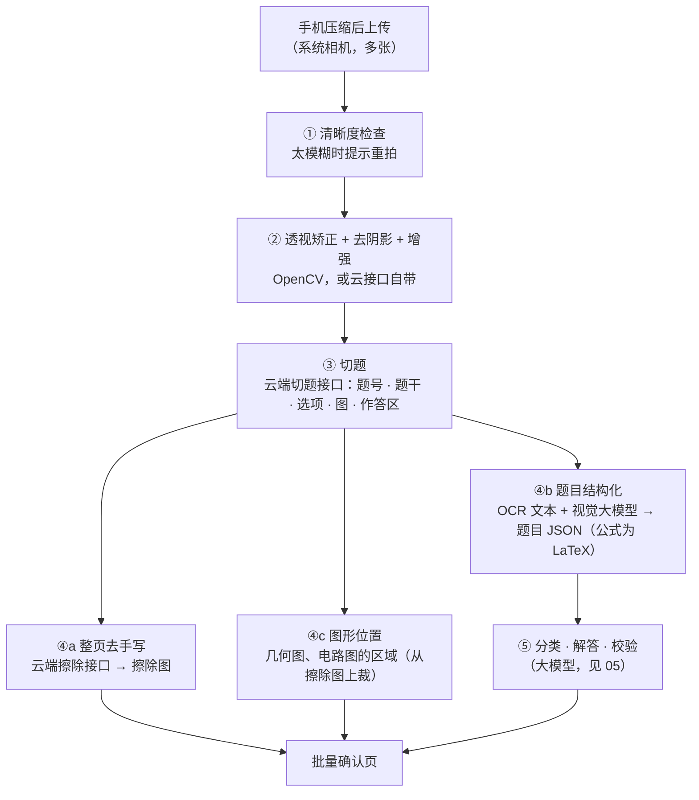
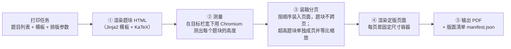

# 03 · 系统架构

> **当前阶段是本地版**：同一个程序先跑在家里的电脑上，手机连家里 Wi-Fi 访问，数据同样同步到 GitHub 私有仓库（§5）。§3 的服务器选址、§4 的公网安全，等以后部署到公网时再落实。
>
> 原则：**一台服务器上跑一个程序，数据的"正本"存在 GitHub 私有仓库里**。手机随时随地通过公网访问。重活（识别、擦除、出题）交给云端 AI 接口；服务器只做编排、排版，并保存一份工作副本。
> 只服务一个家庭，所以不用消息队列、对象存储、多租户和监控体系。但因为能从公网访问，**安全要做足**（§4）。

---

## 1. 架构总览



---

## 2. 技术选型

| 层 | 选型 | 理由 | 不选什么、为什么 |
|----|------|------|------------------|
| 前端 | **React + Vite + TypeScript**，手机优先的网页，可以"添加到主屏幕"（PWA） | 和本仓库股票项目一致；手机浏览器直接打开，不需要上架或审核 | 微信小程序：要注册主体、走审核，对自家用没有必要 |
| 拍照 | 网页调起系统相机：`<input type="file" accept="image/*" capture="environment" multiple>`；上传前在手机上压缩到长边 2000px | 最简单；压缩后上传快 | 自己写取景框：成本高，收益小 |
| 后端 | **FastAPI（Python 3.11+）**，单进程同时提供接口和前端页面 | 图像处理、符号计算的生态都在 Python | — |
| 工作数据库 | **SQLite**（WAL 模式）+ SQLAlchemy 2 | 单文件、零运维；能随时从 GitHub 上的数据重建 | PostgreSQL：一个家庭的数据量用不上 |
| **数据正本** | **GitHub 私有仓库**：表数据导出为 JSONL 文本，图片按目录存放（§5） | 自带完整版本历史和异地备份；文本格式能在 GitHub 网页上直接看、看得出每次改了什么；换服务器时 clone 下来就能恢复 | 直接提交 SQLite 文件：二进制文件每次都整份存一遍，仓库会迅速膨胀，也看不出改了什么 |
| 后台任务 | **进程内任务队列**：`jobs` 表 + 一个工作线程池；重启后把未完成的任务重新入队 | 不需要 Redis、Celery 这些额外服务 | Celery：要多跑几个服务 |
| HTTPS | **Caddy** 反向代理，自动申请和续期证书 | 一个配置文件搞定 | 手动配 Nginx + certbot：步骤多 |
| 图像预处理 | OpenCV | 透视矫正、去阴影、清晰度检查 | — |
| 切题、OCR、去手写 | **云端接口**，经适配器接入，可切换 | 擦除质量直接决定体验，自己训练模型不划算 | 自己训练擦除模型：投入远超收益 |
| 大模型 | **国内平台的模型**（通义千问、豆包、DeepSeek 等），经 OpenAI 兼容协议调用 | 中文数理能力强、价格低；与股票项目调用通义的方式相同 | Claude、OpenAI 的接口不支持中国大陆地区使用 |
| 数学校验 | sympy，放在带超时的子进程里运行 | 核验变式题和 AI 解答的计算结果 | — |
| PDF 排版 | **HTML 模板 + KaTeX + Chromium（Playwright）** | 熟悉的 Web 技术；数学公式渲染成熟；能精确知道每道题的位置 | LaTeX：模板难改 |
| 部署 | `docker compose up -d`（应用 + Caddy 两个容器） | 一条命令启动 | — |

---

## 3. 服务器放在哪里

既要**公网访问**，又要**和 GitHub 稳定通信**，服务器的位置有讲究：

| 方案 | ICP 备案 | 访问 GitHub | 北京访问速度 | 结论 |
|------|----------|-------------|--------------|------|
| **A. 香港轻量应用服务器**（阿里云或腾讯云） | **不需要** | **稳定** | 较好（选对大陆优化的线路） | **推荐** |
| B. 大陆云服务器（如北京地域） | 用域名提供网站服务**需要先做个人 ICP 备案**（通常要一到几周） | 时好时坏，推送经常失败 | 最好 | 不推荐：两个问题都要额外处理 |
| C. 家里的电脑 + 内网穿透 | 视方式而定 | 时好时坏 | 取决于家庭宽带上行 | 不推荐：家庭宽带一般没有公网 IP，80/443 端口通常被封；电脑还得一直开着 |

**推荐配置**：香港轻量应用服务器，**2 核 2G 内存**起步（Chromium 排版需要约 1G 内存），系统盘 40G 以上。外加一个域名（例如 `xuetou.example.com`），A 记录解析到服务器 IP。

- 大模型和擦除接口从香港调用国内平台的公网地址，一般没有问题。第 0 步会在服务器上实际测一遍（见 [09 §2](09-roadmap.md)）。
- 国内域名注册需要实名认证；服务器在大陆以外时，不需要 ICP 备案。

---

## 4. 公网安全

服务器暴露在公网上，任何人都能访问到登录页。要防住两类风险：**孩子的数据被看到**，以及 **AI 接口被人盗刷**。

| 层面 | 措施 |
|------|------|
| 传输 | 全站 HTTPS（Caddy 自动证书）；开启 HSTS |
| 登录 | 家庭密码（argon2 哈希存储，长度 ≥ 12 位）；**登录限速**：同一 IP 连续失败 5 次后锁定 15 分钟；会话 Cookie 设为 `HttpOnly`、`Secure`、`SameSite=Lax`，有效期 30 天；设置页可以"退出所有设备"（递增会话版本号，旧 Cookie 全部失效） |
| 两步验证 | v0.2 起可选 TOTP（手机验证器 App），开启后新设备登录需要输入动态码 |
| 数据访问 | **所有图片和 PDF 都经过鉴权接口读取**，不开放静态目录；二维码落地页同样要求登录；响应头加 `X-Robots-Tag: noindex`，不让搜索引擎收录 |
| 防盗刷 | 应用内设置**每日 AI 费用上限**（默认 ¥5，按 `ai_calls` 估算），超过后暂停 AI 任务并在首页提示；同时在各 AI 平台的控制台开启**余额或预算告警** |
| 服务器 | SSH 只允许密钥登录、禁用密码登录；防火墙只开放 80、443（22 端口最好限制来源 IP）；开启系统自动安全更新；应用容器以非 root 用户运行 |
| 密钥 | AI 接口密钥、GitHub 部署密钥只放在服务器的 `.env` 文件和密钥文件里，**不进任何 git 仓库** |
| GitHub 账号 | 开启两步验证并保存好恢复码；数据仓库保持私有、不加协作者 |

---

## 5. 数据存 GitHub

### 5.1 两个仓库，严格分开

| 仓库 | 可见性 | 放什么 | 绝不能放什么 |
|------|--------|--------|--------------|
| **代码仓库**（本仓库 `Claude-made-stock-bot`） | **公开** | 代码、设计文档、知识点树等通用资料 | 孩子的任何数据：照片、错题、档案、评测集、密钥 |
| **数据仓库**（新建，例如 `xuetou-data`） | **私有** | 孩子的全部学习数据（见下） | 密钥 |

> ⚠️ 本仓库是公开的。孩子的区、学校、照片、错题等，一律只存在数据仓库和服务器上。

### 5.2 数据仓库的目录结构

```
xuetou-data/                      # 私有仓库
├── README.md                     # 说明：私有数据仓库，切勿公开
├── tables/                       # 每张表一个 JSONL 文件：按主键排序，一行一条记录
│   ├── students.jsonl
│   ├── exam_events.jsonl
│   ├── source_documents.jsonl
│   ├── source_pages.jsonl
│   ├── questions.jsonl
│   ├── question_kps.jsonl
│   ├── question_instances.jsonl
│   ├── mistakes.jsonl
│   ├── variant_sets.jsonl
│   ├── print_jobs.jsonl
│   ├── print_job_items.jsonl
│   ├── bank_papers.jsonl         # 题库的卷子（见 10）
│   ├── bank_items.jsonl          # 题库题目在原卷上的位置
│   ├── tutor_sessions.jsonl
│   ├── tutor_messages.jsonl
│   └── attempts/                 # 作答记录只追加，按月分文件
│       └── 2026-10.jsonl
├── files/
│   ├── pages/2026/10/{page_id}/original.jpg   # 原图（长边 2000px，JPEG 质量 80）
│   ├── pages/2026/10/{page_id}/erased.png     # 擦除图（8 位灰度 PNG）
│   ├── bank/{paper_id}/paper-1.pdf             # 题库：导入的原卷和答案（PDF 或照片）
│   └── figures/{question_id}-{n}.png          # 变式题的图（程序绘制时才有）
├── evals/                        # 评测集：孩子卷子上的题 + 标准答案（见 05 §6）
└── settings.json                 # 非敏感设置：模型选择、学透参数等
```

**不进数据仓库的东西**（都能重新生成，或者本来就不该存）：SQLite 文件本身（它只是索引）、派生数据（调度优先级、知识点掌握度，重建时重算）、每题的裁切图（由原图和位置重新裁出）、PDF（由打印任务的定义重新渲染）、`jobs` 表、`ai_calls` 原始日志（只把每月费用汇总写进 `settings.json`）、日志、任何密钥。

### 5.3 同步机制



- **触发**：最后一次改动后 2 分钟；另外每 30 分钟兜底一次，进程退出前再同步一次。
- **只有服务器写**：数据仓库只由服务器写入。不要在 GitHub 网页上直接改数据文件；确实改了的话，在服务器上执行 `git pull` 后重建索引。
- **推送失败**：提交已经留在服务器本地，重试成功前数据不会丢；连续失败超过 1 小时，首页显示提醒。
- **GitHub 权限**：用**部署密钥**（Deploy Key，只对数据仓库有写权限），不用个人令牌，即使服务器被攻破，影响范围也只限这一个仓库。

### 5.4 换服务器或恢复

```bash
git clone git@github.com:<你的账号>/xuetou-data.git /srv/xuetou/data
docker compose run --rm app python -m app.tools.rebuild_index   # 从 JSONL 重建 SQLite
docker compose up -d
```

服务器随时可以丢弃重建，数据在 GitHub 上。另外，git 历史本身就是版本记录：误删的错题可以从历史中找回，也能看到任意一天的错题本状态。

### 5.5 容量估算

| 项目 | 估算 |
|------|------|
| 每页图片 | 原图约 0.3–0.5MB + 擦除图约 0.2–0.4MB ≈ **0.5–0.9MB** |
| 每月 | 约 40 页 → **20–40MB**；表数据只有几 MB |
| 整个初三 | 约 **0.3–0.5GB** |

GitHub 建议单个仓库保持在 1GB 左右以内、单个文件不超过 50MB，这个量在范围内。用满一届后，可以把数据仓库归档，下一个孩子或下一学年新建一个。

---

## 6. 模块划分

代码按领域分模块，都在同一个进程里：

| 模块 | 职责 |
|------|------|
| `capture` | 上传、来源卷、识别任务编排、批量确认 |
| `mistakes` | 错题、状态机、作答记录、错题旅程 |
| `mastery` | 掌握度、复习调度、每日学透单、回炉规则 |
| `variants` | 变式出题、校验、作废重出 |
| `tutor` | 讲解会话、流式输出、追问 |
| `printing` | 打印任务、模板、排版、二维码 |
| `curriculum` | 知识点树、题型、错因字典、北京题位（从 YAML 文件加载） |
| `settings` | 孩子档案、考试日历、参数、费用上限 |
| `auth` | 登录、限速、会话、两步验证 |
| `sync` | 导出 JSONL、git 提交与推送、重建索引 |
| `jobs` | 进程内任务队列、重试、进度查询 |

---

## 7. 图像处理管线



### 7.1 各阶段的产物

| 阶段 | 产物 | 存放 |
|------|------|------|
| 原图 | `pages/…/original.jpg` | 工作副本 → 同步到数据仓库 |
| ② 矫正 | 变换矩阵（矫正图需要时再生成） | `source_pages.layout` |
| ③ 切题 | 每道题的位置、题号、子区域 | `question_instances.bbox`、`source_pages.layout` |
| ④a 擦除 | `pages/…/erased.png` | 工作副本 → 同步到数据仓库 |
| ④b 结构化 | 题干、选项、小问（Markdown + LaTeX） | `questions` |
| ④c 图形 | 图形区域坐标（打印和讲解时从擦除图上裁） | `questions.figures` |

### 7.2 作答区估算

"原位重做"要求作答空间和原卷一致。切题时取"本题最后一行印刷内容"到"下一题题号"之间的区域作为作答区，按纸张尺寸换算成毫米，记在 `question_instances.answer_area_mm`。错题重做单按这个高度留白。

### 7.3 送出去之前涂白卷头（可选）

`.env` 里的 `XT_MASK_HEADER_RATIO` 设为大于 0（例如 0.08）时，第 1 页送给云端接口之前，最上方这一比例的区域（姓名、班级、学号所在的卷头）会被涂白。**默认关闭**：很多卷子的第 1 题紧挨着卷头，一刀切容易把题目也涂掉。本地擦除算法（`local_color`）不把图片送出本机。

---

## 8. 手写擦除

擦除是整个系统中**最影响体验、也最依赖外部能力**的环节。

### 8.1 难点

| 难点 | 例子 |
|------|------|
| 笔迹压在印刷文字上 | 在题干上画线、圈点；在选项字母上打勾 |
| 笔迹压在印刷图形上 | **几何图上手画的辅助线和标注**；电路图上画的电流方向 |
| 铅笔笔迹浅 | 颜色接近印刷体 |
| 红笔批改 | 大面积 ✗、分数、评语 |
| 涂改 | 涂黑的块、修正带残影 |

### 8.2 方案

1. **先挑接口**：用孩子自己的 10 页真实卷子（数学几何图、物理电路图、红笔批改都要有），在百度、有道、TextIn 三家的去手写接口上各跑一遍，肉眼对比，选最好的一家（候选与价格见 [08 §3.1](08-privacy-vendors-and-tools.md)）。
2. **修补工具兜底**：擦除预览页提供"补擦"和"恢复"两支画笔，处理接口的少量失误。
3. **退路**：某一页效果不好时，可以用夸克扫描王的"试卷去手写"处理后再上传。

> 不做：自己训练擦除模型。可用的开源数据集只限非商用；即使能用，标注和训练的投入对一个家庭来说也远超收益。

---

## 9. AI 调用

详细设计见 [05-AI 设计](05-ai-design.md)。工程约定：

- **统一客户端**：用 OpenAI 兼容协议调用各家模型，按任务从配置中选模型；超时重试；主模型失败时换备用模型。
- **结构化输出**：非对话类任务都要求按 JSON Schema 输出，服务端用 Pydantic 校验，失败重试一次。
- **调用日志与费用上限**：每次调用记入 `ai_calls` 表（任务、模型、提示词版本、tokens、耗时、费用估算），既能回查问题，也用于每日费用上限（§4）。
- **缓存**：以"题目内容哈希 + 任务 + 提示词版本"为键缓存结果，重跑时不重复付费。

---

## 10. 打印排版引擎

### 10.1 先测量再装箱，确定性分页



- **为什么自己分页**：这样能精确知道每道题在第几页、什么位置。页面二维码打开的回填页靠这份清单按页列出题目；以后做"拍照回传批改"时，也靠它把照片切回到每道题。
- **页面元素**：页眉（日期、范围）、页脚（页码、二维码）、题号角标 ⌜n⌟；预留四角定位标，给以后的回传批改用。
- **清晰度**：题目截图按 300 DPI 等效尺寸嵌入。
- **灰度友好**：不用浅色细线；"AI 生成"的标识用文字，不只靠颜色。
- **目录**：装箱时已经知道每节在第几页，一次就能生成目录。
- **PDF 不长期保存**：生成后在服务器上缓存 7 天，过期后需要时按打印记录重新生成。
- **性能**：常驻一个 Chromium 实例；50 题的考前错题集在半分钟左右生成即可。

---

## 11. 运行成本（一个孩子，每月）

**数字是量级估算，以实际账单为准。**

| 项目 | 月用量（估） | 单价量级 | 月成本（估） |
|------|--------------|----------|--------------|
| 香港轻量服务器（2 核 2G） | — | — | **¥30–60**（年付常有优惠，以官网为准） |
| 域名 | — | 约 ¥40–80 / 年 | 约 ¥5 |
| 整页切题 + OCR | 40 页 | ¥0.02–0.10 / 页 | ¥1–4 |
| 整页去手写 | 30 页 | ¥0.006–0.05 / 页 | ¥0.2–1.5 |
| 结构化识别 + 分类 + 解答 + 交叉校验 | 60 题 | ¥0.03–0.10 / 题 | ¥2–6 |
| 变式组（出题 + 盲解 + 质检） | 15 组 | ¥0.15–0.50 / 组 | ¥2–7.5 |
| 讲解 | 20 次 | ¥0.02–0.10 / 次 | ¥0.4–2 |
| GitHub 私有仓库 | — | 免费 | ¥0 |
| **合计** | | | **约 ¥40–85 / 月**（其中服务器和域名约占一半以上） |

- 去手写可以买资源包（例如有道 1 万次约 60 元，够用整个初三），具体以官网为准。
- 各大模型平台通常有新用户免费额度，开始阶段 AI 费用可能接近零。

---

## 12. 日常维护

| 事项 | 做法 |
|------|------|
| 首次部署 | 买服务器和域名 → 装 Docker → `git clone` 代码仓库 → 新建私有数据仓库并添加部署密钥 → 填写 `.env` → `docker compose up -d`。步骤写成 `deploy/README.md` |
| 升级 | 代码仓库 `git pull` 后 `docker compose up -d --build`；数据库结构变更由启动时的迁移脚本执行 |
| 备份 | **数据仓库就是备份**；想再多一份，在家里电脑上 `git clone` 数据仓库，偶尔 `git pull` 一下即可 |
| 恢复 | 见 §5.4，几分钟完成 |
| 同步状态 | 设置页显示"最后同步时间"，可以手动"立即同步" |
| 出问题 | 查看服务器上的日志；AI 相关问题查 `ai_calls` 表 |

---

## 13. 代码目录（公开的代码仓库，v0.1 本地版已实现）

```
mistake-mastery/
├── README.md · SETUP.md       # 概要；本地版安装与使用
├── docs/                      # 本套设计文档
├── app/                       # 后端（FastAPI，uv run python -m app 启动）
│   ├── main.py · __main__.py  # 应用入口；启动命令（显示局域网地址）
│   ├── config.py              # 配置（.env，前缀 XT_）
│   ├── context.py             # 把数据库、存储、AI、任务队列、同步装在一起；空库时自动从数据仓库恢复
│   ├── db.py · models.py      # SQLite 与数据表（__sync__ 标明是否导出到数据仓库）
│   ├── auth.py · jobs.py · storage.py · ids.py
│   ├── api/                   # 接口：auth、core（档案、设置、同步、首页）、capture、mistakes、knowledge、printing、bank
│   ├── services/              # capture（采集管线）、bank（题库导入与匹配）、mastery（状态机）、knowledge（知识点掌握度与掌握死角）、lessons（知识点讲解）、printing（排版）、sync（GitHub 同步）、prompts
│   ├── adapters/              # imaging（OpenCV）、pdf（pdfium 渲染和取文字）、eraser（各家去手写）、llm（OpenAI 兼容客户端）
│   ├── curriculum/            # 知识点树、错因、北京题位（YAML，通用资料）
│   └── tools/                 # bakeoff（第 0 步试水）、bank_try（试导入一套卷子）、rebuild_index、hash_password
├── web/                       # 前端（React + Vite，npm run build 后由后端直接提供；npm run build:demo 出预览版）
├── tests/                     # 67 个测试，只用虚构数据
├── pyproject.toml · uv.lock
└── .env.example               # 配置模板（不含真实密钥）
```
