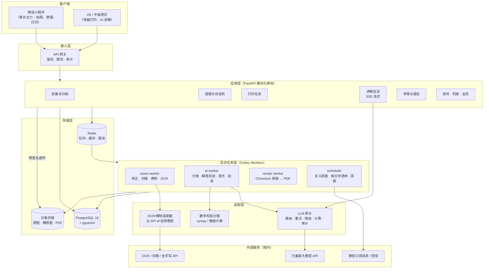
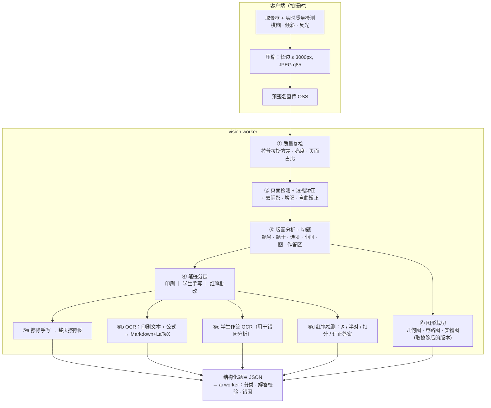
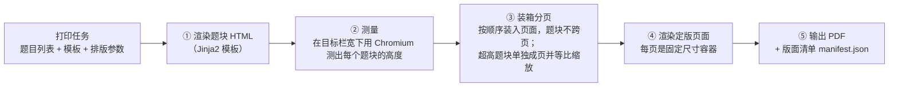
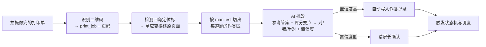

# 03 · 系统架构

> 原则：**MVP 用模块化单体，异步任务做重活，AI 和 OCR 走可替换的供应商适配层**。先用成熟的云 API 验证产品，再把成本高、质量关键的环节逐步换成自研。

---

## 1. 架构总览



---

## 2. 技术选型

| 层 | 选型 | 理由 | 备选 |
|----|------|------|------|
| 客户端 | **Taro 4 + React + TypeScript**，一套代码同时出微信小程序和 H5 | 家长的主要入口是微信；团队已有 React 经验（与本仓库股票项目一致）；H5 版本用于电脑打印和平板讲解 | uni-app（Vue 生态）；或者 MVP 先只做 H5/PWA，最快验证 |
| 后端框架 | **FastAPI（Python 3.11+）** | 图像处理、OCR、符号计算的生态都在 Python；团队熟悉 | — |
| ORM / 迁移 | SQLAlchemy 2 + Alembic | 成熟 | — |
| 数据库 | **PostgreSQL 16 + pgvector** | 多用户并发；JSONB 存题目结构；向量检索用于去重和同类题匹配 | MySQL + 独立向量库 |
| 任务队列 | **Celery + Redis** | 成熟；canvas（chord/group）适合"一页切成 N 题再并行处理"的扇出 | Arq（更轻、原生 async） |
| 对象存储 | 阿里云 OSS / 腾讯云 COS（北京地域） | 预签名直传，省服务器带宽；可配生命周期策略 | MinIO（私有化部署） |
| 图像预处理 | OpenCV | 透视矫正、去阴影、质量检测 | 云 API 自带的矫正 |
| OCR / 切题 / 擦除 | **MVP 用云 API**，经适配层接入，可切换 | 擦除质量直接影响核心体验，自研门槛高；先用云 API 验证需求 | 自研：PP-StructureV3 + 擦除分割模型（见 §5.3） |
| 大模型 | **境内已备案模型**，经 LLM 网关多模型路由 | 合规要求；按任务选模型；单一供应商故障时可降级 | 见 [05-AI 设计](05-ai-design.md) §2 |
| 数学校验 | sympy + 受限 Python 沙箱 | 用代码核验变式题和 AI 解答的数值与符号结果 | — |
| PDF 排版 | **HTML 模板 + Chromium（Playwright）** | 团队熟悉 Web；KaTeX/MathJax 数学渲染成熟；可精确拿到每道题的坐标 | Typst（排版质量高、速度快） |
| 公式渲染 | H5：KaTeX；小程序：服务端 MathJax 预渲染成 SVG 并缓存 | 小程序没有 DOM，KaTeX 不能直接运行 | towxml 等小程序富文本组件 |
| 部署 | 容器化（Docker），阿里云或腾讯云北京地域 | 数据境内存储；与选定的 OCR、大模型供应商同云，降低时延 | — |

> **为什么不复用股票项目的代码？** 两个产品的领域没有交集。新产品放在本仓库的独立目录 `mistake-mastery/` 下，只沿用相同的技术栈和工程习惯（FastAPI、React、OpenAI 兼容 SDK 调用大模型）。是否拆分成独立仓库，见 README 中的待决策项。

---

## 3. 服务与模块划分

MVP 阶段部署为**一个 API 进程 + 三类 Worker**，代码按领域模块组织，以后需要时可以拆成独立服务。

| 模块 | 职责 | 主要依赖 |
|------|------|----------|
| `capture` | 上传、来源卷、处理任务编排、批量确认 | vision worker、ai worker |
| `mistakes` | 错题实体、状态机、作答记录、错题旅程 | `mastery` |
| `mastery` | 掌握度计算、复习调度、每日学透单、回炉规则 | — |
| `variants` | 变式组生成、校验、下发、反馈 | ai worker |
| `tutor` | 讲解会话、流式输出、追问 | LLM 网关 |
| `printing` | 打印任务、模板、排版、回传扫描 | render worker、vision worker |
| `curriculum` | 知识点树、题型、错因字典、北京题位 | — |
| `accounts` | 家庭账号、孩子档案、监护人同意、会员 | — |
| `reports` | 看板、周报 | `mastery` |

---

## 4. 图像处理管线



### 4.1 各阶段输入与输出

| 阶段 | 输出 | 存储 |
|------|------|------|
| ② 矫正 | `page_corrected.jpg`，记录变换矩阵 | OSS |
| ③ 切题 | 每道题的 `bbox`、题号、子区域（题干、选项、图、作答区） | `questions.layout`（JSONB） |
| ④⑤a 擦除 | `page_erased.png`（整页） | OSS |
| ⑤b OCR | `stem_md`（Markdown + LaTeX）、`options[]`、`sub_questions[]` | `questions` |
| ⑤c/⑤d | 学生作答文本、批改标记、订正答案 | `attempts`（首次作答） |
| ⑥ 图形 | `figure_*.png`（擦除后裁切）| OSS + `questions.figures` |

### 4.2 作答区估算

"原位重做"要求作答空间和原卷一致。版面分析时，取"本题最后一行印刷内容"到"下一题题号"之间的区域，扣掉印刷内容，作为作答区，记录它在原卷上的物理高度（按纸张尺寸换算成毫米）。错题重做单排版时按这个高度留白。

### 4.3 隐私预处理

送给第三方模型之前，先检测卷头（姓名、班级、学号、学校）区域并**打码**。原图只保存在我方的对象存储中。

---

## 5. 手写擦除方案

擦除是整个产品中**体验最敏感、技术门槛最高**的环节。

### 5.1 难点

| 难点 | 例子 |
|------|------|
| 笔迹压在印刷内容上 | 在印刷题干上画线、圈点；在选项字母上打勾 |
| 笔迹压在印刷图形上 | **几何图上手画的辅助线和标注**；电路图上画的电流方向 |
| 铅笔笔迹浅 | 灰度接近印刷体的浅色笔迹 |
| 红笔批改 | 大面积 ✗、分数、评语 |
| 涂改与修正带 | 涂黑的块、修正带残影 |

### 5.2 分阶段策略

| 阶段 | 方案 | 说明 |
|------|------|------|
| MVP | **云 API**（候选供应商见 [08-合规与竞品](08-compliance-and-landscape.md) §2） | 做 2 周技术验证：用 50 张北京真实试卷（含几何图、电路图）横向对比 2–3 家，按 §5.4 的指标选型 |
| MVP 补强 | **用户修补工具**（补擦、恢复画笔） | 兜住云 API 的长尾错误；修补数据回流，作为自研模型的训练数据（需用户授权） |
| P1/P2 | **自研擦除模型** | 像素级分割（印刷 / 手写 / 红笔三类）+ 修复（inpainting）。训练数据：用户授权的修补数据 + 合成数据（在干净试卷上叠加真实笔迹图层） |

### 5.3 自研模型思路（P2）

1. **合成数据**：干净的试卷 PDF 渲染图 + 采集的手写笔迹图层（不同笔型、颜色、压力），叠加时随机加入光照、阴影、透视畸变，掩码自带标注。
2. **分割网络**：轻量 U-Net / SegFormer，三分类（背景、印刷、手写）；红笔可以先用 HSV 色彩分离做粗筛。
3. **修复**：被手写覆盖的印刷像素，用"印刷类概率 + 局部纹理"修复；被手写覆盖的空白区域直接填充背景色。
4. **图形保护**：在图形区域单独做直线和圆弧检测，保住印刷线条的连续性。

### 5.4 擦除质量评估指标

| 指标 | 定义 | MVP 目标 |
|------|------|----------|
| 手写残留率 | 擦除后残留的手写像素 / 原手写像素 | ≤ 2% |
| 印刷误伤率 | 被误擦的印刷字符数 / 印刷字符总数 | ≤ 0.5% |
| 图形完整率 | 印刷图形线条保留完整的题目占比 | ≥ 95% |
| 免修补率 | 用户没有动用修补工具的页面占比 | ≥ 85% |

---

## 6. AI 编排

详细设计见 [05-AI 设计](05-ai-design.md)。架构层面的约定：

- **LLM 网关**：统一入口，使用 **OpenAI 兼容协议**（与本仓库股票项目调用通义千问的方式一致）。网关负责按任务路由模型、超时重试、主备降级、Token 计量（按用户和按任务）、请求审计和内容安全过滤。
- **结构化输出**：所有非对话类任务都要求按 JSON Schema 输出，并在服务端用 Pydantic 校验；校验失败自动重试一次。
- **可复现**：每次调用记录模型名、版本、提示词版本号和参数，方便回溯问题题目。
- **缓存**：以 `题目内容哈希 + 任务类型 + 提示词版本` 为键缓存识别、分类、解答结果；不同用户拍到同一道题时可以复用（只复用题目层面的数据）。

---

## 7. 打印排版引擎

### 7.1 流程：先测量再装箱，确定性分页



- **为什么自己分页**：不依赖浏览器的自动分页，就能精确知道每道题、每个作答区在第几页、哪个坐标。回传扫描批改正是靠这份 `manifest.json`（题目 ID → 页码、作答区坐标，单位毫米）把照片切回到每道题。
- **页面元素**：四角定位标（用于回传照片的透视还原）、页眉、页脚、二维码、题号角标 ⌜n⌟。
- **图片分辨率**：题目截图按 300 DPI 等效尺寸嵌入；擦除图以 PNG 无损格式保存，保证打印清晰。
- **灰度友好**：不使用浅色细线；"AI 生成"标识用文字和图标，不只用颜色区分。
- **目录**：分节标题在装箱时已经知道页码，可以一次生成目录，不需要两遍渲染。

### 7.2 性能

- Chromium 实例池（每个 render worker 常驻 2–4 个浏览器上下文）。
- 50 题的考前错题集目标生成时间 ≤ 30 秒。
- 题块 HTML 和测量结果按"题目 + 栏宽"缓存。

---

## 8. 回传扫描批改（P1）



---

## 9. 成本模型（初步估算）

以一个活跃学生一个月的典型用量估算，**数字是量级参考，以技术验证阶段的实测为准**。

| 用量项 | 月用量 | 单价量级（估） | 月成本（估） | 依据 |
|--------|--------|----------------|--------------|------|
| 整页切题 + OCR | 40 页 | ¥0.02–0.10 / 页 | ¥0.8–4 | 云 API 资源包价格（待核） |
| 整页擦除 | 30 页 | ¥0.01–0.05 / 页 | ¥0.3–1.5 | 有道资源包约 ¥0.006/次，TextIn 约 ¥0.04/次（见 08 §2.1） |
| 识别结构化 + 分类 + 解答 + 交叉校验 | 60 题 | ¥0.03–0.10 / 题 | ¥1.8–6 | 视觉模型 1–2K 图片 tokens + 推理输出；两家厂商各解一次 |
| 变式组（生成 + 盲解 + 质检） | 15 组 | ¥0.15–0.50 / 组 | ¥2.3–7.5 | 生成和校验的推理输出合计约 2–4 万 tokens |
| 讲解会话 | 20 次 | ¥0.02–0.10 / 次 | ¥0.4–2 | 轻量模型流式输出 |
| 存储、带宽、渲染 | — | — | ¥0.5–1 | — |
| **合计** | | | **约 ¥6–22 / 月** | |

**降本手段**：题目层面的结果跨用户缓存；变式题优先从题库取；分类等简单任务用小模型；纯文本题用 DeepSeek 等低价模型做解答；擦除自研后成本还能再降。会员定价需要覆盖这个成本区间的上沿。

---

## 10. 部署与运维

| 环境 | 说明 |
|------|------|
| dev | 本地 docker compose：api、worker、postgres、redis、minio |
| staging | 云上单节点，接入真实 OCR 和大模型的测试额度 |
| prod | 北京地域；API 和 Worker 分别弹性伸缩；RDS PostgreSQL 高可用版；OSS 开启服务端加密 |

**可观测性**
- 链路追踪：一次拍照从上传到归档的全链路耗时（OpenTelemetry）。
- AI 质量看板：识别准确率抽检、变式题反馈率、校验拦截率、各模型的错误率和成本。
- 业务看板：闭环转化漏斗（录入 → 重做 → 变式 → 学透）。

---

## 11. 代码目录规划

```
mistake-mastery/
├── README.md
├── docs/                      # 本套设计文档
├── backend/
│   ├── app/
│   │   ├── main.py            # FastAPI 入口
│   │   ├── core/              # 配置、鉴权、数据库、日志
│   │   ├── modules/
│   │   │   ├── capture/ mistakes/ mastery/ variants/
│   │   │   ├── tutor/ printing/ curriculum/ accounts/ reports/
│   │   ├── adapters/
│   │   │   ├── ocr/           # 云 API 适配器（可切换）
│   │   │   ├── llm/           # LLM 网关
│   │   │   └── storage/
│   │   ├── workers/           # vision / ai / render / scheduler
│   │   └── prompts/           # 版本化提示词（YAML）
│   ├── templates/print/       # 打印模板（Jinja2 + CSS）
│   ├── data/curriculum/       # 知识点树、错因字典（YAML，可审阅）
│   ├── alembic/
│   └── tests/
├── client/                    # Taro：小程序 + H5
│   └── src/{pages,components,services,stores,types}
├── evals/                     # AI 评测集与评测脚本（见 05 §8）
└── deploy/                    # docker-compose、K8s 清单
```
