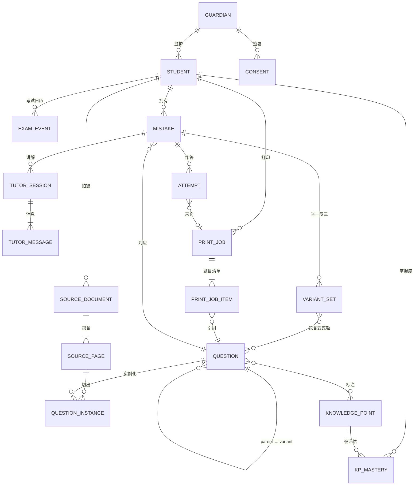

# 04 · 数据模型与接口

---

## 1. 核心概念

| 概念 | 含义 | 关键区分 |
|------|------|----------|
| **题目（Question）** | 题目本身的规范化内容：题干、选项、图、答案、解析、知识点 | **不含任何个人信息**，可以跨用户去重和缓存。来源有三种：拍照录入、AI 变式、题库 |
| **题目实例（QuestionInstance）** | 某次拍照中这道题在某页上的样子：位置、截图、擦除图、作答区尺寸 | 属于用户；含孩子的笔迹 |
| **错题（Mistake）** | "某个孩子 × 某道题"的学习档案：状态、轮次、关卡、调度 | 每个孩子每道题**只有一条**；重复录入时合并 |
| **作答记录（Attempt）** | 每一次作答的结果：录入时的原始错误、重做、变式、复习、考前打印 | 状态机的唯一输入 |
| **变式组（VariantSet）** | 为某道错题生成的一组变式题（5 题，或追加的 3 题） | 变式题本身也是 Question（`origin=variant`） |
| **打印任务（PrintJob）** | 一次打印：模板、筛选条件、题目清单、PDF、版面清单 | 回传扫描靠它定位题目 |

---

## 2. ER 图



---

## 3. 表结构（PostgreSQL）

> 下列 DDL 按领域分组展示，实际建表顺序以 Alembic 迁移为准（如 `kp_mastery` 依赖 §3.5 的 `knowledge_points`）。主键统一用 UUIDv7（按时间有序）。所有表都有 `created_at`、`updated_at`；用户数据表带 `deleted_at`，用于软删除，再由定时任务做物理清除。

### 3.1 账号与档案

```sql
CREATE TABLE guardians (
    id              uuid PRIMARY KEY,
    phone_hash      text UNIQUE,            -- 手机号哈希，明文加密后另存
    phone_enc       bytea,
    wechat_openid   text UNIQUE,
    nickname        text,
    membership      jsonb,                  -- {plan, expires_at}
    created_at      timestamptz NOT NULL DEFAULT now()
);

CREATE TABLE students (
    id              uuid PRIMARY KEY,
    guardian_id     uuid NOT NULL REFERENCES guardians(id),
    display_name    text NOT NULL,          -- 昵称即可，不要求真实姓名
    grade           smallint NOT NULL,      -- 9 = 初三
    district        text,                   -- 北京区县，如 'haidian'
    school          text,                   -- 选填
    textbooks       jsonb NOT NULL,         -- {"math":"rjb","physics":"bsd"}，教材版本编码见 07
    settings        jsonb NOT NULL DEFAULT '{}', -- 每日时长上限、学生模式等
    deleted_at      timestamptz
);

CREATE TABLE consents (                     -- 监护人同意记录，只追加
    id              uuid PRIMARY KEY,
    guardian_id     uuid NOT NULL REFERENCES guardians(id),
    student_id      uuid REFERENCES students(id),
    policy_version  text NOT NULL,          -- 隐私政策 / 儿童个人信息保护规则版本
    scopes          text[] NOT NULL,        -- {'basic','ai_processing','training_data'}
    granted         boolean NOT NULL,
    created_at      timestamptz NOT NULL DEFAULT now()
);

CREATE TABLE exam_events (
    id              uuid PRIMARY KEY,
    student_id      uuid NOT NULL REFERENCES students(id),
    name            text NOT NULL,          -- '海淀一模'
    kind            text NOT NULL,          -- midterm|final|mock1|mock2|zhongkao|monthly|other
    exam_date       date NOT NULL,
    subjects        text[] NOT NULL,
    scope_kp_ids    uuid[]                  -- 考试范围（知识点），为空表示全部
);
```

### 3.2 采集

```sql
CREATE TABLE source_documents (            -- 一份来源卷（可多页）
    id              uuid PRIMARY KEY,
    student_id      uuid NOT NULL REFERENCES students(id),
    subject         text NOT NULL,          -- math|physics
    source_kind     text NOT NULL,          -- homework|quiz|monthly|midterm|final|mock1|mock2|other
    title           text,                   -- '2026 海淀区九年级上学期期中'（可由卷头识别）
    exam_date       date,
    status          text NOT NULL,          -- uploading|processing|ready|failed
    deleted_at      timestamptz
);

CREATE TABLE source_pages (
    id              uuid PRIMARY KEY,
    document_id     uuid NOT NULL REFERENCES source_documents(id),
    page_no         smallint NOT NULL,
    original_key    text NOT NULL,          -- OSS 对象键
    corrected_key   text,
    erased_key      text,
    erase_status    text,                   -- pending|done|user_patched|failed
    paper_size      text,                   -- A4|B4|A3|8K
    layout          jsonb,                  -- 版面分析原始结果
    quality         jsonb,                  -- {blur, glare, skew}
    UNIQUE (document_id, page_no)
);

CREATE TABLE questions (                    -- 规范化题目，无个人信息
    id                 uuid PRIMARY KEY,
    subject            text NOT NULL,
    origin             text NOT NULL,       -- captured|variant|bank
    content_hash       text NOT NULL,       -- 规范化题干的哈希，用于去重
    stem_md            text NOT NULL,       -- Markdown + LaTeX
    options            jsonb,               -- [{"key":"A","md":"..."}]
    sub_questions      jsonb,               -- [{"no":"(1)","md":"...","points":3}]
    figures            jsonb,               -- [{"key":"oss/...","kind":"geometry|circuit|photo|chart","source":"crop|generated"}]
    answer             jsonb,               -- {"final":"C"} 或按小问给出
    solution_md        text,
    answer_source      text NOT NULL,       -- teacher|answer_key|manual|ai_verified|ai_unverified|bank
    verification       jsonb,               -- 校验记录：各模型解答、sympy 结果、结论
    question_type      text NOT NULL,       -- choice_single|choice_multi|fill|solve|experiment|reading|calc ...
    difficulty         smallint,            -- 1–5
    bj_slot            text,                -- 北京中考题位标签，如 'math.q28.new_definition'
    kp_ids             uuid[] NOT NULL,     -- 知识点（主知识点放第一个）
    embedding          vector(1024),        -- 用于去重、同类题检索
    parent_question_id uuid REFERENCES questions(id),  -- 变式题的母题
    variant_level      smallint,            -- 1–5，对应变式阶梯
    gen_meta           jsonb,               -- 模型、提示词版本、生成参数
    status             text NOT NULL DEFAULT 'active'  -- active|flagged|retired
);
CREATE INDEX ON questions (content_hash);
CREATE INDEX ON questions USING gin (kp_ids);
CREATE INDEX ON questions USING hnsw (embedding vector_cosine_ops);

CREATE TABLE question_instances (           -- 题目在某页上的实例，属于用户
    id               uuid PRIMARY KEY,
    page_id          uuid NOT NULL REFERENCES source_pages(id),
    question_id      uuid NOT NULL REFERENCES questions(id),
    number_label     text,                  -- 卷面题号 '27'
    bbox             jsonb NOT NULL,        -- 在矫正图上的位置
    crop_key         text,                  -- 原貌截图
    erased_crop_key  text,                  -- 擦除后截图（错题重做单使用）
    answer_area_mm   numeric(6,1),          -- 原卷作答区高度（毫米）
    student_answer   jsonb,                 -- OCR 出的孩子原始作答
    grading_marks    jsonb                  -- 红笔批改：{"mark":"wrong","score":"3/8"}
);
```

### 3.3 错题与学习

```sql
CREATE TABLE mistakes (
    id               uuid PRIMARY KEY,
    student_id       uuid NOT NULL REFERENCES students(id),
    question_id      uuid NOT NULL REFERENCES questions(id),
    first_instance_id uuid REFERENCES question_instances(id),
    status           text NOT NULL,         -- 状态机，见 06 §2
    round            smallint NOT NULL DEFAULT 1,
    gates            jsonb NOT NULL DEFAULT '{"original":false,"variant":false,"spaced":false}',
    error_causes     text[] NOT NULL DEFAULT '{}',   -- 错因编码，见 07
    wrong_count      smallint NOT NULL DEFAULT 1,
    leitner_box      smallint NOT NULL DEFAULT 0,
    next_review_at   date,
    priority         real,                  -- 调度优先级（每日重算）
    mastered_at      timestamptz,
    last_wrong_at    timestamptz NOT NULL,
    deleted_at       timestamptz,
    UNIQUE (student_id, question_id)
);
CREATE INDEX ON mistakes (student_id, status);
CREATE INDEX ON mistakes (student_id, next_review_at);

CREATE TABLE attempts (                     -- 只追加，是状态机的事实来源
    id               uuid PRIMARY KEY,
    mistake_id       uuid NOT NULL REFERENCES mistakes(id),
    question_id      uuid NOT NULL REFERENCES questions(id),  -- 原题或变式题
    round            smallint NOT NULL,
    context          text NOT NULL,         -- capture|redo|variant|review|exam_pack|daily
    variant_set_id   uuid,
    print_job_id     uuid,
    result           text NOT NULL,         -- correct|wrong|partial|skipped
    graded_by        text NOT NULL,         -- teacher|self|guardian|ai
    ai_confidence    real,
    answer_image_key text,
    error_cause      text,
    created_at       timestamptz NOT NULL DEFAULT now()
);

CREATE TABLE variant_sets (
    id               uuid PRIMARY KEY,
    mistake_id       uuid NOT NULL REFERENCES mistakes(id),
    round            smallint NOT NULL,
    kind             text NOT NULL,         -- initial(5)|followup(3)
    target_levels    smallint[] NOT NULL,   -- 追加题针对的阶梯层级
    status           text NOT NULL,         -- generating|ready|partial|failed|completed
    question_ids     uuid[] NOT NULL DEFAULT '{}',
    score            jsonb                  -- {"correct":4,"total":5,"synthesis_ok":true}
);

CREATE TABLE tutor_sessions (
    id               uuid PRIMARY KEY,
    student_id       uuid NOT NULL REFERENCES students(id),
    mistake_id       uuid REFERENCES mistakes(id),
    question_id      uuid REFERENCES questions(id),
    mode             text NOT NULL,         -- guided|diagnose
    current_step     smallint NOT NULL DEFAULT 1,
    status           text NOT NULL          -- active|completed|abandoned|low_confidence
);

CREATE TABLE tutor_messages (
    id               uuid PRIMARY KEY,
    session_id       uuid NOT NULL REFERENCES tutor_sessions(id),
    role             text NOT NULL,         -- student|assistant|system
    step             smallint,
    content_md       text NOT NULL,
    attachments      jsonb,
    created_at       timestamptz NOT NULL DEFAULT now()
);

CREATE TABLE kp_mastery (
    student_id       uuid NOT NULL REFERENCES students(id),
    kp_id            uuid NOT NULL REFERENCES knowledge_points(id),
    score            real NOT NULL,         -- 0–1，见 06 §6
    evidence_count   integer NOT NULL,
    updated_at       timestamptz NOT NULL,
    PRIMARY KEY (student_id, kp_id)
);
```

### 3.4 打印

```sql
CREATE TABLE print_jobs (
    id               uuid PRIMARY KEY,
    student_id       uuid NOT NULL REFERENCES students(id),
    template         text NOT NULL,         -- page_restore|redo_sheet|variant_sheet|exam_pack|daily
    filters          jsonb,                 -- 筛选条件（用于重新打印）
    layout           jsonb NOT NULL,        -- {paper:'A4',columns:2,answer_space:'original',with_key:true,...}
    status           text NOT NULL,         -- queued|rendering|ready|failed
    pdf_key          text,
    key_pdf_key      text,                  -- 答案页单独的 PDF
    manifest_key     text,                  -- 版面清单（题目 → 页码、坐标）
    page_count       smallint,
    qr_token         text UNIQUE NOT NULL   -- 回传二维码短码，不含个人信息
);

CREATE TABLE print_job_items (
    print_job_id     uuid NOT NULL REFERENCES print_jobs(id),
    seq              smallint NOT NULL,
    question_id      uuid NOT NULL REFERENCES questions(id),
    mistake_id       uuid REFERENCES mistakes(id),
    page_no          smallint,
    answer_bbox_mm   jsonb,                 -- 作答区在页面上的坐标（毫米）
    PRIMARY KEY (print_job_id, seq)
);
```

### 3.5 字典与运营

```sql
CREATE TABLE knowledge_points (             -- 由 data/curriculum/*.yaml 导入
    id               uuid PRIMARY KEY,
    subject          text NOT NULL,
    code             text UNIQUE NOT NULL,  -- 'M.FUN.QUAD.GRAPH'
    name             text NOT NULL,
    parent_id        uuid REFERENCES knowledge_points(id),
    level            smallint NOT NULL,     -- 1 模块 | 2 主题 | 3 考点
    bj_weight        real,                  -- 北京中考权重（0–1），用于调度优先级
    textbook_refs    jsonb                  -- {"rjb":"九上 22.1", "bjb":"..."}
);

CREATE TABLE question_feedback (
    id               uuid PRIMARY KEY,
    question_id      uuid NOT NULL REFERENCES questions(id),
    student_id       uuid REFERENCES students(id),
    reason           text NOT NULL,         -- wrong_answer|ambiguous|out_of_scope|figure_mismatch|other
    note             text,
    status           text NOT NULL          -- open|confirmed|rejected
);

CREATE TABLE ai_calls (                     -- 审计与计量
    id               uuid PRIMARY KEY,
    task             text NOT NULL,         -- classify|solve|verify|variant_gen|tutor|grade ...
    model            text NOT NULL,
    prompt_version   text NOT NULL,
    student_ref      text,                  -- 孩子 ID 的哈希
    input_tokens     integer, output_tokens integer,
    cost_cny         numeric(10,5),
    latency_ms       integer,
    outcome          text,                  -- ok|schema_retry|failed|blocked
    created_at       timestamptz NOT NULL DEFAULT now()
);
```

---

## 4. 题目结构化 JSON（AI 识别的输出）

识别任务（见 05 §3.1）必须按以下 Schema 输出，服务端用 Pydantic 校验：

```json
{
  "number_label": "27",
  "subject": "math",
  "question_type": "solve",
  "stem_md": "如图，在 $\\triangle ABC$ 中，$AB=AC$，$\\angle BAC=90^\\circ$，点 $D$ 在 $BC$ 上……",
  "options": null,
  "sub_questions": [
    {"no": "(1)", "md": "依题意补全图形；"},
    {"no": "(2)", "md": "求证：$BD=CE$；"},
    {"no": "(3)", "md": "用等式表示线段 $AF$，$BD$，$DC$ 之间的数量关系，并证明。"}
  ],
  "figures": [{"ref": "fig1", "kind": "geometry", "bbox": [120, 340, 560, 720]}],
  "student_answer": {"text": "(2) 证明：∵ AB=AC ……", "legible": true},
  "grading_marks": {"mark": "partial", "score": "4/7"},
  "teacher_answer": null,
  "header_info": {"title": "2026 海淀区九年级第一学期期中", "has_name_field": true}
}
```

分类任务的输出：

```json
{
  "kp_codes": ["M.TRF.ROT.HAND", "M.GEO.TRI.CONG", "M.GEO.TRI.ISO"],
  "bj_slot": "math.q27.geometry_synthesis",
  "difficulty": 4,
  "error_cause_suggestions": [
    {"code": "METHOD_UNKNOWN", "evidence": "第(3)问未作辅助线，直接猜结论", "confidence": 0.72}
  ]
}
```

---

## 5. 接口设计（REST，`/api/v1`）

鉴权：微信登录或手机号登录后获得 JWT；所有带 `student_id` 的资源都会校验它是否属于当前监护人。长任务一律异步：返回 `job_id`，再通过轮询 `GET /jobs/{id}` 或订阅消息获取结果。

### 5.1 账号与档案

| 方法 | 路径 | 说明 |
|------|------|------|
| POST | `/auth/wechat` · `/auth/sms` | 登录 |
| POST | `/consents` | 记录监护人同意 |
| GET/POST/PATCH | `/students` · `/students/{id}` | 孩子档案 |
| GET/POST/DELETE | `/students/{id}/exams` | 考试日历 |
| POST | `/students/{id}/export` · `DELETE /students/{id}` | 数据导出、注销删除 |

### 5.2 采集

| 方法 | 路径 | 说明 |
|------|------|------|
| POST | `/uploads/presign` | 获取 OSS 直传签名 |
| POST | `/captures` | 提交来源卷：`{student_id, subject, mode: single|page, pages:[{object_key}], source_kind?}` → `job_id` |
| GET | `/jobs/{id}` | 任务进度：`{stage, progress, result_ref}` |
| GET | `/documents/{id}/candidates` | 批量确认页数据：识别出的题目及预选状态 |
| POST | `/documents/{id}/confirm` | 批量确认：`{items:[{instance_id, selected, kp_codes?, error_causes?, answer?}]}` → 生成或合并错题 |
| PATCH | `/pages/{id}/erase` | 提交修补后的擦除结果（补擦、恢复的蒙版） |

### 5.3 错题

| 方法 | 路径 | 说明 |
|------|------|------|
| GET | `/students/{id}/mistakes` | 列表；筛选参数：`subject, kp, status, cause, min_wrong, source_kind, from, to` |
| GET | `/mistakes/{id}` | 详情（含旅程时间线） |
| PATCH | `/mistakes/{id}` | 修改知识点、错因、答案 |
| POST | `/mistakes/{id}/attempts` | 回填一次作答（单题） |
| POST | `/attempts:batch` | 按打印任务批量回填：`{print_job_id, results:[{seq, result}]}` |

### 5.4 变式与讲解

| 方法 | 路径 | 说明 |
|------|------|------|
| POST | `/mistakes/{id}/variant-sets` | 生成变式组：`{kind: initial|followup}` → `job_id` |
| GET | `/variant-sets/{id}` | 变式组详情（题目、答案只在请求答案页时返回） |
| POST | `/questions/{id}/feedback` | 反馈题目有误 |
| POST | `/tutor/sessions` | 发起讲解：`{mistake_id?}` 或 `{image_key}`（拍新题），`mode: guided|diagnose` |
| POST | `/tutor/sessions/{id}/messages` | 发送追问或"下一步"；**SSE 流式**返回 |

### 5.5 打印

| 方法 | 路径 | 说明 |
|------|------|------|
| POST | `/print-jobs/preview` | 按筛选条件和排版参数预估：题数、页数、时长 |
| POST | `/print-jobs` | 创建：`{student_id, template, filters | item_ids, layout}` → `job_id` |
| GET | `/print-jobs/{id}` | 状态与 PDF 下载链接（短时有效的签名 URL） |
| GET | `/students/{id}/print-jobs` | 打印记录 |
| POST | `/print-jobs/{id}/returns` | 上传回传照片 → AI 批改任务（P1） |
| GET | `/p/{qr_token}` | 二维码落地：已登录时跳转到对应打印任务的回填页 |

### 5.6 学情

| 方法 | 路径 | 说明 |
|------|------|------|
| GET | `/students/{id}/today` | 首页数据：倒计时、今日学透单、待处理计数 |
| GET | `/students/{id}/dashboard` | 知识点掌握度、错因分布、反复错 TOP |
| GET | `/students/{id}/reports/weekly?week=2026-W42` | 周报 |
