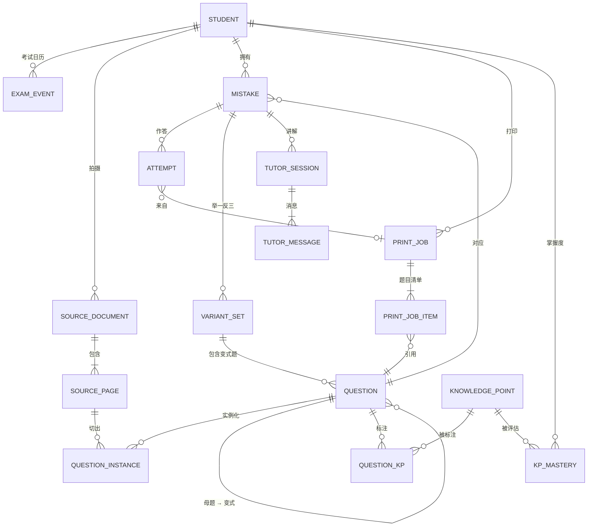

# 04 · 数据模型与接口

> 服务器上用 SQLite 做**工作数据库**；数据的**正本**以 JSONL 文本存在 GitHub 私有仓库里（见 [03 §5](03-system-architecture.md) 和本文 §6）。没有账号体系，只有一个家庭密码；可以有多个孩子档案。

---

## 1. 核心概念

| 概念 | 含义 | 关键区分 |
|------|------|----------|
| **题目（Question）** | 题目本身的规范化内容：题干、选项、图、答案、解析、知识点 | 来源有三种：拍照录入、AI 变式、（以后）导入的真题 |
| **题目实例（QuestionInstance）** | 某次拍照中这道题在某页上的样子：位置、截图、擦除图、作答区尺寸 | 含孩子的笔迹 |
| **错题（Mistake）** | "某个孩子 × 某道题"的学习档案：状态、轮次、关卡、调度 | 每个孩子每道题**只有一条**；重复录入时合并 |
| **作答记录（Attempt）** | 每一次作答的结果：录入时的原始错误、重做、变式、复习、考前打印 | 状态机的唯一输入，只追加不修改 |
| **变式组（VariantSet）** | 为某道错题生成的一组变式题（5 题，或追加的 3 题） | 变式题本身也是 Question（`origin='variant'`） |
| **打印任务（PrintJob）** | 一次打印：模板、筛选条件、题目清单、PDF、版面清单 | 页面二维码指向它的回填页 |
| **后台任务（Job）** | 识别、擦除、出题、排版等耗时操作 | 进程内队列，存在数据库里，重启后可以续跑 |

---

## 2. ER 图



---

## 3. 表结构（SQLite）

**约定**
- 主键是 UUIDv7 字符串（按时间有序）；时间是 ISO 8601 字符串；布尔值用 0/1。
- 标注为 `JSON` 的列以文本存储，用 SQLite 的 JSON 函数查询。
- 每张表都有 `created_at`；需要修改的表另有 `updated_at`。
- 建表顺序按依赖关系：`knowledge_points`（§3.5）先于 `question_kps` 和 `kp_mastery`。
- 标注 **【仅本地】** 的表和列不同步到数据仓库；其余都会导出成 JSONL（§6）。

### 3.1 孩子档案与设置

```sql
CREATE TABLE students (
    id            TEXT PRIMARY KEY,
    name          TEXT NOT NULL,          -- 昵称即可
    grade         INTEGER NOT NULL,       -- 9 = 初三
    district      TEXT,                   -- 北京区县，如 'haidian'
    textbooks     JSON NOT NULL,          -- {"math":"rjb","physics":"bsd"}，编码见 07 §7
    settings      JSON NOT NULL DEFAULT '{}', -- 每日时长预算、学透参数、家长模式等
    created_at    TEXT NOT NULL
);

CREATE TABLE exam_events (
    id            TEXT PRIMARY KEY,
    student_id    TEXT NOT NULL REFERENCES students(id),
    name          TEXT NOT NULL,          -- '海淀期末'
    kind          TEXT NOT NULL,          -- midterm|final|mock1|mock2|zhongkao|monthly|other
    exam_date     TEXT NOT NULL,
    subjects      JSON NOT NULL,          -- ["math","physics"]
    scope_kp_codes JSON                   -- 考试范围（知识点编码），为空表示全部
);

CREATE TABLE app_settings (               -- 【仅本地】家庭密码哈希、会话版本号、TOTP 密钥等；非敏感项另存 settings.json 同步
    key           TEXT PRIMARY KEY,
    value         JSON NOT NULL
);
```

> 接口密钥和 GitHub 部署密钥只放在服务器的 `.env` 和密钥文件里，不进数据库，也不进任何仓库。

### 3.2 采集

```sql
CREATE TABLE source_documents (           -- 一份来源卷（可以有多页）
    id            TEXT PRIMARY KEY,
    student_id    TEXT NOT NULL REFERENCES students(id),
    subject       TEXT NOT NULL,          -- math|physics
    source_kind   TEXT NOT NULL,          -- homework|quiz|monthly|midterm|final|mock1|mock2|other
    title         TEXT,                   -- '2026 海淀区九年级上学期期中'
    exam_date     TEXT,
    status        TEXT NOT NULL,          -- processing|ready|failed
    created_at    TEXT NOT NULL
);

CREATE TABLE source_pages (
    id            TEXT PRIMARY KEY,
    document_id   TEXT NOT NULL REFERENCES source_documents(id),
    page_no       INTEGER NOT NULL,
    original_path TEXT NOT NULL,          -- 数据仓库 files/ 下的相对路径
    transform     JSON,                   -- 透视矫正的变换矩阵（矫正图按需重新生成）
    erased_path   TEXT,
    erase_status  TEXT,                   -- pending|done|patched|failed
    paper_size    TEXT,                   -- A4|B4|A3|8K
    layout        JSON,                   -- 切题接口的原始结果
    UNIQUE (document_id, page_no)
);

CREATE TABLE questions (
    id                 TEXT PRIMARY KEY,
    subject            TEXT NOT NULL,
    origin             TEXT NOT NULL,     -- captured|variant|imported
    content_hash       TEXT NOT NULL,     -- 规范化题干的哈希，用于去重
    stem_md            TEXT NOT NULL,     -- Markdown + LaTeX
    options            JSON,              -- [{"key":"A","md":"..."}]
    sub_questions      JSON,              -- [{"no":"(1)","md":"...","points":3}]
    figures            JSON,              -- [{"path":"figures/...png","kind":"geometry|circuit|photo|chart"}]
    answer             JSON,              -- {"final":"C"} 或按小问给出
    solution_md        TEXT,
    answer_source      TEXT NOT NULL,     -- teacher|answer_key|manual|ai_verified|ai_unverified|imported
    verification       JSON,              -- 校验记录：各模型的解答、sympy 结果、结论
    question_type      TEXT NOT NULL,     -- choice_single|choice_multi|fill|solve|experiment|reading|calc
    difficulty         INTEGER,           -- 1–5
    bj_slot            TEXT,              -- 北京中考题位，如 'math.q28.new_definition'
    parent_question_id TEXT REFERENCES questions(id),  -- 变式题的母题
    variant_set_id     TEXT,              -- 所属变式组
    variant_level      INTEGER,           -- 1–5，对应变式阶梯
    gen_meta           JSON,              -- 模型、提示词版本、生成参数
    status             TEXT NOT NULL DEFAULT 'active',  -- active|flagged（被标记有问题）
    created_at         TEXT NOT NULL
);
CREATE INDEX idx_questions_hash ON questions(content_hash);

CREATE TABLE question_kps (               -- 题目 × 知识点
    question_id   TEXT NOT NULL REFERENCES questions(id),
    kp_code       TEXT NOT NULL REFERENCES knowledge_points(code),
    is_primary    INTEGER NOT NULL DEFAULT 0,
    PRIMARY KEY (question_id, kp_code)
);

CREATE TABLE question_instances (
    id              TEXT PRIMARY KEY,
    page_id         TEXT NOT NULL REFERENCES source_pages(id),
    question_id     TEXT NOT NULL REFERENCES questions(id),
    number_label    TEXT,                 -- 卷面题号 '27'
    bbox            JSON NOT NULL,        -- 在矫正图上的位置；原貌截图和擦除截图都按它现场裁出并缓存
    answer_area_mm  REAL,                 -- 原卷作答区高度（毫米）
    student_answer  JSON,                 -- 识别出的孩子原始作答
    grading_marks   JSON,                 -- 红笔批改：{"mark":"wrong","score":"3/8","cause_suggestions":[...]}
    status          TEXT NOT NULL,        -- candidate（待确认）| confirmed | discarded
    preselected     INTEGER NOT NULL      -- 老师判错或半对时，批量确认页默认勾选
);
```

**去重**：一个家庭的题量很小（一学期几百到一两千道），录入时先按 `content_hash` 精确匹配，再在同学科题目里做文本相似度比较（如 rapidfuzz），相似度高于阈值时提示"可能是同一道题，合并吗？"。不需要向量数据库。

### 3.3 错题与学习

```sql
CREATE TABLE mistakes (
    id                TEXT PRIMARY KEY,
    student_id        TEXT NOT NULL REFERENCES students(id),
    question_id       TEXT NOT NULL REFERENCES questions(id),
    first_instance_id TEXT REFERENCES question_instances(id),
    status            TEXT NOT NULL,      -- 状态机，见 06 §2
    round             INTEGER NOT NULL DEFAULT 1,
    gates             JSON NOT NULL DEFAULT '{"original":false,"variant":false,"spaced":false}',
    error_causes      JSON NOT NULL DEFAULT '[]',   -- 错因编码，见 07 §6.2
    wrong_count       INTEGER NOT NULL DEFAULT 1,
    followups         INTEGER NOT NULL DEFAULT 0,   -- 已追加变式的次数
    variant_passed_at TEXT,
    next_review_at    TEXT,
    priority          REAL,               -- 【仅本地】调度优先级（每天重算，重建索引时也重算）
    mastered_at       TEXT,
    last_wrong_at     TEXT NOT NULL,
    created_at        TEXT NOT NULL,
    UNIQUE (student_id, question_id)
);
CREATE INDEX idx_mistakes_status ON mistakes(student_id, status);
CREATE INDEX idx_mistakes_review ON mistakes(student_id, next_review_at);

CREATE TABLE attempts (                   -- 只追加，是状态机的事实来源
    id              TEXT PRIMARY KEY,
    mistake_id      TEXT NOT NULL REFERENCES mistakes(id),
    question_id     TEXT NOT NULL REFERENCES questions(id),  -- 原题或变式题
    round           INTEGER NOT NULL,
    context         TEXT NOT NULL,        -- capture|redo|variant|review|exam_pack|daily
    variant_set_id  TEXT,
    print_job_id    TEXT,
    result          TEXT NOT NULL,        -- correct|wrong|partial|skipped
    graded_by       TEXT NOT NULL,        -- teacher|guardian|ai
    error_cause     TEXT,
    note            TEXT,
    created_at      TEXT NOT NULL
);

CREATE TABLE variant_sets (
    id              TEXT PRIMARY KEY,
    mistake_id      TEXT NOT NULL REFERENCES mistakes(id),
    round           INTEGER NOT NULL,
    kind            TEXT NOT NULL,        -- initial(5)|followup(3)
    target_levels   JSON NOT NULL,        -- 追加题针对的阶梯层级
    status          TEXT NOT NULL,        -- generating|ready|partial|failed|completed
    score           JSON,                 -- {"correct":4,"total":5,"synthesis_ok":true}
    created_at      TEXT NOT NULL
);

CREATE TABLE tutor_sessions (
    id              TEXT PRIMARY KEY,
    student_id      TEXT NOT NULL REFERENCES students(id),
    mistake_id      TEXT REFERENCES mistakes(id),
    question_id     TEXT REFERENCES questions(id),
    mode            TEXT NOT NULL,        -- guided|diagnose|parent（家长模式）
    current_step    INTEGER NOT NULL DEFAULT 1,
    status          TEXT NOT NULL,        -- active|completed|abandoned|low_confidence
    created_at      TEXT NOT NULL
);

CREATE TABLE tutor_messages (
    id              TEXT PRIMARY KEY,
    session_id      TEXT NOT NULL REFERENCES tutor_sessions(id),
    role            TEXT NOT NULL,        -- student|assistant
    step            INTEGER,
    content_md      TEXT NOT NULL,
    attachments     JSON,
    created_at      TEXT NOT NULL
);

CREATE TABLE kp_lessons (                 -- 知识点讲解：每个孩子每个知识点一份，见 06 §6.2
    id              TEXT PRIMARY KEY,
    student_id      TEXT NOT NULL REFERENCES students(id),
    kp_code         TEXT NOT NULL,
    content         JSON NOT NULL,        -- one_line, key_points, method, pitfalls, example, self_check
    basis           JSON NOT NULL,        -- 用到了哪些错题；M1/B1 这些编号对应的错题和题库题
    model           TEXT NOT NULL,
    prompt_version  TEXT NOT NULL,
    created_at      TEXT NOT NULL,
    UNIQUE (student_id, kp_code)
);

CREATE TABLE kp_mastery (                 -- 【仅本地】派生数据：由作答记录算出，重建索引时重算（知识点整理页目前现算，见 06 §6.1）
    student_id      TEXT NOT NULL REFERENCES students(id),
    kp_code         TEXT NOT NULL REFERENCES knowledge_points(code),
    score           REAL NOT NULL,        -- 0–1，见 06 §6
    evidence_count  INTEGER NOT NULL,
    updated_at      TEXT NOT NULL,
    PRIMARY KEY (student_id, kp_code)
);
```

### 3.4 打印

```sql
CREATE TABLE print_jobs (
    id              TEXT PRIMARY KEY,
    student_id      TEXT NOT NULL REFERENCES students(id),
    template        TEXT NOT NULL,        -- page_restore|redo_sheet|variant_sheet|exam_pack|daily
    filters         JSON,                 -- 筛选条件（用于重新打印）
    layout          JSON NOT NULL,        -- {paper:'A4',columns:2,answer_space:'original',with_key:true,...}
    status          TEXT NOT NULL,        -- queued|rendering|ready|failed
    pdf_path        TEXT,                 -- 【仅本地】缓存 7 天，需要时按本记录重新渲染
    key_pdf_path    TEXT,                 -- 【仅本地】答案页单独的 PDF
    manifest        JSON,                 -- 版面清单（题目 → 页码、坐标），同步
    page_count      INTEGER,
    created_at      TEXT NOT NULL
);

CREATE TABLE print_job_items (
    print_job_id    TEXT NOT NULL REFERENCES print_jobs(id),
    seq             INTEGER NOT NULL,     -- 打印单上的题号
    question_id     TEXT REFERENCES questions(id),
    mistake_id      TEXT REFERENCES mistakes(id),
    instance_id     TEXT REFERENCES question_instances(id),  -- 打印用哪一次拍到的截图
    page_id         TEXT REFERENCES source_pages(id),        -- 原卷还原时按页打印（此时没有题目）
    page_no         INTEGER,
    answer_bbox_mm  JSON,                 -- 作答区在页面上的坐标（毫米）
    PRIMARY KEY (print_job_id, seq)
);
```

### 3.4a 题库

详见 [10 §4](10-question-bank.md)。题目内容放在 `questions`（`origin = 'bank'`），位置单独一张表：

```sql
CREATE TABLE bank_papers (                -- 一套卷子；原卷和答案文件在 files/bank/<id>/
    id              TEXT PRIMARY KEY,
    subject         TEXT NOT NULL,
    title           TEXT NOT NULL,        -- '2025 海淀一模 · 数学'
    year            INTEGER,
    region          TEXT,                 -- beijing（全市）或区的代码
    exam_kind       TEXT NOT NULL,        -- zhongkao|yimo|ermo|midterm|final|monthly|other
    files           JSON NOT NULL,        -- [{"role":"paper|answer","kind":"pdf|image","path":…,"name":…,"pages":3}]
    pages           JSON NOT NULL,        -- [{"n":1,"file":0,"index":0,"role":"paper","kind":"questions|answers|other"}]
    status          TEXT NOT NULL,        -- processing|ready|failed
    error           TEXT,
    stats           JSON,                 -- 题数、官方答案数、待核对数、答案对不上题号的列表……
    created_at      TEXT NOT NULL
);

CREATE TABLE bank_items (                 -- 一道题库题在原卷上的位置
    question_id     TEXT PRIMARY KEY REFERENCES questions(id),
    paper_id        TEXT NOT NULL REFERENCES bank_papers(id),
    seq             INTEGER NOT NULL,
    number_label    TEXT NOT NULL,
    regions         JSON NOT NULL,        -- [{"page":1,"bbox":[x0,y0,x1,y1]}]，0–1000 归一化；跨页时多段
    points          TEXT                  -- 卷面分值 '2分'
);
-- questions 加一列 bank_match JSON：录入的题对上了哪道题库题 {"question_id","score","status":"auto|rejected",…}
-- questions.answer_source 增加取值 official（官方答案及评分标准）
```

### 3.5 字典、任务与日志

```sql
CREATE TABLE knowledge_points (           -- 【仅本地】启动时从代码仓库的 app/curriculum/*.yaml 加载
    code            TEXT PRIMARY KEY,     -- 'M.FUN.QUAD.GRAPH'
    subject         TEXT NOT NULL,
    name            TEXT NOT NULL,
    parent_code     TEXT REFERENCES knowledge_points(code),
    level           INTEGER NOT NULL,     -- 1 模块 | 2 主题 | 3 考点
    bj_weight       REAL,                 -- 北京中考权重（0–1），用于调度优先级
    textbook_refs   JSON                  -- {"rjb":"九上 …","bsd":"…"}
);

CREATE TABLE jobs (                       -- 【仅本地】进程内任务队列
    id              TEXT PRIMARY KEY,
    kind            TEXT NOT NULL,        -- capture|erase|variants|render|grade ...
    payload         JSON NOT NULL,
    status          TEXT NOT NULL,        -- queued|running|done|failed
    progress        JSON,                 -- {"stage":"切题","pct":40}
    result          JSON,
    error           TEXT,
    attempts        INTEGER NOT NULL DEFAULT 0,
    created_at      TEXT NOT NULL,
    updated_at      TEXT NOT NULL
);
CREATE INDEX idx_jobs_status ON jobs(status, created_at);

CREATE TABLE ai_calls (                   -- 【仅本地】调试、费用统计、每日费用上限；每月汇总写入 settings.json
    id              TEXT PRIMARY KEY,
    task            TEXT NOT NULL,        -- classify|solve|verify|variant_gen|tutor|grade ...
    model           TEXT NOT NULL,
    prompt_version  TEXT NOT NULL,
    input_tokens    INTEGER,
    output_tokens   INTEGER,
    cost_cny        REAL,
    latency_ms      INTEGER,
    outcome         TEXT,                 -- ok|schema_retry|failed
    created_at      TEXT NOT NULL
);
```

---

## 4. 题目结构化 JSON（AI 识别的输出）

识别任务（见 05 §3.1）必须按以下 Schema 输出，服务端用 Pydantic 校验：

```json
{
  "number_label": "27",
  "subject": "math",
  "question_type": "solve",
  "stem_md": "如图，在 $\\triangle ABC$ 中，$AB=AC$，$\\angle BAC=90^\\circ$，点 $D$ 在 $BC$ 上……",
  "options": null,
  "sub_questions": [
    {"no": "(1)", "md": "依题意补全图形；"},
    {"no": "(2)", "md": "求证：$BD=CE$；"},
    {"no": "(3)", "md": "用等式表示线段 $AF$，$BD$，$DC$ 之间的数量关系，并证明。"}
  ],
  "figures": [{"ref": "fig1", "kind": "geometry", "bbox": [120, 340, 560, 720]}],
  "student_answer": {"text": "(2) 证明：∵ AB=AC ……", "legible": true},
  "grading_marks": {"mark": "partial", "score": "4/7"},
  "teacher_answer": null,
  "header_info": {"title": "2026 海淀区九年级第一学期期中"}
}
```

分类任务的输出：

```json
{
  "kp_codes": ["M.TRF.ROT.HAND", "M.GEO.TRI.CONG", "M.GEO.TRI.ISO"],
  "bj_slot": "math.q27.geometry_synthesis",
  "difficulty": 4,
  "error_cause_suggestions": [
    {"code": "METHOD_UNKNOWN", "evidence": "第(3)问未作辅助线，直接猜结论", "confidence": 0.72}
  ]
}
```

---

## 5. 接口（REST，`/api`）

- **鉴权**：`POST /api/login` 校验家庭密码（同一 IP 连续失败 5 次锁定 15 分钟；开启两步验证时还要动态码），写入 30 天有效的会话 Cookie；**除登录接口外，所有接口和文件都要求已登录**（见 03 §4）。
- **长任务**一律异步：返回 `job_id`，前端轮询 `GET /api/jobs/{id}` 显示进度。
- 当前孩子由请求参数 `student_id` 指定（只有一个孩子时前端自动带上）。

### 5.1 基础

| 方法 | 路径 | 说明 |
|------|------|------|
| POST | `/api/login` · `/api/logout` | 家庭密码登录 |
| POST | `/api/logout-all` | 退出所有设备（递增会话版本号） |
| POST | `/api/totp/setup` · `/api/totp/verify` | 开启两步验证（v0.2） |
| GET/POST/PATCH | `/api/students` · `/api/students/{id}` | 孩子档案 |
| GET/POST/DELETE | `/api/students/{id}/exams` | 考试日历 |
| GET/PATCH | `/api/settings` | 模型选择、学透参数、每日费用上限 |
| GET | `/api/jobs/{id}` | 任务进度：`{status, progress, result}` |
| GET | `/api/sync/status` | 最后同步时间、待推送的提交数、最近一次错误 |
| POST | `/api/sync` | 立即同步到 GitHub |
| GET | `/api/files/{path}` | 读取图片（鉴权后返回；不开放静态目录） |

### 5.2 采集

| 方法 | 路径 | 说明 |
|------|------|------|
| POST | `/api/captures` | multipart 上传一份来源卷的多张照片：`subject, mode=single|page, source_kind?, title?` → `job_id` |
| GET | `/api/documents/{id}/candidates` | 批量确认页数据：识别出的题目和预选状态 |
| POST | `/api/documents/{id}/confirm` | 批量确认：`{items:[{instance_id, selected, kp_codes?, error_causes?, answer?}]}` → 生成或合并错题 |
| POST | `/api/pages/{id}/regions` | 手动框选或调整切题结果 |
| PATCH | `/api/pages/{id}/erase` | 提交修补后的擦除结果（补擦、恢复的蒙版） |

### 5.3 错题

| 方法 | 路径 | 说明 |
|------|------|------|
| GET | `/api/mistakes` | 列表；筛选参数：`subject, kp, status, cause, min_wrong, source_kind, from, to`（`kp` 含下级知识点） |
| GET | `/api/mistakes/{id}` | 详情（含错题旅程） |
| PATCH | `/api/mistakes/{id}` | 修改知识点、错因、答案 |
| POST | `/api/mistakes/{id}/attempts` | 回填一次作答 |
| POST | `/api/print-jobs/{id}/results` | 按打印单批量回填：`{results:[{seq, result}]}` |

### 5.4 变式与讲解

| 方法 | 路径 | 说明 |
|------|------|------|
| POST | `/api/mistakes/{id}/variant-sets` | 出一组变式：`{kind: initial|followup}` → `job_id` |
| GET | `/api/variant-sets/{id}` | 变式组详情 |
| POST | `/api/questions/{id}/flag` | 标记题目有问题（作废并重出） |
| POST | `/api/tutor/sessions` | 发起讲解：`{mistake_id}`，或上传一张新题照片；`mode: guided|diagnose|parent` |
| POST | `/api/tutor/sessions/{id}/messages` | 发送追问或"下一步"，**SSE 流式**返回 |

### 5.5 打印

| 方法 | 路径 | 说明 |
|------|------|------|
| POST | `/api/print-jobs/preview` | 按筛选条件和排版参数预估：题数、页数、时长 |
| POST | `/api/print-jobs` | 创建：`{template, filters | item_ids, layout}` → `job_id` |
| GET | `/api/print-jobs/{id}` | 状态和 PDF 下载 |
| GET | `/api/print-jobs` | 打印记录 |
| GET | `/p/{print_job_id}` | **页面二维码的落地页**：打开这次打印的回填页（未登录时先输密码） |

### 5.5a 题库

见 [10 §5](10-question-bank.md)：`/api/bank/papers`（列表、上传、详情、删除、重新识别、继续核对）、`/api/bank/questions/{id}`（改答案、标记已核对）、`/api/questions/{id}/bank-match`（取消录入时的自动匹配）。

### 5.6 学情

| 方法 | 路径 | 说明 |
|------|------|------|
| GET | `/api/today` | 首页数据：考试倒计时、今日学透单、待处理计数 |
| GET | `/api/knowledge?student_id&subject` | 知识点整理：汇总（薄弱 / 待加强 / 较好的考点数）、掌握死角、还没有错题记录的常考点、整棵知识点树（每个节点带掌握度和错题数），见 06 §6.1 |
| GET | `/api/knowledge/blind-spots?student_id&limit=3` | 首页用：两科合在一起最该补的几个考点 |
| GET | `/api/knowledge/{code}?student_id` | 单个知识点：掌握度、错因、错题列表（`mistake_list`）、下级知识点、题库里的同类题 |
| GET | `/api/knowledge/{code}/lesson?student_id` | 知识点讲解（没有时为 null）、写完之后新增的错题数、正在生成的任务 |
| POST | `/api/knowledge/{code}/lesson` | 生成或重新生成讲解：`{student_id, fresh}` → `job_id`（已经在生成的返回同一个任务），见 06 §6.2 |
| GET | `/api/dashboard` | 知识点掌握度、错因分布、反复错 TOP |
| GET | `/api/weekly?week=2026-W42` | 周小结 |

---

## 6. 同步到 GitHub 的格式

数据仓库的目录结构见 [03 §5.2](03-system-architecture.md)。导出规则保证**同样的数据导出两次，结果逐字节相同**，这样 git 里只会出现真正变化的行：

| 规则 | 说明 |
|------|------|
| 一表一文件 | `tables/{表名}.jsonl`；`attempts` 按 `created_at` 的年月分成 `tables/attempts/YYYY-MM.jsonl` |
| 一行一条 | 每条记录占一行 JSON；按主键排序（UUIDv7 有序，新记录追加在末尾） |
| 键有序 | 每行的键按字母排序；JSON 列直接嵌入为对象，不再转成字符串 |
| 中文可读 | 不转义非 ASCII 字符（`ensure_ascii=False`），在 GitHub 网页上能直接看懂 |
| 删除 | 记录从文件中移除；git 历史里仍然能找回 |
| 只导出变化的表 | 同步时只重写有改动的表文件 |

**重建索引**（`python -m app.tools.rebuild_index`）：清空 SQLite → 读入全部 JSONL → 从代码仓库加载知识点树 → 重算 `priority` 和 `kp_mastery`。这两项随时间变化，所以标为【仅本地】、不导出；其余数据导出 → 重建 → 再导出，结果必须和原来逐字节一致，这一条写成单元测试。
