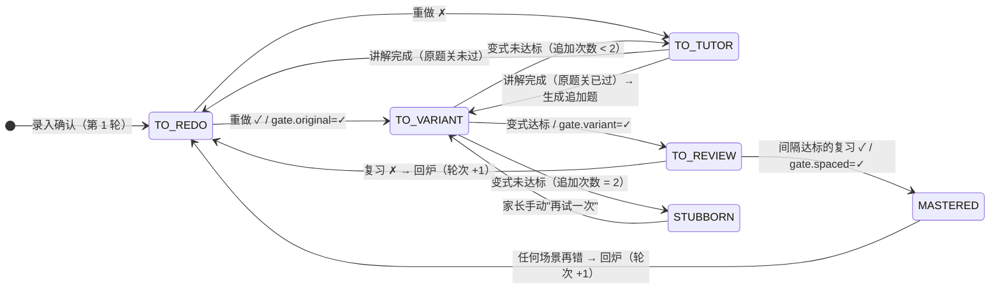

# 06 · 掌握度与复习算法

> 解决三个问题：**一道题什么时候算学透？今天该练哪几道？做错之后怎么回炉？**
> 用**规则 + 参数**实现，可解释、可手调。一个孩子的作答数据不够训练统计模型，规则就够用（见 §6）。

---

## 1. 设计原则

1. **作答记录是唯一事实来源**：状态只由 `attempts` 推导，状态机是纯函数，可以重放、可以单测。
2. **关卡制，不做模糊打分**：用"原题关 → 变式关 → 时间关"三道关定义"学透"，家长和孩子都看得懂。
3. **防死循环**：追加练习有上限，超过上限就转为"顽固错题"，提示请老师介入。
4. **考试感知**：考试临近时压缩复习间隔，保证考试范围内的错题考前至少复习一遍。
5. **控量**：每日任务按时间预算装填，不按题数。

---

## 2. 错题状态机

### 2.1 状态

| 状态 | 含义 | 首页显示的下一步 |
|------|------|------------------|
| `TO_REDO` | 原题关未过 | 打印空白卷重做 |
| `TO_TUTOR` | 原题重做又错，或变式未达标 | AI 讲解 |
| `TO_VARIANT` | 原题关已过，变式关未过 | 生成并打印变式 |
| `TO_REVIEW` | 原题关、变式关已过，等待时间关 | 到期复习 |
| `MASTERED` | 三关全过 | 低频维护（考前打印、每日学透单补位） |
| `STUBBORN` | 追加练习达到上限仍未通过 | 建议请教老师；降低出现频率 |

另有一个与状态正交的标志 `awaiting_result`：错题已经出现在某次打印里，但还没回填结果。首页"待回填"计数就是它。

### 2.2 状态转移



### 2.3 事件处理规则

| 事件 | 条件 | 动作 |
|------|------|------|
| `CONFIRM`（录入确认） | 新题 | 新建错题，`round=1`，进入 `TO_REDO` |
| | 已有同一道题（去重命中） | `wrong_count+1`；如果状态是 `TO_REVIEW` 或 `MASTERED`，按**回炉**处理；否则保持当前状态，只追加作答记录 |
| `REDO_RESULT` | ✓ | `gate.original=✓` → `TO_VARIANT` |
| | ✗ 或半对 | `wrong_count+1` → `TO_TUTOR` |
| `TUTOR_DONE` | 讲解会话完成（走到第 5 步，或孩子点了"我懂了"） | 原题关未过 → `TO_REDO`；已过 → 生成追加变式（3 题），进入 `TO_VARIANT` |
| `VARIANT_SET_SCORED` | 首组 5 题：做对 ≥ 4 题**且**第 5 题（综合题）做对 | `gate.variant=✓` → `TO_REVIEW`，安排时间关复习 |
| | 追加组 3 题：做对 ≥ 2 题**且**其中层级最高的那题做对 | 同上 |
| | 未达标，且追加次数 < 2 | 记录做错的阶梯层级 → `TO_TUTOR` |
| | 未达标，且追加次数 = 2 | → `STUBBORN` |
| `REVIEW_RESULT` | ✓，且距离变式达标 ≥ 时间关间隔 | `gate.spaced=✓` → `MASTERED` |
| | ✓，但间隔不足（比如家长提前打印了） | 只记录，不改变状态 |
| | ✗ 或半对 | **回炉** |
| `EXAM_PACK_RESULT` / `DAILY_RESULT` | 按题目当前所处的关卡，等同于对应事件 | — |

**回炉（第 ⑥ 步）**
1. `round+1`，`wrong_count+1`，三道关全部重置为未通过，状态回到 `TO_REDO`。
2. **重新走一遍第 ① 步的"错因标注"**：提示家长或孩子一键选择这次的错因（可以和上次不同）；可选拍下这次的错误过程，交给 AI 做诊断式讲解。
3. 错题旅程追加"第 N 轮开始"节点；`last_wrong_at` 更新；这道题所属知识点的掌握度下调（见 §6）。
4. 第 2 轮起，原题关改为**擦除后的原题 + 一道新的同构变式**，两道都做对才算通过，避免孩子凭记忆答对。

> **半对**一律按"未通过关卡"处理（中考步骤分丢了也是丢分）。但在知识点掌握度里按 0.5 计。

---

## 3. "学透"判定参数

| 参数 | 默认值 | 说明 |
|------|--------|------|
| `variant.initial_size` | 5 | 首组变式题数 |
| `variant.initial_pass` | ≥ 4 且综合题 ✓ | 首组达标条件 |
| `variant.followup_size` | 3 | 追加题数 |
| `variant.followup_pass` | ≥ 2 且最高层级 ✓ | 追加组达标条件 |
| `variant.max_followups` | 2 | 追加上限，超过转 `STUBBORN` |
| `spaced.min_interval_days` | 7 | 时间关最小间隔（常规） |
| `spaced.min_interval_days_exam` | 4 | 考前 14 天内的压缩间隔 |
| `mastered.maintenance` | 21 天、60 天 | 学透后的维护复习间隔（低优先级） |

---

## 4. 复习调度

### 4.1 时间关的安排

- 变式达标当天，设定 `next_review_at = today + 7`。
- **复习题优先用新的变式题**（层级 3 或 4，孩子没见过的），没有可用变式时才用擦除后的原题。目的是检验"会做这类题"，而不是"记住了这道题"。
- 学透之后进入维护：第 21 天、第 60 天各安排一次低优先级复习，只在每日学透单有空余时间时补位，或在考前打印时被选入。

### 4.2 考试感知

孩子档案里录入了考试（期中、期末、一模、二模、中考）及考试范围后：

```text
对每道错题 m，若 m 的知识点 ∈ 考试 E 的范围，且 E 在 14 天内：
    时间关最小间隔 ← 4 天
    若 m.next_review_at > E.date - 2：
        m.next_review_at ← max(today, E.date - 2)
    m.priority 增加考试紧迫度加成（见 §5）
考前 3 天：首页提示"生成考前错题集"，预设筛选条件 = E 的范围 ∩ 未学透 ∪ 反复错
```

---

## 5. 每日学透单（今日任务）

### 5.1 优先级

每天凌晨，为每道未学透的错题重新计算优先级：

```text
priority(m) =
      3.0 · due(m)               # 已到期的复习：1；逾期按天数递增，上限 2
    + 2.0 · exam_urgency(m)      # 范围内且考试临近：1 - days_to_exam/14，下限 0
    + 1.5 · bj_weight(kp(m))     # 北京中考权重（0–1），见 07
    + 1.0 · repeat(m)            # min(1, (wrong_count - 1) / 3) + 0.3 · (round - 1)
    + 1.0 · (1 - mastery(kp(m))) # 知识点越弱越优先
    + 0.5 · stage_bonus(m)       # TO_REDO 和 TO_VARIANT 比 TO_TUTOR 更适合放进纸面任务
    - 2.0 · recently_done(m)     # 48 小时内练过：1
```

权重是**初始值**。用一段时间后，按孩子的实际情况（哪些题总是排不上、哪些题推得太勤）在设置里调整。

### 5.2 装填算法

```python
def build_daily_sheet(student, budget_min=20):
    items, used = [], 0
    candidates = sorted(open_items(student), key=priority, reverse=True)

    # 1) 先放到期复习：有时间要求，而且单题耗时短
    for m in [c for c in candidates if is_due_review(c)]:
        if used + est_minutes(m) <= budget_min:
            items.append(m); used += est_minutes(m)

    # 2) 再按优先级放重做题和变式题，满足搭配约束
    for m in candidates:
        if m in items or not fits_constraints(items, m):
            continue   # 约束：每天最多 1 道难度 ≥4 的解答题；两科比例不超过 2:1
        if used + est_minutes(m) <= budget_min:
            items.append(m); used += est_minutes(m)

    return layout_one_page_a4(items)   # 装不下一页时，从最低优先级开始剔除
```

**单题耗时估算**（分钟，初始值，之后用回填数据校准）

| 题型 | 难度 1–2 | 难度 3 | 难度 4–5 |
|------|---------|--------|---------|
| 选择题 | 1.5 | 2 | 3 |
| 填空题 | 2 | 3 | 5 |
| 解答题（数学） | 5 | 8 | 12 |
| 实验探究题（物理） | 4 | 6 | 8 |
| 计算题（物理） | 5 | 7 | 10 |
| 科普阅读题（物理） | 4 | 6 | 8 |

变式题按"一组 5 题"整体装入，耗时为 5 题之和；如果超出预算，就拆成两天完成（前 3 题 + 后 2 题）。

---

## 6. 知识点掌握度

用于看板热力图、调度优先级和变式难度选择。

```text
mastery(s, k) = (Σ wᵢ · rᵢ + α · 0.5) / (Σ wᵢ + α)

rᵢ ∈ {1, 0.5, 0}            对 / 半对 / 错
wᵢ = cᵢ · dᵢ · exp(-(t_now - tᵢ) / τ)
    cᵢ = 1.0（主知识点）或 0.5（次知识点）
    dᵢ = 0.8 + 0.1 · difficulty   # 难题做对更能说明问题
    τ  = 21 天                    # 近期表现权重更高
α = 2                          # 先验：相当于 2 次"半对"，避免样本少时分数大起大落
```

| 掌握度 | 看板颜色 | 含义 |
|--------|----------|------|
| < 0.4 | 🟥 | 薄弱 |
| 0.4–0.7 | 🟨 | 待加强 |
| > 0.7 | 🟩 | 较好 |

**录入时的错题**本身就是一次 `r=0` 的观测。这意味着拍得越多掌握度越低，这是符合事实的；看板上会同时展示"本周学透数"，用进步数据平衡观感。

**为什么不用统计模型**：BKT、IRT 这类模型需要大量作答数据来估参数，一个孩子一年的作答量远远不够。规则 + 参数可解释、可手调，对自家用更合适。

### 6.1 知识点整理页（已实现，2026-10）

从知识点的角度看错题，找出掌握死角。代码在 `app/services/knowledge.py`，页面在"错题本 → 按知识点看"，首页也显示最该补的 3 个考点。

- **现算，不存表**：每次打开页面时从错题和作答记录算出来（一个孩子几百道错题，毫秒级）。`kp_mastery` 表留给以后的每日学透单调度用。
- **观测**：每条作答记录（录入时做错、重做、复习……）是一次观测，按上面的公式加权；难度没填时按 3 算。没有任何观测的知识点不打分，显示"暂无数据"。
- **上级汇总**：知识点树分三级（模块 › 主题 › 考点）。一道错题对它的每个知识点和所有上级各算一次；同一个上级下既有主知识点又有次知识点时，按主知识点的权重（1.0）只算一次，不重复计。
- **掌握死角**：只看最细一级的考点，列出"还有没学透的错题"或"掌握度 < 0.4"的考点，按风险排序：

  ```text
  risk = (未学透题数 + 2 × 顽固题数 + 反复错题数 + 3 × (1 − mastery)) × (0.6 + 中考权重)
  ```

  "反复错"指错了不止一次或回炉过的题。中考权重来自 `app/curriculum/*.yaml` 里模块的 `bj_weight`（没填按 0.5）。每个死角都写明原因：几道未学透、几道顽固、最近做得不好、中考常考、主要错因。
- **还没有错题记录的常考点**：模块中考权重 ≥ 0.6、但一道错题都没有的考点单独列出。没有错题不一定是会了，也可能是还没学到、还没考到；题库里有同类题时可以点进去拿来测一测。
- **知识点详情**：掌握度、错因分布、这个知识点（含下级）的全部错题（没学透的在前，可以一键打印）、题库里的同类题（孩子做错过的排在后面）。

---

## 7. 实现要点

```python
# mastery/state_machine.py —— 纯函数，便于单测和重放
@dataclass(frozen=True)
class MistakeState:
    status: Status
    round: int
    gates: Gates
    wrong_count: int
    followups: int
    variant_passed_at: date | None
    next_review_at: date | None

def apply(state: MistakeState, event: Event, cfg: MasteryConfig, today: date) -> MistakeState:
    ...

def replay(attempts: list[Attempt], cfg: MasteryConfig) -> MistakeState:
    """从作答记录完整重放出当前状态；修改参数后可以批量重算。"""
```

- **测试**：用表驱动测试覆盖 §2.3 的每一行；再用基于属性的测试（hypothesis）保证：任意事件序列下，状态始终合法；`MASTERED` 一定三关齐过；回炉后轮次严格递增。
- **每日重算**：每天第一次打开首页时（或凌晨定时）重算优先级与知识点掌握度，生成每日学透单候选；考前 3 天在首页提示生成考前错题集。
- **参数**：§3 和 §5 中的参数放在孩子档案的设置里（`students.settings`），可以在设置页调整；改参数后用 `replay` 批量重算所有错题的状态。
