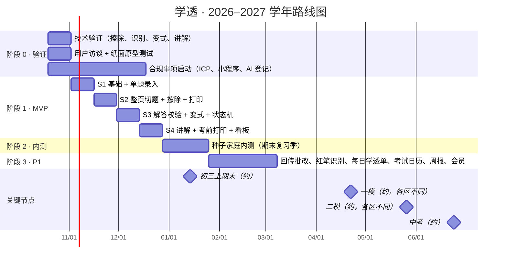

# 09 · 路线图与验证计划

> 节奏对齐北京初三学年：**期末（2027 年 1 月中旬）做内测，一模（2027 年 4 月下旬起）前正式上线**。一模前的集中复习是错题需求最旺的时间窗口。

---

## 1. 总体时间线

> 考试日期是根据往年规律的估计，以北京市和各区当年发布的通知为准（见 07 §8）。

---

## 2. 阶段 0：技术与用户验证（2 周）

**目标**：在投入完整开发之前，回答 4 个"能不能做"和 1 个"要不要做"。

| 验证项 | 方法 | 通过标准 | 不通过时的预案 |
|--------|------|----------|----------------|
| **V1 擦除质量** | 收集 50 张北京真实试卷照片（数学几何、物理电路图各占三成以上），横向对比 2–3 家云 API | 免修补率 ≥ 80%；图形完整率 ≥ 90% | 加大修补工具的投入；提前启动自研擦除模型 |
| **V2 识别分类** | 同一批照片跑切题、OCR、VLM 结构化和分类 | 切题 ≥ 93%；知识点 Top-3 ≥ 85% | 增加人工确认环节；收窄 MVP 题型范围 |
| **V3 变式正确性** | 30 道母题 × 5 层级，两科各半，教研人员评审 | 校验后正确率 ≥ 98%；不超纲 ≥ 90% | 提高程序化出题的比例；MVP 只开放 1–3 层级 |
| **V4 讲解体验** | 5 道题的五步讲解原型，找 5 名初三学生试用 | 学生自评"讲懂了"≥ 4/5 | 调整讲解节奏和提示分级 |
| **V5 需求验证** | 访谈 10 个北京初三家庭；纸面原型：给孩子发打印好的"错题重做单 + 变式单"，试用 1 周 | ≥ 6 户愿意持续使用；≥ 4 户愿意付费 | 重新定义切入点（例如只做"考前打印"） |

**阶段 0 产出**：供应商选型报告、模型路由表（补全 05 §2）、评测集 v0、MVP 范围最终确认。

---

## 3. 阶段 1：MVP（8 周，4 个双周迭代）

| 迭代 | 后端 | 客户端 | 验收演示 |
|------|------|--------|----------|
| **S1** 基础 | 项目骨架、账号、监护人同意、孩子档案；知识点和错因字典导入；预签名上传；单题识别管线 | 引导页、相机（单题）、处理队列 | 家长拍一道题，30 秒内在错题本里看到带知识点的题目 |
| **S2** 整页 + 擦除 + 打印 | 整页切题、批量确认、去重；擦除适配器 + 修补蒙版；排版引擎（原卷还原、错题重做单）+ 版面清单 | 整页模式、批量确认页、擦除预览与修补、打印中心 v1 | 一份 3 页月考卷：拍照 → 确认 7 道错题 → 打印擦除后的原卷 |
| **S3** 校验 + 变式 + 状态机 | 双模型解答校验；方法骨架；程序化出题 + 生成校验 + 质检；状态机 + 作答回填 | 错题详情（旅程）、变式组页、回填页 | 重做 ✓ → 5 道变式 → 回填 4/5 → 状态变为待复习 |
| **S4** 讲解 + 考前打印 | 讲解会话（SSE）、兜底；考前错题集模板 + 预设；看板 API；埋点；内容安全接入 | 讲解页、打印中心完整版、首页、简版看板 | 端到端闭环演示 + 内测准入检查 |

**工程约定**
- 状态机、调度算法、排版分页都是纯函数，单元测试覆盖率 ≥ 90%。
- AI 相关改动必须跑 `evals/` 回归评测。
- 每个迭代结束时部署到 staging，由教研人员走查题目质量。

---

## 4. 阶段 2：内测（4 周，期末复习季）

- **规模**：30–50 个北京初三家庭（通过家长群、合作的教育博主招募），覆盖至少 4 个区。
- **重点观察**：闭环漏斗（录入 → 重做 → 变式 → 学透）、擦除免修补率、变式题反馈率、期末前"考前错题集"的使用率。
- **反馈机制**：内测群 + 每周一次 15 分钟回访（抽样 5 户）。
- **出口标准**：第 4 周周留存 ≥ 40%；变式题反馈率 < 1%；没有 P0 级缺陷。

---

## 5. 阶段 3：P1（6 周，寒假期间）

按内测数据排定优先级，候选项：

| 功能 | 价值 | 依赖 |
|------|------|------|
| 回传扫描 + AI 批改 | 回填成本降到 1 次拍照 | 版面清单（S2 已具备） |
| 红笔批改识别，自动预选错题 | 录入步骤减少 1 步 | 识别评测集 |
| 每日学透单 | 形成每天的习惯 | 调度算法 |
| 考试日历驱动复习 | 正好赶上一模季 | — |
| 家长周报 | 付费转化、留存 | 看板 |
| 程序化绘图（几何、电路） | 解锁图形题变式 | 绘图引擎 |
| 会员与支付 | 商业化 | 合规（支付、未成年人消费限制） |

---

## 6. 团队配置（最小可行）

| 角色 | 人数 | 职责 |
|------|------|------|
| 产品经理（兼项目管理） | 1 | 需求、验证、节奏 |
| 教研（数学、物理） | 各 1（可兼职） | 知识点树、方法卡、错因字典、评测集标注、每周抽检 |
| 后端（含计算机视觉） | 2 | API、管线、排版引擎、AI 编排 |
| 前端（Taro） | 1–2 | 小程序 + H5 |
| 设计 | 0.5 | 交互、视觉、打印模板 |
| 测试 | 0.5 | 端到端测试、评测集维护 |

---

## 7. 主要风险

| 风险 | 影响 | 概率 | 应对 |
|------|------|------|------|
| 变式题出错，伤害家长信任 | 高 | 中 | 程序化出题 + 交叉校验 + 每周抽检 + 一键反馈下线；拿不准就不出 |
| 擦除质量不稳定（尤其图形题） | 高 | 中 | 阶段 0 选型；修补工具兜底；自研模型路线 |
| 家长操作负担重，用不下去 | 高 | 中 | 批量确认、红笔识别自动选题、回传扫描；每日学透单一键打印 |
| 合规事项耗时，影响上线 | 中 | 中 | 阶段 0 就启动；只调用已备案模型的 API，走属地登记而不是完整备案（见 08 §1） |
| AI 成本超过会员收入 | 中 | 中 | 跨用户缓存题目层数据；题库优先；小模型分流；擦除自研 |
| 头部厂商推出同类功能 | 中 | 高 | 聚焦"学透闭环 + 北京本地化"，靠教研深度建立壁垒 |
| 试卷版权 | 中 | 低 | 用户的拍照内容只供本人学习使用；题库只收录原创和改编题 |
