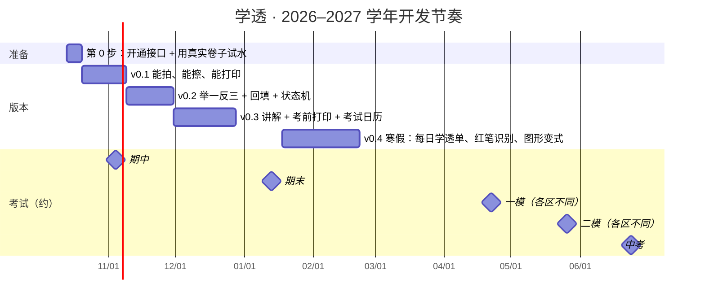

# 09 · 路线图

> 家长自己（借助 Claude Code）在业余时间开发，**按孩子的考试节奏分小版本交付，每个版本都能马上用起来**。
> 新功能做出来之前，先用现成工具顶上（见 [08 §4](08-privacy-vendors-and-tools.md)），学习不等工具。

---

## 1. 时间线

> 考试日期是根据往年规律的估计，以学校和区里的通知为准（见 07 §8）。

| 版本 | 目标时间 | 赶的是 |
|------|----------|--------|
| v0.1 | 11 月上旬 | **期中卷子发回来**时能用上 |
| v0.2 | 11 月底 | 期中错题的举一反三 |
| v0.3 | 12 月底 | **期末前两周**的考前错题集 |
| v0.4 | 寒假 | 寒假"错题清零"，为初三下学期总复习（八年级力学会大量回流）做准备 |

---

## 2. 第 0 步：开通接口，用真实卷子试水（本周）

**目标**：花一两个晚上，在写正式代码之前，确认关键能力在自家孩子的卷子上管用。

| 事项 | 做法 | 看什么 |
|------|------|--------|
| 开通接口 | 阿里云百炼（通义）、火山方舟（豆包）各开一个 API Key；擦除接口开通百度、有道、TextIn 中的两三家（都要实名认证） | 能调通 |
| 准备素材 | 拍孩子最近的 10 页卷子：数学几何图、物理电路图、红笔批改都要有 | — |
| **试擦除** | 用小脚本把 10 页分别送到各家擦除接口，并排对比 | 几何辅助线和红笔擦干净没有；印刷线条有没有被擦坏 |
| **试识别** | 同样 10 页：视觉大模型直接切题 + 识别，与专门的切题接口对比 | 切题准不准；公式和图形认得对不对；知识点分得对不对 |
| **试出题** | 挑 5 道错题，让模型按变式阶梯各出 5 题，另一家模型盲解 | 答案对不对；像不像北京的题；有没有超纲 |
| 填信息 | 孩子所在区、教材版本、本学期考试日期 | 见 [01 §2.2](01-product-requirements.md) |

**产出**：选定擦除接口和模型搭配（补全 [05 §2](05-ai-design.md) 的路由表）；把试水用的题和答案整理成最初的评测集（`evals/`）。

---

## 3. 各版本内容

### v0.1 能拍、能擦、能打印（约 3 周）

| 范围 | 完成标准 |
|------|----------|
| 项目骨架：FastAPI + SQLite + React；家庭密码；孩子档案；知识点和错因字典导入 | 手机浏览器能打开、能登录 |
| 拍照上传（单题、整页、多页）→ 矫正 → 切题（自动 + 手动框选兜底）→ 结构化识别 → 分类 | 拍一份 3 页月考卷，几分钟内在批量确认页看到切好的题 |
| 整页擦除 + 预览 | 擦除图和原图可以对比 |
| 答案：卷面答案或手动输入优先，否则 AI 单模型解答并标"⚠ 待核" | — |
| 打印：原卷还原、错题重做单（作答区按原卷留白）；打印记录 | 拿到 PDF，家用打印机打出来清晰 |
| 错题本列表（按学科、知识点、来源） | 能找到录入过的题 |
| 每日自动备份 | 网盘文件夹里每天有一份 |

### v0.2 举一反三 + 回填 + 状态机（约 3 周）

| 范围 | 完成标准 |
|------|----------|
| 答案交叉校验（两家模型 + sympy） | 校验不通过的题标"⚠ 待核" |
| 变式出题：1–2 层级程序化出题，3–5 层级生成 + 盲解 + 质检；图形题先复用原图或降级 | 一道错题 5 分钟内出好 5 道变式 |
| 变式练习单 + 单独的答案页 | 能打印 |
| 页面二维码 → 回填页；逐题勾 ✓/✗/半对 | 手机扫码就能回填 |
| 状态机 + 回炉 + 错题旅程；错因标注；去重合并 | 走通"重做 ✓ → 5 道变式 → 回填 4/5 → 待复习" |
| 擦除修补画笔 | 残留笔迹能手动补擦 |

### v0.3 讲解 + 考前打印 + 考试日历（约 4 周）

| 范围 | 完成标准 |
|------|----------|
| 五步分步讲解（流式）、追问、置信度兜底、家长模式 | 孩子在平板上能跟着走完一道题 |
| 考前错题集：多维筛选、预设、分节目录、时长预估 | 期末前一键打出"考试范围内未学透 + 反复错"的题 |
| 考试日历 + 考前压缩复习间隔 | 期末范围内的错题考前都安排过复习 |
| 简版看板 | 看得到学透数量、薄弱知识点 |

### v0.4 寒假（约 5 周）

按前三个版本的使用感受排优先级，候选：

| 功能 | 价值 |
|------|------|
| 每日学透单 | 一页 A4、约 20 分钟，形成每天的习惯 |
| 红笔批改识别，自动预选错题 | 录入时少点几下 |
| 诊断式讲解（拍孩子的解题过程） | 精准定位错在哪一步 |
| 程序化绘图（几何、电路） | 图形题也能出变式 |
| 八年级力学知识点补全 | 初三下学期总复习会大量用到 |
| 周小结 | 每周看一眼进展 |

### 以后（看需要）

拍照回传自动批改、导入各区真题 PDF 作为私人题库、语音讲解。

---

## 4. 开发方式

- **每个版本拆成若干次 Claude Code 会话**，每次完成一块能运行的功能，提交到 git。
- **纯逻辑写单元测试**：状态机（06 §7）、复习调度、排版分页都是纯函数，用测试守住，改参数不怕改坏。
- **小型评测集**：从孩子卷子上积累约 30 道"题目 + 标准答案"，换模型或改提示词之前跑一遍，确认没有变差。
- **代码位置**：先放在本仓库的 `mistake-mastery/` 目录下；想独立出去时再拆成单独的仓库。

---

## 5. 风险

| 风险 | 应对 |
|------|------|
| 家长时间不够，版本拖期 | 版本切小；每个版本先做最常用的环节；没做完的环节用现成工具顶上 |
| 擦除效果不好（尤其是图形题） | 第 0 步先试三家；修补画笔兜底；实在不行用夸克扫描王处理后再上传 |
| AI 出题或解答出错 | 交叉校验；"⚠ 待核"由家长确认；变式题可以一键作废重出；打印件标注"AI 生成"，鼓励孩子发现错误 |
| 孩子不愿意用 | 控量（默认每天 20 分钟）；以纸面练习为主；每日时长和孩子商量着定；不展示让孩子有压力的数字 |
| 电脑关机或出故障 | 开机自启；每日备份；最坏情况先回到纸笔和现成工具，数据可以恢复 |
