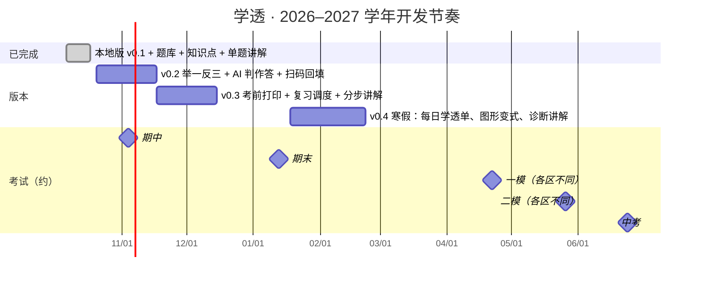

# 09 · 路线图

> 家长自己（借助 Claude Code）在业余时间开发，**按孩子的考试节奏分小版本交付，每个版本都能马上用起来**。
> 新功能做出来之前，先用现成工具顶上（见 [08 §4](08-privacy-vendors-and-tools.md)），学习不等工具。
>
> **本文按 2026-10-17 的真实进度重排**：§2 是已经做好的，§3 是接下来按版本要做的。原来的 v0.1 范围表、"提前做了"的备注都并进了 §2。

---

## 1. 时间线

> 考试日期是根据往年规律的估计，以学校和区里的通知为准（见 07 §8）。

| 版本 | 目标时间 | 赶的是 |
|------|----------|--------|
| v0.1 | 已完成（10 月 17 日） | 期中卷子发回来（11 月上旬）就能拍、能擦、能打印、能看讲解 |
| v0.2 | 11 月底 | 期中错题的举一反三；没批改的作业也能录 |
| v0.3 | 12 月底 | **期末前两周**的考前错题集 |
| v0.4 | 寒假 | 寒假"错题清零"，为初三下学期总复习（八年级力学会大量回流）做准备 |

---

## 2. 已经做好的（截至 2026-10-17）

本地版：程序跑在家里的电脑上，手机连同一个 Wi-Fi 访问；数据自动同步到 GitHub 私有仓库。全部经过单元测试，拍照、擦除、切题、题库导入都用孩子的真实卷子验证过（物理期中卷 6 页、数学和物理的区统考 PDF）。

| 环节 | 做好的内容 | 设计 |
|------|-----------|------|
| 拍照收集 | 单题、整页、多页上传；透视矫正；视觉模型认题（题号、文字、作答、老师红笔批改）；**位置由本地 OCR 按题号行锚定**（模型给的框不准）；跨页的题接上（含只有图的后半段）；照片倒序上传时按题号排页；手动框题兜底 | [03 §5](03-system-architecture.md)、[05 §3.1](05-ai-design.md) |
| 批量确认 | 老师判错、半对的默认勾选；没作答的题问"没做 / 不会 / 没时间"；改知识点、错因，填答案；识别出的题干、选项、小问、表格可核对 | [02 P05](02-ux-design.md) |
| 答案 | 优先级：题库官方答案 > 老师卷面订正 > 家长填写 > AI 单模型解答标"⚠ 待核" | [05 §3.3](05-ai-design.md) |
| 擦除 | 本地算法：去阴影、校正偏色、擦红笔蓝笔等彩色笔迹，**保留彩色印刷图**；黑笔和铅笔擦不掉（要擦黑笔得换云端接口，适配器已写好，还没用真卷试）；详情页可重新擦除 | [03 §5](03-system-architecture.md) |
| 打印 | 错题重做单 PDF（作答区按原卷留白）；打印记录；打印后逐题回填结果 | [02 §5](02-ux-design.md) |
| 错题本与状态机 | 状态、轮次、三道关进度；重做结果记录；做对过原题关、做错回炉；错题旅程；同一道题再次录入合并 | [06 §2](06-mastery-algorithm.md) |
| 单题讲解 | AI 看着题目截图、针对孩子的作答讲这一道题（读题、思路、分步、错在哪、提醒）；"待讲解"看完回到待重做；链到相关知识点 | [06 §2.4](06-mastery-algorithm.md) |
| 知识点整理 | 每个考点的掌握度、掌握死角、还没有错题记录的常考点；首页显示最该补的 3 个考点；薄弱知识点由 AI 按孩子的错题写讲解（可打印） | [06 §6](06-mastery-algorithm.md) |
| 题库 | 导入真题、区统考 PDF，按题号对官方答案，AI 逐题核对，对不上的标出请家长看；录入时自动匹配带官方答案和出处；能改学科、名称 | [10](10-question-bank.md) |
| 模型 | 通义、小米 MiMo、DeepSeek 三套预设，一行配置切换；每日费用上限；结果缓存 | [05 §2](05-ai-design.md) |
| 数据与运行 | 导出 JSONL 自动提交推送到私有仓库，同步状态，新机器恢复脚本；登录、限速、退出所有设备；启动前检查密钥和数据仓库位置 | [03 §4](03-system-architecture.md)、[SETUP](../SETUP.md) |

**第 0 步里还没做的**：云端擦除（百度、有道、TextIn）用真卷对比，选一家擦黑笔；香港服务器和域名（公网访问，代码不用改）；用试水的题整理评测集。

---

## 3. 接下来按版本要做的

### v0.2 举一反三 + AI 判作答 + 扫码回填（11 月底前）

现在的闭环在"原题关通过 → 待变式"断开，这一版把它接上；同时让没有老师批改的作业也能录。

| 范围 | 完成标准 |
|------|----------|
| **AI 判作答**：选择、填空题有标准答案的直接比对（不花钱）；解答、实验题让模型看截图和作答判对、错、半对并说错在哪一步。确认页标"老师判错 / AI 判错 / AI 判对"，默认勾选前两种，家长最后确认 | 一份没批改的作业拍进来，家长只需要核对 AI 的判断 |
| **变式出题**：1–2 层程序化出题，3–5 层优先从题库取同类真题，不够再生成 + 另一家模型盲解 + 质检；图形题先复用原图或降级 | 一道错题 5 分钟内出好 5 道变式，家长抽查基本挑不出错 |
| 变式练习单 + 单独的答案页 | 能打印 |
| 页面二维码 → 回填页；逐题勾 ✓/✗/半对 | 手机扫码就能回填 |
| 变式关判定（5 道对 ≥ 4，综合题必须对）→ 待复习；回炉 | 走通"重做 ✓ → 5 道变式 → 回填 4/5 → 待复习" |
| 答案交叉校验（两家模型 + sympy） | 校验不通过的题标"⚠ 待核" |
| 擦除修补画笔；云端擦除选型 | 黑笔作答也能擦干净 |

### v0.3 考前打印 + 复习调度 + 分步讲解（12 月底前）

| 范围 | 完成标准 |
|------|----------|
| 考前错题集：多维筛选、预设、分节目录、时长预估 | 期末前一键打出"考试范围内未学透 + 反复错"的题 |
| 时间关：间隔复习调度 + 考试日历 + 考前压缩间隔 | 期末范围内的错题考前都安排过复习；复习做对才算"学透" |
| 五步分步讲解（流式）、追问、家长模式（现在的单题讲解是一次讲完的简版） | 孩子在平板上能跟着走完一道题 |
| 看板：学透数量、薄弱知识点、周小结 | 每周看一眼进展 |

### v0.4 寒假（约 5 周）

按前三个版本的使用感受排优先级，候选：

| 功能 | 价值 |
|------|------|
| 每日学透单 | 一页 A4、约 20 分钟，形成每天的习惯 |
| 诊断式讲解（拍孩子的解题过程） | 精准定位错在哪一步 |
| 程序化绘图（几何、电路） | 图形题也能出变式 |
| 八年级力学知识点补全 | 初三下学期总复习会大量用到 |
| 公网部署（香港服务器 + HTTPS）、两步验证 | 孩子在外面也能用 |

### 以后（看需要）

按知识点浏览和搜索题库、语音讲解。

---

## 4. 开发方式

- **每个版本拆成若干次 Claude Code 会话**，每次完成一块能运行的功能，提交到 git。
- **纯逻辑写单元测试**：状态机（06 §7）、复习调度、排版分页、同步导出都是纯函数，用测试守住，改参数不怕改坏。测试只用虚构的题目和数据。
- **小型评测集**：从孩子卷子上积累约 30 道"题目 + 标准答案"，**放在私有数据仓库里**；换模型或改提示词之前跑一遍，确认没有变差。
- **代码位置**：先放在本仓库的 `mistake-mastery/` 目录下；想独立出去时再拆成单独的仓库。**本仓库是公开的**，提交前确认没有夹带孩子的数据或密钥。

---

## 5. 风险

| 风险 | 应对 |
|------|------|
| 家长时间不够，版本拖期 | 版本切小；每个版本先做最常用的环节；没做完的环节用现成工具顶上 |
| 擦除效果不好（尤其是图形题） | 第 0 步先试三家；修补画笔兜底；实在不行用夸克扫描王处理后再上传 |
| AI 出题或解答出错 | 交叉校验；"⚠ 待核"由家长确认；变式题可以一键作废重出；打印件标注"AI 生成"，鼓励孩子发现错误 |
| 孩子不愿意用 | 控量（默认每天 20 分钟）；以纸面练习为主；每日时长和孩子商量着定；不展示让孩子有压力的数字 |
| 服务器出故障或被攻破 | 数据正本在 GitHub，新开一台服务器就能恢复（§3 v0.1 已演练）；部署密钥只能写数据仓库；被攻破时作废所有密钥、重建服务器 |
| 网站被盗刷 AI 接口 | 登录限速 + 每日费用上限 + 平台预算告警 |
| GitHub 推送失败 | 提交先留在服务器上自动重试；设置页能看到同步状态 |
| 不小心把孩子的数据提交到公开仓库 | 数据只写进私有数据仓库；代码仓库的 `.gitignore` 排除数据目录；万一提交了，要从 git 历史里彻底清除，而不只是删掉文件 |
