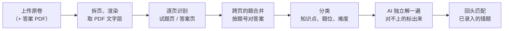

# 10 · 题库

> 一个**小而精的北京私人题库**：近几年中考真题、各区一模二模、本区的期中期末统考，加上孩子自己的卷子。
> 每科一两千题，只存在家里的私有数据仓库里，只供自家学习。

---

## 1. 为什么要建

| 现在的问题 | 有了题库之后 |
|------------|--------------|
| 卷面上没有答案的题只能靠 AI 解答，标"待核"，家长还得核对 | 拍到的题如果在题库里，直接带上**官方答案、评分标准和出处**（如"2025 海淀一模 第 27 题"） |
| 数学第 27、28 题，物理实验探究和科普阅读，AI 现编的变式题质量不稳 | v0.2 起，第 3–5 层变式优先用同知识点、同题位、孩子没做过的真题 |
| 时间关复习还是做原题，可能只是记住了答案 | v0.2 起，复习可以换成同类真题，检验的是会不会这一类题 |

北京的期中、期末、一模、二模多是区统考，卷子发回后通常能拿到原卷和"答案及评分标准"的 PDF（家长群、学校或区里会发）。**题库只导入家长自己拿到的文件，不爬网站。**

## 2. 导入流程

1. **上传**：题库 → 导入卷子。填学科、年份、地区、考试（中考 / 一模 / 二模 / 期中 / 期末 / 月考），名称默认按这些自动生成。
   - 试卷：PDF，或每页一张照片
   - 答案及评分标准：选填；答案在同一个 PDF 的最后几页也可以，程序按内容判断每页是试题还是答案
   - **答案版卷子**（菁优网、组卷网常见的"参考答案与试题解析"：每道题后面紧跟【答案】【解答】）可以直接导入，不用另传答案
   - 只有"参考答案"、没有题目的文件不能单独导入，要和对应的试卷一起传
   - 文件原样存进数据仓库的 `files/bank/<卷子 id>/`
2. **拆页**：PDF 用 pdfium 渲染成长边 2000 像素的图片（只缓存在本机的 `.local/`），同时取出 PDF 自带的文字层；照片做透视矫正。
3. **逐页识别**（提示词 `bank-page-v4`，默认用通义千问视觉模型）：
   - 先判断页面类型：试题、答案、试题和答案交替（答案版卷子）、其他（封面、答题卡）
   - 试题：切出每道题的位置、题号、题干、选项、小问、分值；页面顶部接着上一页的半道题标 `continued`，**跨页的题自动合并**成一道（截图把几段竖着拼起来；下一页上的选项、小问也接上，页尾断开的句子直接连起来，模型给只有图的后半段写的说明不算题干）；题号前面的阅读材料单独列出、标 `material`
   - 答案：按题号取最终答案和评分标准；小问的答案归到大题；页面顶部接着上一页的解答时，用提示里给的"上一页最后一道题"的题号
   - 答案版卷子的填空题横线上已经填了答案：题干里写成 ______，截图标记"截图里能看到答案"
   - A3 横版双栏的页面**分成左右两半**分别识别，小字认得更准
   - **PDF 文字层一并交给模型做校对参考**（Word 导出的卷子文字准确，但公式和图常常是图片，所以仍以图片为准）
   - **用文字层校准截图范围**：Word / WPS 导出的 PDF 每行文字的位置是准的。模型给的框只当提示，题目从"27．"这一行开始，截到下一个边界（下一题、【答案】【解答】等、大题标题）之前；分值从"（2 分）"读出。一道题的【答案】已经开始的话，下一页开头的内容只能是解答，即使模型说是题目的后半段也不接上。扫描件没有文字层，用模型给的框
   - **题号前面的阅读材料**（科普阅读题："请阅读《……》并回答第 24 题"下面的短文，常常跨页）：从这一行开始、到"24．"之前的内容（包括下一页开头接着的短文）都放到第 24 题最前面；"第 24～25 题"这种共用一段材料的，每道题前面都放。只认写明了题号的说明行，题目里面的"阅读下面的材料……"不算。扫描件用模型单独列出的材料框
4. **按题号对答案**：题号规范化后匹配（"27."、"第27题"、"27(1)" 都是 27）。答案里有、卷子里没识别出的题号会提示出来。
5. **分类**：和拍照录入共用分类提示词，每批 12 题。
6. **AI 核对**（可选，默认开）：AI 看着题目截图独立解一遍，4 道题同时问（一道题常要半分钟以上）。
   - 有官方答案的：比对最终答案，一致的标 ✓；对不上的标 **⚠ 待核对**，家长看一眼，点"官方答案没问题"或修改答案；证明题这类没法自动比对的，把 AI 的解答放在旁边供参考，不打 ⚠
   - 怎么比：选择题比选项字母；分小问的答案按 (1)(2)… 逐问比，有一问对不上就算对不上；数值比数字本身，小问编号和物理量的下标（$R_2$、$U_1$）不当数值；文字答案措辞稍有不同（"不同规格的灯泡"和"不同规格的小灯泡"）算一致，短答案不一样（"ap；暗"和"cp；亮"）算不一致；"见图""见表"这类没法比
   - 没有官方答案的：用 AI 答案，标"AI 解答 · 待核"
   - 碰到每日费用上限就暂停，第二天在卷子页点"继续核对"
7. **回头匹配**：已经录入的错题如果在这套卷子里，补上官方答案（典型场景：期中卷先拍照录入，过两天拿到区里的答案 PDF 再导入）。

**费用**：每页 1–2 次视觉模型调用，每题一次解答，一套卷子约 0.3–0.8 元；每科 30–40 套，一次性几十元。

## 3. 录入时匹配

拍照录入切出的每道新题，都和同学科的题库比一比：

- **指纹**：题干 + 选项，NFKC 规范化，去掉题号、空白、标点和 LaTeX 命令，只留汉字、字母和数字
- **相似度**：字符二元组的 Dice 系数 ≥ 0.8
- **数字必须完全一样**：换了数的同类题（`y=x^2-2x` 和 `y=x^2-4x`）不算同一道，避免带错答案
- 太短的题干（不到 10 个字）不参与匹配

对上之后：

- 记下出处，带上官方答案和评分标准（`answer_source = official`），知识点、题位、难度也从题库带过来
- 家长自己填的答案不覆盖；官方答案不会被"请 AI 重新解答"覆盖
- 批量确认页显示"📚 题库里有这道题：2025 海淀一模 第 1 题"，旁边有**"不是这道题"**：取消匹配、恢复原来的答案，没有答案的交给 AI 解答，以后也不再自动匹配这一对
- 错题详情页显示出处，点进去能看到整套卷子
- 题库页"找题"：按知识点、题型、中考题位、题干关键字找题，点截图展开识别出的文字和答案（2026-10；为 v0.2 变式关从题库取同类真题做准备，家长也能抽查某个考点有哪些题）
- 导入表单"一次导入多套"：每个 PDF 一套卷子，答案文件按文件名自动配对（2026-10）
- 卷子页右上角"修改信息"：导入时选错的学科、年份、地区、考试类型、名称都能改（2026-10 家长把一份物理卷选成了数学）

## 4. 数据

| 表 | 同步 | 内容 |
|----|------|------|
| `bank_papers` | ✓ | 一套卷子：学科、名称、年份、地区、考试类型、文件清单、页面清单（每页是试题还是答案）、状态、统计 |
| `bank_items` | ✓ | 一道题在原卷上的位置：卷子、序号、题号、分值、`regions`（跨页时多段，每段是页码 + 0–1000 归一化坐标）、`flags`（`answer_in_crop`：截图里能看到答案） |
| `questions` | ✓ | 题目内容和答案，`origin = bank`；核对结果在 `verification`（`ai_answer`、`agree`、`reviewed`） |
| `questions.bank_match` | ✓ | 录入的题对上了哪道题库题：`question_id`、`score`、`status`（auto / rejected），以及匹配前的答案（取消时恢复） |

表结构升级：程序启动时自动给已有的 SQLite 表补上新加的列（新列都允许为空）。

## 5. 接口

| 方法 | 路径 | 说明 |
|------|------|------|
| GET | `/api/bank/papers?subject=` | 卷子列表（含统计） |
| POST | `/api/bank/papers` | 上传（multipart：`subject`、`title`、`year`、`region`、`exam_kind`、`verify`、`paper_files[]`、`answer_files[]`），返回 `paper_id`、`job_id` |
| POST | `/api/bank/papers/batch` | 一次导入多套（multipart：`subject`、`year`、`region`、`exam_kind`、`verify`、`files[]`）：每个文件一套卷子，名称用文件名（去掉【试卷】这类标签）；文件名里带"答案""解析""评分标准"的当答案文件，按文件名相似度（≥ 0.6）配给对应的试卷，配不上的自己算一套。返回每套的 `paper_id`、`job_id`、`title`、`answer_file` |
| GET | `/api/bank/questions?subject=&kp=&type=&slot=&q=` | 找题：知识点（含下级）、题型、北京中考题位、题干关键字（空格分开的词都要出现），最多 200 道，新卷子在前；每条带 `paper_id`、`paper_title` |
| GET | `/api/bank/papers/{id}` | 卷子详情和全部题目 |
| PATCH / DELETE | `/api/bank/papers/{id}` | 改名称、年份、地区、考试类型、学科（`subject`：改学科会清掉原学科的知识点和题位、后台重新分类，返回 `job_id`；跨学科对上的错题取消匹配、恢复原答案） / 删除（连同文件） |
| POST | `/api/bank/papers/{id}/reimport` | 重新识别（换了模型或识别出错时） |
| POST | `/api/bank/papers/{id}/verify` | 继续 AI 核对 |
| PATCH | `/api/bank/questions/{id}` | 改答案、标记"已核对"、改知识点 |
| GET | `/api/bank/questions/{id}/image`、`/api/bank/papers/{id}/pages/{n}/image` | 题目截图、整页图片 |
| POST | `/api/questions/{id}/bank-match` | `{"action": "reject"}`：取消录入时的自动匹配 |

## 6. 还没做的

- **v0.2**：变式第 3–5 层优先从题库取同类真题；复习换同类真题；考前打印"附同类真题"
- 用真实的北京卷子验证通义千问的切题和公式识别（需要在开发环境里配置密钥并放行 `dashscope.aliyuncs.com`，或者在家里电脑上导入后反馈）
- 只有答案、没有题目的文件：给已导入的卷子补传答案；给拍照录入的孩子自己的卷子对上学校发的答案
- 答案版卷子里填空题的截图带着答案：打印给孩子做之前要用识别出的文字重新排版

**试导入工具**：`uv run python -m app.tools.bank_try 试卷.pdf [--answers 答案.pdf] [--pages 1-3] [--no-verify]` 在临时文件夹里用真实大模型跑一遍导入（不写进数据仓库），输出每道题的页码和答案（`report.txt`）、截图（`index.html`，单个文件）和每次调用大模型的原始返回（`raw.jsonl`，不含密钥），用来在家里电脑上验证新换的模型或新格式的卷子。

**用真卷子试过的**（2026-10，为了不透露孩子的学校，这里不写是哪所学校）：一份北京初三上学期期中数学（菁优网答案版，31 页）。第 1–4 页和第 9–12 页按真实流程导入，识别那一步用人工写好的结果代替（框故意给偏），文字层校准后每道题都截到【答案】之前；跨页的题（题干和图、选项分在两页，表格、小问在下一页）都接上了；上一题解答里的图没有被当成题目；答案按题号全部对上。另一份北京初三上学期期中物理（北京题库格式：试卷和答案分开两个 PDF，题号后面没有分值，题与题之间不留空），试卷前 3 页加答案第 1 页一起导入，模型的框故意给成几乎整页：15 道题仍然逐题截准（选项之间夹着图的题、题干跨页的题都对），大题标题处正确截断，答案表里的单选、多选答案按题号全部对上。第三份是同样格式的物理期中卷（试卷 10 页 + 答案 2 页），整份导入：26 道题全部截准、答案全部对上；这份卷子暴露了科普阅读题的短文在题号前面而且跨页的问题（原来短文会丢一半、另一半被接到上一题后面），已按上面的规则修好。之后家长在自己电脑上用真实模型（DeepSeek `deepseek-flash`）试导入这份卷子的前 3 页加答案：12 道题全部截准、答案全部对上，跨页的两道题接对了，5 页用时约 2 分钟；暴露了跨页题的选项没合并、页尾断开的句子中间多了空行、模型给只有图的后半段编了一句说明、知识点编码写短了被丢掉、分类选了非最细的考点，已修好。随后整份导入（试卷 10 页 + 答案 2 页、AI 核对 26 道题）：26 道题全部截准、答案全部对上，科普阅读题的短文（从第 8 页跨到第 9 页）也归到了第 24 题；用时约 18 分钟，其中一道一道核对占了 13 分钟多，已改成 4 道同时问。核对标出的 ⚠ 里有两处是比对规则的误报（"1、4"和"1和4"、"5Ω"和"$R_2=5\Omega$"，小问编号和下标被当成了数值），另有两处 AI 答案和官方答案不一样却没标出来（实验题的"ap；暗"和"cp；亮"、"0.5；5"和"0.24；10"），已改成逐问比对；改完后这份卷子标出 3 道，都是 AI 看图看错（把压缩冲程看成做功冲程、电位器接线柱、电表读数），官方答案是对的。
