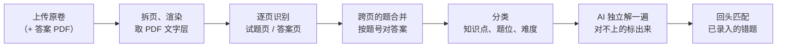

# 10 · 题库

> 一个**小而精的北京私人题库**：近几年中考真题、各区一模二模、本区的期中期末统考，加上孩子自己的卷子。
> 每科一两千题，只存在家里的私有数据仓库里，只供自家学习。

---

## 1. 为什么要建

| 现在的问题 | 有了题库之后 |
|------------|--------------|
| 卷面上没有答案的题只能靠 AI 解答，标"待核"，家长还得核对 | 拍到的题如果在题库里，直接带上**官方答案、评分标准和出处**（如"2025 海淀一模 第 27 题"） |
| 数学第 27、28 题，物理实验探究和科普阅读，AI 现编的变式题质量不稳 | v0.2 起，第 3–5 层变式优先用同知识点、同题位、孩子没做过的真题 |
| 时间关复习还是做原题，可能只是记住了答案 | v0.2 起，复习可以换成同类真题，检验的是会不会这一类题 |

北京的期中、期末、一模、二模多是区统考，卷子发回后通常能拿到原卷和"答案及评分标准"的 PDF（家长群、学校或区里会发）。**题库只导入家长自己拿到的文件，不爬网站。**

## 2. 导入流程

1. **上传**：题库 → 导入卷子。填学科、年份、地区、考试（中考 / 一模 / 二模 / 期中 / 期末 / 月考），名称默认按这些自动生成。
   - 试卷：PDF，或每页一张照片
   - 答案及评分标准：选填；答案在同一个 PDF 的最后几页也可以，程序按内容判断每页是试题还是答案
   - 文件原样存进数据仓库的 `files/bank/<卷子 id>/`
2. **拆页**：PDF 用 pdfium 渲染成长边 2000 像素的图片（只缓存在本机的 `.local/`），同时取出 PDF 自带的文字层；照片做透视矫正。
3. **逐页识别**（提示词 `bank-page-v1`，默认用通义千问视觉模型）：
   - 先判断页面类型：试题、答案、其他（封面、答题卡）
   - 试题页：切出每道题的位置、题号、题干、选项、小问、分值；页面顶部接着上一页的半道题标 `continued`，**跨页的题自动合并**成一道（截图把几段竖着拼起来）
   - 答案页：按题号取最终答案和评分标准；小问的答案归到大题
   - A3 横版双栏的页面**分成左右两半**分别识别，小字认得更准
   - **PDF 文字层一并交给模型做校对参考**（Word 导出的卷子文字准确，但公式和图常常是图片，所以仍以图片为准）
4. **按题号对答案**：题号规范化后匹配（"27."、"第27题"、"27(1)" 都是 27）。答案里有、卷子里没识别出的题号会提示出来。
5. **分类**：和拍照录入共用分类提示词，每批 12 题。
6. **AI 核对**（可选，默认开）：AI 看着题目截图独立解一遍。
   - 有官方答案的：比对最终答案，一致的标 ✓；对不上的标 **⚠ 待核对**，家长看一眼，点"官方答案没问题"或修改答案；证明题这类没法自动比对的，把 AI 的解答放在旁边供参考，不打 ⚠
   - 没有官方答案的：用 AI 答案，标"AI 解答 · 待核"
   - 碰到每日费用上限就暂停，第二天在卷子页点"继续核对"
7. **回头匹配**：已经录入的错题如果在这套卷子里，补上官方答案（典型场景：期中卷先拍照录入，过两天拿到区里的答案 PDF 再导入）。

**费用**：每页 1–2 次视觉模型调用，每题一次解答，一套卷子约 0.3–0.8 元；每科 30–40 套，一次性几十元。

## 3. 录入时匹配

拍照录入切出的每道新题，都和同学科的题库比一比：

- **指纹**：题干 + 选项，NFKC 规范化，去掉题号、空白、标点和 LaTeX 命令，只留汉字、字母和数字
- **相似度**：字符二元组的 Dice 系数 ≥ 0.8
- **数字必须完全一样**：换了数的同类题（`y=x^2-2x` 和 `y=x^2-4x`）不算同一道，避免带错答案
- 太短的题干（不到 10 个字）不参与匹配

对上之后：

- 记下出处，带上官方答案和评分标准（`answer_source = official`），知识点、题位、难度也从题库带过来
- 家长自己填的答案不覆盖；官方答案不会被"请 AI 重新解答"覆盖
- 批量确认页显示"📚 题库里有这道题：2025 海淀一模 第 1 题"，旁边有**"不是这道题"**：取消匹配、恢复原来的答案，没有答案的交给 AI 解答，以后也不再自动匹配这一对
- 错题详情页显示出处，点进去能看到整套卷子

## 4. 数据

| 表 | 同步 | 内容 |
|----|------|------|
| `bank_papers` | ✓ | 一套卷子：学科、名称、年份、地区、考试类型、文件清单、页面清单（每页是试题还是答案）、状态、统计 |
| `bank_items` | ✓ | 一道题在原卷上的位置：卷子、序号、题号、分值、`regions`（跨页时多段，每段是页码 + 0–1000 归一化坐标） |
| `questions` | ✓ | 题目内容和答案，`origin = bank`；核对结果在 `verification`（`ai_answer`、`agree`、`reviewed`） |
| `questions.bank_match` | ✓ | 录入的题对上了哪道题库题：`question_id`、`score`、`status`（auto / rejected），以及匹配前的答案（取消时恢复） |

表结构升级：程序启动时自动给已有的 SQLite 表补上新加的列（新列都允许为空）。

## 5. 接口

| 方法 | 路径 | 说明 |
|------|------|------|
| GET | `/api/bank/papers?subject=` | 卷子列表（含统计） |
| POST | `/api/bank/papers` | 上传（multipart：`subject`、`title`、`year`、`region`、`exam_kind`、`verify`、`paper_files[]`、`answer_files[]`），返回 `paper_id`、`job_id` |
| GET | `/api/bank/papers/{id}` | 卷子详情和全部题目 |
| PATCH / DELETE | `/api/bank/papers/{id}` | 改名称等 / 删除（连同文件） |
| POST | `/api/bank/papers/{id}/reimport` | 重新识别（换了模型或识别出错时） |
| POST | `/api/bank/papers/{id}/verify` | 继续 AI 核对 |
| PATCH | `/api/bank/questions/{id}` | 改答案、标记"已核对"、改知识点 |
| GET | `/api/bank/questions/{id}/image`、`/api/bank/papers/{id}/pages/{n}/image` | 题目截图、整页图片 |
| POST | `/api/questions/{id}/bank-match` | `{"action": "reject"}`：取消录入时的自动匹配 |

## 6. 还没做的

- **v0.2**：变式第 3–5 层优先从题库取同类真题；复习换同类真题；考前打印"附同类真题"
- 按知识点、题位浏览和搜索题库
- 用真实的北京卷子验证切题、公式识别、答案对题号的准确率（需要家长提供 PDF，或者在开发环境里放行下载站点的域名）
